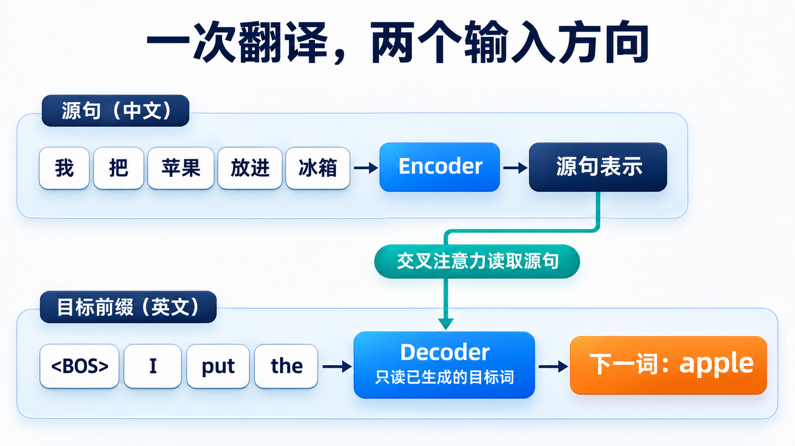
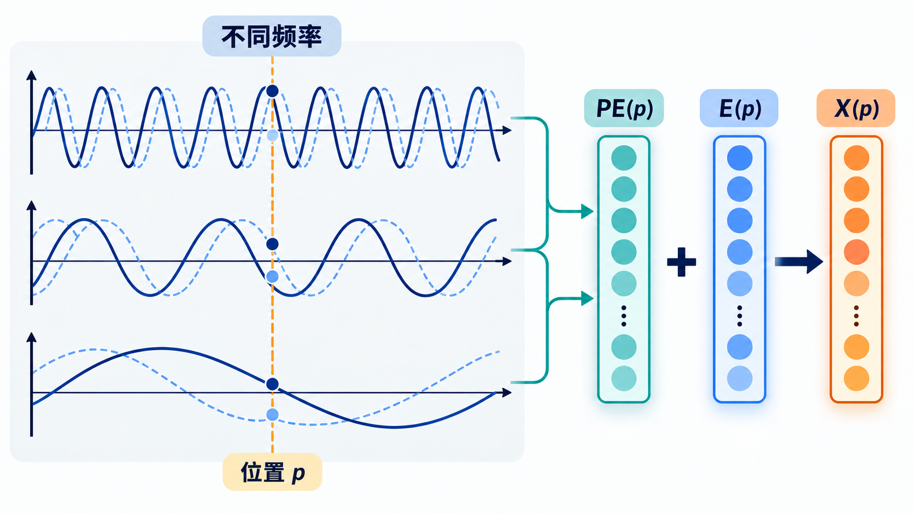
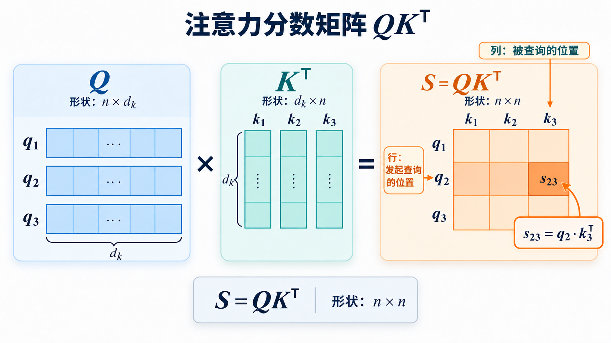
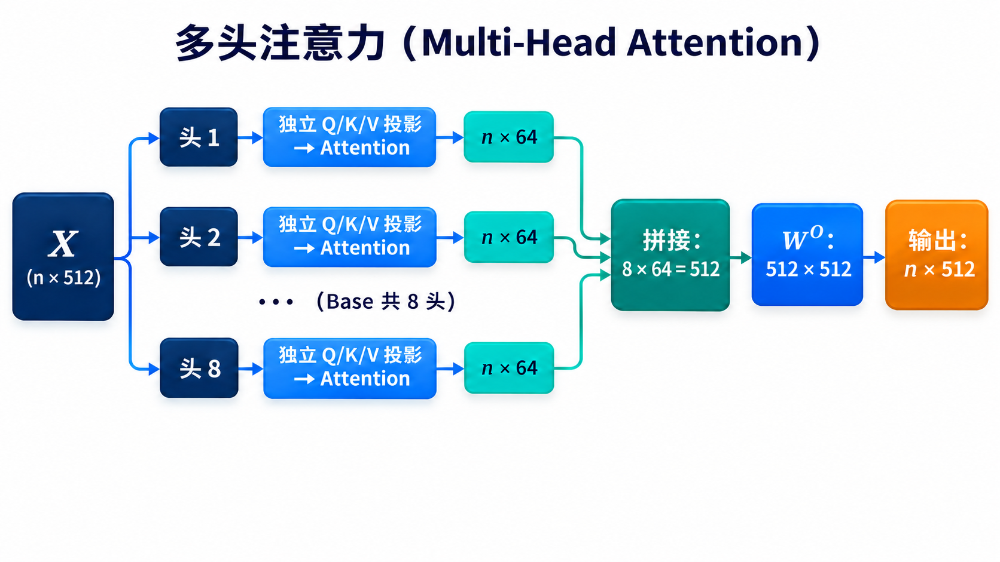
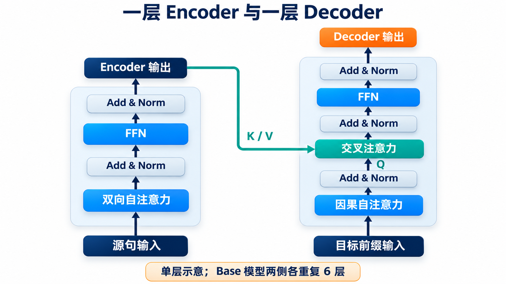
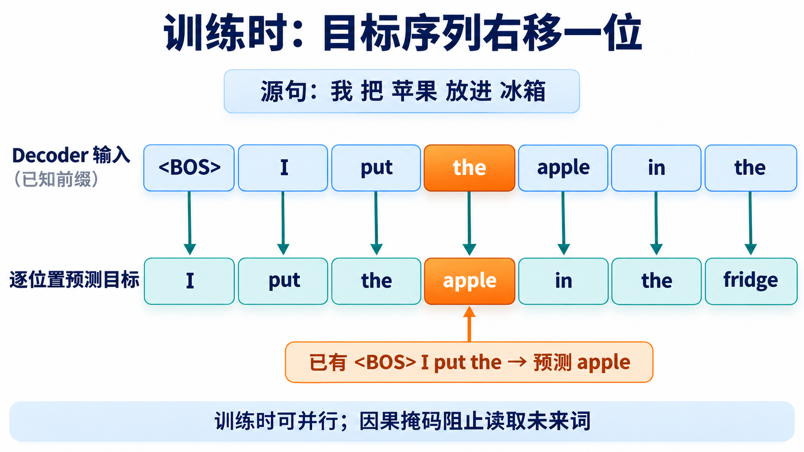

# 从一次翻译理解原始 Transformer：结构、Attention 与关键公式

> 本文用同一句翻译贯穿输入、Encoder、Decoder、生成与训练。先看数据怎样走，再拆开 Attention、FFN 和 Add & Norm。公式用于核对计算，首次阅读可以先沿文字和图片走一遍。想了解后续模型怎样改变这些部件，可接着读[架构演进系列](从原始Transformer到现代大模型：逐项理解架构演进.md)。

## 一、一次翻译怎样完成？

我们要把「我把苹果放进冰箱。」译成「I put the apple in the fridge.」。先停在生成中途：目标侧已经有 `<BOS> I put the`，模型下一步想预测 `apple`。`<BOS>` 是表示开始的特殊 Token；图中按词展示，真实分词器可能把一句话切成不同的 Token。

源句先交给 **Encoder**。它不是直接输出英文，而是为源句各位置生成带上下文的向量表示。随后，**Decoder** 读入已经生成的英文前缀：先在目标侧读取过去的词，再读取 Encoder 留下的源句信息，最后给英文词表里的各个候选 Token 打分。`apple` 是这个例子中期望得到的下一个词，并非模型无条件必然输出的结果。



图中有两条输入线：中文源句通向 Encoder，已生成的英文前缀通向 Decoder。Decoder 的交叉注意力把两条线接在一起。图只画**一次预测**；得到 `apple` 后，推理时再把它接到前缀后面，继续预测 `in`、`the`、`fridge` 等后续词。训练时已知完整译文，目标位置可以在因果掩码保护下一起计算；推理时未知未来词，所以必须逐词生成。

## 二、为什么需要 Transformer？

在它之前，RNN 常用来处理序列。RNN 的当前状态依赖前一步：

$$
h_t=f(x_t,h_{t-1})
$$

这里 $x_t$ 是当前位置的输入，$h_{t-1}$ 是上一位置传来的状态。要处理后一个位置，必须等前一个位置算完；远处信息也要经过多步传递。LSTM、GRU 改善了长期依赖的学习，但没有消除这条同层顺序依赖。

Transformer 把序列内部的信息交换交给 **Self-Attention**：一个位置可以直接计算它与允许读取的其他位置的关系。Encoder 里的源句位置可互相读取；Decoder 的目标位置只能读取自己和过去的位置，不能偷看未来。


图只比较信息路径，不表示实际注意力权重或两种模型的计算量。自注意力建立直接连接，也让一层中不同位置的主要矩阵运算便于并行；但标准全局注意力仍需处理位置两两之间的关系，序列很长时会付出计算和显存代价。

## 三、文本怎样进入模型？

先区分三个说法：**词**是我们读句子时使用的语言单位；**Token** 是分词器交给模型的单位，未必恰好等于一个词；**位置**是某个 Token 在当前序列中的序号。下面把「我 / 把 / 苹果 / 放进 / 冰箱」当作教学用 Token 切分，英文前缀也按词展示。实际切分方式由分词器决定。

### 3.1 从 Token 到向量

模型先用 Embedding 表把每个 Token 映射为 $d_{\text{model}}$ 维向量。单有这些向量仍不够：如果输入位置互换，纯粹的自注意力没有内建的先后顺序。比如「把苹果放进冰箱」和「把冰箱放进苹果」使用了相近的词，却表达了完全不同的关系。

同一个 Token 的 Embedding 不随它在句子里的位置自动改变。若把「苹果」从第 1 个位置移到第 3 个位置，它的内容向量仍来自同一行 Embedding 表；模型还需要另一份信息指出“现在在哪里”。位置编码提供的就是这份序列坐标。单靠自注意力，打乱输入位置后，输出也会相应跟着换位，却没有额外信号告诉模型哪个位置原本在前。

原始 Transformer 在 Encoder 和 Decoder 的输入底部都加入位置编码。内容向量与位置向量怎样合成？对于位置 $p$，输入可写成：

$$
X(p)=\sqrt{d_{\text{model}}}\,E_{\text{token}}(p)+\mathrm{PE}(p)
$$

这里 $E_{\text{token}}(p)$ 是该位置 Token 的 Embedding；两项维度相同，因此逐元素相加。根号因子是原论文对 Embedding 的缩放，不是 Attention 分数里的 $\sqrt{d_k}$。



图的横轴是位置 $p$，曲线表示不同维度随位置变化的取值；右侧 $E(p)$ 表示**缩放后的** Embedding，$X(p)=E(p)+PE(p)$。图展示位置向量怎样与内容向量合成输入，不表示相邻位置必然语义相近。

### 3.2 原始位置编码怎样构造？

原论文使用不同频率的正弦、余弦函数：

$$
\mathrm{PE}_{(p,2i)}=\sin\!\left(\frac{p}{10000^{2i/d_{\text{model}}}}\right),\qquad
\mathrm{PE}_{(p,2i+1)}=\cos\!\left(\frac{p}{10000^{2i/d_{\text{model}}}}\right)
$$

$p$ 是位置，$2i$ 和 $2i+1$ 是一对向量维度。随着 $i$ 增大，分母 $10000^{2i/d_{\text{model}}}$ 增大：有些维度沿位置变化得快，有些变化得慢。一个位置因此由多种频率的取值共同表示。这些数值不需逐个解释成“第几个词”，重点是不同位置进入 Attention 前带有不同的规律性信号。

为什么用成对的 Sin/Cos？对某个固定的位移 $k$，位置 $p+k$ 的一对取值可以由位置 $p$ 的这一对取值通过线性组合表示。这给模型学习相对位移提供了规律。它不等于模型自动理解所有未见过的长序列；原论文把可能外推到更长长度视为选用固定位置函数的一个理由，而非保证。

## 四、一个位置怎样读取上下文？

先放大源句里的「苹果」。只看它本身，可能想到水果，也可能想到品牌；结合「放进」「冰箱」后，水果的解释更自然。这里说的是**可能用于更新表示的上下文**，不是用一张注意力图证明模型最终为什么作出某个判断。

假设源句被示意性地切成「我 / 把 / 苹果 / 放进 / 冰箱」。更新「苹果」位置时，一个注意力头可能给出下面这组权重：

| 被读取的 Token | 权重（示意） |
| :--- | ---: |
| 我 | 0.05 |
| 把 | 0.05 |
| 苹果 | 0.10 |
| 放进 | 0.35 |
| 冰箱 | 0.45 |

这五个数相加为 1，但它们不是实际模型输出。每个权重只是当前头对对应 Value 的加权系数，**不直接等于**该 Token 对最终语义判断的贡献比例。


图的终点是「苹果」的新表示；下游任务可以使用这个表示，但不能只凭图中的连线或权重断言模型内部的解释过程。

### 4.1 Q、K、V 是哪三个角色？

当前 Token 的 **Query（Q）** 提出匹配需求，各位置的 **Key（K）** 用于与它比较，各位置的 **Value（V）** 是最后被取回的信息。先用 Q 与 K 得到分数，再用 Softmax 转成权重，最后对 V 加权求和。同一位置的 K 和 V 配对：匹配用 K，汇总用 V。

### 4.2 从输入向量得到 Q、K、V

假设输入序列的向量矩阵为：

$$
X\in\mathbb{R}^{n\times d_{\text{model}}}
$$

其中：

- $n$：序列长度。
- $d_{\text{model}}$：每个 Token 的向量维度。

Transformer 使用三个不同的线性变换：

$$
Q=XW^Q,\qquad K=XW^K,\qquad V=XW^V
$$

三个投影矩阵的维度为：

$$
W^Q,W^K\in\mathbb{R}^{d_{\text{model}}\times d_k},\qquad W^V\in\mathbb{R}^{d_{\text{model}}\times d_v}
$$

其中：

- $d_k$：Query 和 Key 向量的维度，也就是匹配时所使用的特征维度。
- $d_v$：Value 向量的维度，也就是最终被加权求和的信息维度。

这三个矩阵都是模型训练过程中学习得到的参数。

需要注意，$d_k$、$d_v$ **可以**与输入维度 $d_{\text{model}}$ 不同，具体取值由架构决定。线性变换把每个 Token 从 $d_{\text{model}}$ 维映射到用于匹配的 $d_k$ 维，或用于传递信息的 $d_v$ 维。在原始 Transformer 的 Base 模型中，$d_{\text{model}}=512$，每个注意力头的 $d_k=d_v=64$。

为什么要设计三个不同的矩阵？

因为同一个 Token 在不同任务中承担的角色不同。

例如：

- 作为 Query，它需要表达当前 Token 希望寻找什么信息。
- 作为 Key，它需要表达自己具备什么特征，便于其他 Token 匹配。
- 作为 Value，它需要表达自己能够提供什么信息。

通过不同的线性变换，模型可以学习三种不同的表示空间。下图只追踪**同一个 Token 向量**怎样产生三种角色：


### 4.3 用点积衡量关联程度

有了 Q 和 K，接下来需要计算它们之间的匹配程度。

Transformer 使用点积：

$$
s_{ij}=q_i k_j^\top
$$

对于单个 Query 和多个 Key：

$$
s_i=q_iK^\top
$$

点积越大，通常表示两个向量在当前表示空间中的匹配程度越高。

对于整个序列：

$$
S=QK^\top\in\mathbb{R}^{n\times n}
$$

得到一个 $n\times n$ 的注意力分数矩阵。为什么矩阵的行列各对应一个位置？第 $i$ 行第 $j$ 列就是第 $i$ 个 Token 查询第 $j$ 个 Token 的匹配分数。



图中行对应发起查询的位置，列对应被查询的位置；第 $i$ 行第 $j$ 列的分数是 $q_i$ 与 $k_j$ 的点积。

### 4.4 为什么要除以 $\sqrt{d_k}$？

这是 Transformer 中一个非常重要的细节。

如果直接使用点积 $q_i k_j^\top$，当向量维度 $d_k$ 增大时，点积的数值通常也会增大。

假设 $q_i$ 与 $k_j$ 的各分量相互独立，均值为 0，方差为 1。

那么点积：

$$
q_i k_j^\top=\sum_{r=1}^{d_k}q_{ir}k_{jr}
$$

其期望为：

$$
\mathbb{E}[q_i k_j^\top]=0
$$

方差为：

$$
\text{Var}(q_i k_j^\top)=d_k
$$

因此，点积的标准差为：

$$
\text{Std}(q_i k_j^\top)=\sqrt{d_k}
$$

随着维度增大，点积数值的波动也会变大。

接下来还要经过 Softmax。对第 $i$ 个 Query，先将各个 Key 的缩放分数转换为权重：

$$
\alpha_{ij}=\frac{\exp(s_{ij}/\sqrt{d_k})}{\sum_{\ell=1}^{n}\exp(s_{i\ell}/\sqrt{d_k})}
$$

同一行的权重非负且相加为 1。权重表示这次 Value 加权求和的系数，**不等于**某个位置对最终语义判断的贡献比例。

如果输入数值过大，Softmax 容易出现某个位置的概率接近 1，其他位置接近 0 的情况。

这会导致梯度变得很小，不利于模型训练。

因此，Transformer 使用缩放点积：

$$
\text{Attention}(Q,K,V)=\text{softmax}\!\left(\frac{QK^\top}{\sqrt{d_k}}\right)V
$$

其中 $\sqrt{d_k}$ 就是缩放因子。

它的作用是控制点积的数值范围，使 Softmax 的输入更加稳定。

这就是 Transformer 最核心的数学公式之一。

用一个可验算的例子感受缩放。假设 $d_k=4$，某行未缩放分数为 $[4,2,0]$，除以 $\sqrt{d_k}=2$ 后变成 $[2,1,0]$：

| 处理 | 分数 | Softmax 权重（约） |
| :--- | :--- | :--- |
| 未缩放 | $[4,2,0]$ | $[0.867,0.117,0.016]$ |
| 除以 $2$ | $[2,1,0]$ | $[0.665,0.245,0.090]$ |

这只是同一组分数的数值示例，说明缩放会改变 Softmax 输入的尺度；它不保证每次都产生某种固定分布。

### 4.5 完整走一遍 Attention 的计算

把前面的步骤串起来，对于第 $i$ 个 Token：

1. 用 $x_i$ 得到 $q_i$，并由所有输入向量得到各位置的 $k_j$ 与 $v_j$；
2. 计算 $q_i$ 与每个 $k_j$ 的点积，并除以 $\sqrt{d_k}$；
3. 对分数做 Softmax，得到权重 $\alpha_{ij}$；
4. 用权重对 $v_j$ 加权求和，得到 $z_i$。

最后一步写成 $z_i=\sum_{j=1}^{n}\alpha_{ij}v_j$。这里 $\alpha_{ij}$ 与第 $j$ 个位置的 Value $v_j$ 配对，$z_i$ 是第 $i$ 个位置融合信息后的表示。若用于 Decoder 的因果自注意力，还要在 Softmax **之前**遮住未来位置；交叉注意力的 Q 与 K/V 则分别来自 Decoder 和 Encoder，详见第五节。

前面介绍的 Attention，每个 Token 只用一组 Q、K、V，这称为单头 Attention。

但 Transformer 并没有只使用一个 Attention，而是采用了 Multi-Head Attention。

为什么？

因为一个注意力头可能只学习到某一种关联模式。

例如，在一个句子中：

- 一个注意力头可能关注语法关系。
- 一个注意力头可能关注主谓关系。
- 一个注意力头可能关注语义关联。
- 一个注意力头可能关注距离较远的词语。

当然，这只是帮助理解的直观例子，并不意味着每个头一定具有固定的语言学功能。

### 4.6 多头注意力的基本思想

Transformer 将输入分别映射到多个不同的 Q、K、V 空间。

假设有 $h$ 个注意力头。

第 $r$ 个头的计算为：

$$
\text{head}_r=\text{Attention}(XW_r^Q,XW_r^K,XW_r^V)
$$

每个头都有自己独立的可训练参数。

最后，将所有头的结果拼接：

$$
H=\text{Concat}(\text{head}_1,\ldots,\text{head}_h)
$$

再经过一个线性变换：

$$
\text{MultiHead}(X)=HW^O
$$

其中：

$$
W^O\in\mathbb{R}^{hd_v\times d_{\text{model}}}
$$

在原始 Transformer 的 Base 模型中：

$$
h=8,\qquad d_{\text{model}}=512
$$

每个注意力头的维度为：

$$
d_k=d_v=\frac{d_{\text{model}}}{h}=64
$$

因此，8 个头分别产生 64 维的输出。

拼接后：

$$
hd_v=8\times64=512
$$

最终再经过 $W^O$，输出维度仍然为 512。



### 4.7 为什么不直接使用一个 512 维的 Attention？

多头机制的价值在于：

**让模型在不同的表示子空间中并行学习不同的注意力关系。**

单头注意力需要用一个注意力分布描述关联关系，而多头注意力允许模型同时学习多个不同的关联分布。

这增强了模型的表达能力。

## 五、这些模块怎样组成 Encoder 和 Decoder？

### 5.1 Encoder：源句内部先交换信息

源句经过 Embedding 与位置编码后，进入 Encoder 层。每层先做**双向自注意力**：同一源句中的每个位置都可以读取其他源句位置，Q/K/V 都由该层的输入产生。比如「苹果」可以读取「放进」「冰箱」，更新后的表示再进入 FFN。Encoder 不负责直接写出英文，它输出一组源句表示，供 Decoder 的交叉注意力读取。

原始 Base 模型把这样的 Encoder 层重复 6 次。单层的两类子层是自注意力和 FFN；每个子层外都有残差连接与 LayerNorm。下面先看 FFN 和这条外侧路径，再看多出的 Decoder 子层。



图中 Encoder 一侧只有自注意力与 FFN；Decoder 一侧在因果自注意力后多了交叉注意力。Encoder 输出只接到交叉注意力的 K/V，Decoder 当前状态提供 Q。图画单层连接，原始 Base 模型两侧各堆叠 6 层。

### 5.2 Attention 之后，FFN 怎样加工每个位置？

原始 Transformer 使用一个两层全连接神经网络：

$$
\text{FFN}(x)=\max(0,xW_1+b_1)W_2+b_2
$$

其中：

第一层：

$$
u=xW_1+b_1,\qquad W_1\in\mathbb{R}^{d_{\text{model}}\times d_{\text{ff}}}
$$

第二层：

$$
y=\text{ReLU}(u)W_2+b_2,\qquad W_2\in\mathbb{R}^{d_{\text{ff}}\times d_{\text{model}}}
$$

ReLU 函数：

$$
\text{ReLU}(a)=\max(0,a)
$$

ReLU 把负值截为 0，引入非线性。如果中间没有这样的激活函数，两次线性变换可以合并成一次，FFN 就难以表达更复杂的特征组合。Attention 负责跨位置取信息，FFN 则在每个位置内部加工取回后的特征。

在 Base 模型中：

$$
d_{\text{model}}=512,\qquad d_{\text{ff}}=2048
$$

因此：
$512\rightarrow2048\rightarrow512$。

整个过程就是：

$$
x\rightarrow xW_1+b_1\rightarrow\text{ReLU}\rightarrow\text{ReLU}(xW_1+b_1)W_2+b_2
$$

#### 为什么先升维，再降维？

可以理解为：

第一层将特征映射到更高维度的空间，使网络有更多能力组合和提取特征。

第二层再将结果映射回原来的维度，方便后续网络继续处理。

这里需要注意一个细节：

FFN 是逐位置独立计算的。

也就是说，对于序列中的每一个 Token，都会使用相同的 FFN 参数进行计算，但不同 Token 之间不会在这个模块中直接交换信息。

Token 之间的信息交互主要发生在 Attention 模块中。


### 5.3 为什么每个子层后都有 Add & Norm？

假设输入为 $x$，经过某个神经网络子层得到 $F(x)$。

普通网络直接输出：

$$
y=F(x)
$$

而残差连接将输入直接加到输出上：

$$
y=x+F(x)
$$

这样，模型不仅可以学习新的特征，也可以保留原始输入的信息。

从反向传播的角度看：

$$
\frac{\partial y}{\partial x}=I+\frac{\partial F(x)}{\partial x}
$$

其中的直接梯度通路有助于缓解深层网络训练中的梯度传播问题。

这条等式只描述**残差相加**本身。原始 Transformer 随后还要执行 LayerNorm，因此不能把整个 Post-LN 子层的梯度都当成严格的恒等映射。残差提供旁路，使子层更容易在原表示上学习增量，而不是每层都从头重建全部信息。

#### LayerNorm 怎样控制尺度？

LayerNorm 的作用是对特征维度进行归一化。层数增加时，各子层的输出不断参与残差相加，传给下一层的数值范围可能变化；如果某些特征尺度特别大，后续计算就可能被它们主导。Norm 给每个位置的特征提供相对稳定的尺度，同时保留通过参数重新缩放的能力。

这里按**一个 Token 的特征维度**计算统计量，不把句子里不同位置或一个 batch 中不同样本混在一起。这样做能控制子层传往下一层的数值尺度；后面的可训练缩放与偏移又允许模型选择适合任务的范围。

假设某个 Token 的向量为：

$$
x=(x_1,\ldots,x_{d_{\text{model}}})
$$

计算均值：

$$
\mu=\frac{1}{d_{\text{model}}}\sum_{r=1}^{d_{\text{model}}}x_r
$$

计算方差：

$$
\sigma^2=\frac{1}{d_{\text{model}}}\sum_{r=1}^{d_{\text{model}}}(x_r-\mu)^2
$$

归一化：

$$
\widehat{x}_r=\frac{x_r-\mu}{\sqrt{\sigma^2+\varepsilon}}
$$

再通过可训练参数进行缩放和平移：

$$
\text{LayerNorm}(x)_r=\gamma_r\widehat{x}_r+\beta_r
$$

其中：

- $\gamma$：可学习的缩放参数。
- $\beta$：可学习的偏移参数。
- $\varepsilon$：数值稳定项。

#### 原始版本的顺序：先加后归一化

这里有一个很重要的历史细节：

**2017 年原始 Transformer 使用的是 Post-LN 结构。**

也就是先进行残差相加，再执行 LayerNorm：

$$
\text{AddNorm}(x,\text{Sublayer})=\text{LayerNorm}\!\left(x+\text{Sublayer}(x)\right)
$$

这里先看计算顺序；训练时的 Dropout 位置见附录。图中也省略了 Dropout。


例如，Encoder 的一个 Layer 包含两个子层：

第一个：

$$
a=\text{LayerNorm}\!\left(x+\text{MultiHead}(x)\right)
$$

第二个：

$$
y=\text{LayerNorm}\!\left(a+\text{FFN}(a)\right)
$$

最终：

$$
x\rightarrow a\rightarrow y
$$

后续很多 Transformer 架构采用了 Pre-LN，即先 LayerNorm 再执行子层运算。

但这属于后续架构的演变，不应该与原始版本混淆。

因此，若 $X\in\mathbb R^{n\times d_{\text{model}}}$ 是某层 Encoder 的输入，它先经自注意力得到 $a=\text{LayerNorm}(X+\text{MultiHead}(X))$，再经 FFN 得到 $Y=\text{LayerNorm}(a+\text{FFN}(a))$。一层的输入输出形状相同；六层堆叠后形成供 Decoder 读取的 $E\in\mathbb R^{n\times d_{\text{model}}}$。

### 5.4 Decoder：目标前缀先自读，再读取源句

Decoder 的输入来自已经生成的目标前缀。它每层有三类子层，按顺序是**因果自注意力 → 交叉注意力 → FFN**，每个子层后都执行前面介绍的残差相加与 LayerNorm。

**第一步，因果自注意力。** 假设我们正用 `<BOS> I put the` 预测 `apple`。Decoder 可以读取这些已经出现的目标 Token，不能看到未来的 `apple`、`fridge`。训练时虽然完整译文已知，也必须遮住右侧未来位置，才能让训练任务与逐词生成保持一致。对第 $i$ 行（当前目标位置）和第 $j$ 列（可读取位置），加性掩码是：

$$
M_{ij}=\begin{cases}0,&j\leq i,\\-\infty,&j>i,\end{cases}
\qquad
\mathrm{MaskedAttention}(Q,K,V)=\mathrm{softmax}\!\left(\frac{QK^\top}{\sqrt{d_k}}+M\right)V
$$

例如三个目标位置的可见矩阵为：

```text
行＝当前目标位置；列＝可读取的目标位置
1 0 0
1 1 0
1 1 1
```

**第二步，交叉注意力。** 经过因果自注意力后，Decoder 当前状态作为 Q；Encoder 的源句输出提供 K 和 V：

$$
Q=DW^Q,\qquad K=EW^K,\qquad V=EW^V
$$

$D$ 表示 Decoder 当前状态，$E$ 表示 Encoder 输出。若 Decoder 有 $m$ 个目标位置、Encoder 有 $n$ 个源位置，则单个头的 $QK^\top$ 是 $m\times n$，每一行是一个目标位置对所有源位置的匹配分数。预测 `apple` 时，某些头**可能**较多读取源句「苹果」附近的信息；预测 `fridge` 时，读取「冰箱」附近的信息可能更有用。这不是强制的词对词对齐，也不能拿单个头的权重当作完整解释。交叉注意力让目标侧每个位置有机会读取**全部源句位置**，与目标侧因果掩码的限制不同。

**第三步，FFN。** 交叉注意力已经把可用源句信息汇入目标表示，FFN 再逐位置加工特征。六层 Decoder 依次堆叠后，最后一层的输出才用于词表预测。

把每层的三次 Post-LN 写在一起，可核对信息顺序：

$$
U=\text{LayerNorm}(D+\text{MaskedMultiHead}(D)),\quad
C=\text{LayerNorm}(U+\text{MultiHeadCross}(U,E)),\quad
D_{\text{out}}=\text{LayerNorm}(C+\text{FFN}(C))
$$

这里 $E$ 在 Decoder 各层都来自**最后一层 Encoder 的输出**，并不是随着 Decoder 层数同步改变的另一串目标状态。训练时的 Dropout 省略在式子外，详见附录。

## 六、模型怎样生成和训练？

### 6.1 推理：一个词接着一个词

沿着第一节的例子，给定源句和目标前缀 `<BOS> I put the`，Decoder 最后一个位置的表示经过线性层得到词表分数，再由 Softmax 转成各候选 Token 的概率：

$$
L=D_{\text{final}}W_{\text{vocab}}+b_{\text{vocab}},\qquad
P(y_i=w\mid y_{<i},x)=\frac{\exp(L_{i,w})}{\sum_{u\in\mathcal V}\exp(L_{i,u})}
$$

这里 $x$ 是源句，$y_{<i}$ 是已生成的目标前缀，$|\mathcal V|$ 是词表大小。若这一步选出 `apple`，下一步的前缀就变成 `<BOS> I put the apple`，再预测 `in`。实际解码未必每次都简单选概率最大的词；原论文的解码策略和输出投影权重共享细节放在附录。

如果 Decoder 共处理 $m$ 个目标位置，则 $D_{\text{final}}\in\mathbb R^{m\times d_{\text{model}}}$，$W_{\text{vocab}}\in\mathbb R^{d_{\text{model}}\times|\mathcal V|}$，所以词表分数 $L\in\mathbb R^{m\times|\mathcal V|}$。推理时只取**当前最后一个位置**的分布来决定下一 Token。

### 6.2 训练：已知译文，怎样练习预测下一个词？

训练样本已经给出完整目标句。为了与推理时的任务一致，Decoder 输入使用**右移一位**的真实目标序列，输出位置逐个预测原目标。为了看清对齐，下面先省略句号和结束标记：

| 位置 | 1 | 2 | 3 | 4 | 5 | 6 | 7 |
| :--- | :--- | :--- | :--- | :--- | :--- | :--- | :--- |
| Decoder 输入 | `<BOS>` | `I` | `put` | `the` | `apple` | `in` | `the` |
| 预测目标 | `I` | `put` | `the` | `apple` | `in` | `the` | `fridge` |



第 4 列正是“已有 `<BOS> I put the`，预测 `apple`”。训练时各列可以并行计算，但因果掩码保证第 4 列不能读取后面的正确答案。把预测概率与真实目标比较，常用的负对数似然写成：

这种用真实目标前缀作为 Decoder 输入的训练方式常称为 **Teacher Forcing**。推理时拿不到未来的真实目标，只能把已生成的词接回前缀，所以两种过程的输入来源要分清。

$$
\mathcal L_{\mathrm{NLL}}=-\sum_{i=1}^{T}\log P_\theta(y_i\mid y_{<i},x)
$$

原论文还使用标签平滑，训练优化器和学习率调度见附录。图中只展示右移与对齐，不把训练画成一次只算一个位置。

## 七、回看整条路线

从源句开始，Token 先变成带位置的向量；Encoder 的自注意力让源句位置交换信息。Decoder 读已知目标前缀，因果掩码挡住未来，再用交叉注意力读取 Encoder 输出。经过 FFN、残差和 LayerNorm 的层层加工，最后一层 Decoder 的表示变成下一个 Token 的概率。

第一次阅读只需抓住四个计算关系；它们的含义和适用位置已在前文展开：

| 关系 | 作用 |
| :--- | :--- |
| $Q=XW^Q,\ K=XW^K,\ V=XW^V$ | 生成匹配用的 Q/K 与被读取的 V |
| $\mathrm{Attention}(Q,K,V)=\mathrm{softmax}(QK^\top/\sqrt{d_k})V$ | 缩放、归一化并汇总信息 |
| $\mathrm{MultiHead}=\mathrm{Concat}(\mathrm{head}_1,\ldots,\mathrm{head}_h)W^O$ | 多个头分别读取后再汇合 |
| $\mathrm{MaskedAttention}=\mathrm{softmax}(QK^\top/\sqrt{d_k}+M)V$ | Decoder 遮住未来目标位置 |

这套结构让同一层中的许多位置可并行处理，也让远处位置通过注意力建立直接联系。代价是标准全局注意力要处理大量位置对；推理生成仍须等前一个目标 Token 确定后才能写下一个。后来的模型在注意力头、位置规则、归一化、缓存等方面继续做取舍，见[架构演进系列](从原始Transformer到现代大模型：逐项理解架构演进.md)。

## 附录：原论文配置与实现细节

以下细节适合在理解主线后回查，不改变前面 Encoder–Decoder 的信息路径。

### Base 与 Big 配置

为了完整理解 2017 年的原始 Transformer，需要记住论文中的两个典型配置：

| 参数              | Base |  Big |
| ----------------- | ---: | ---: |
| Encoder 层数      |    6 |    6 |
| Decoder 层数      |    6 |    6 |
| $d_{\text{model}}$ | 512 | 1024 |
| Attention Head 数 |    8 |   16 |
| $d_k$ | 64 | 64 |
| $d_v$ | 64 | 64 |
| $d_{\text{ff}}$ | 2048 | 4096 |
| Dropout           |  0.1 |  0.3 |
| Warmup Steps      | 4000 | 4000 |

这里需要特别注意：

原始 Transformer 的 Big 模型中 $d_k=d_v=64$，并不是简单地将每个头的维度扩大到 128。

由于 Head 数从 8 增加到 16，最终拼接后的维度才达到 1024（即 $16\times64$）。

表中 Big 的 Dropout $0.3$ 是论文主配置；原论文的英语到法语 Big 实验改用 $0.1$。具体实验配置要和任务一起读。

### Dropout、权重共享与标签平滑

主文的 Post-LN 公式写作 $\mathrm{LayerNorm}(x+\mathrm{Sublayer}(x))$，省略了训练时的 Dropout。[原论文](https://arxiv.org/pdf/1706.03762)在**子层输出与输入相加之前**使用 Dropout，并在 Encoder、Decoder 底部的 Embedding 与位置编码之和上使用 Dropout；推理时关闭 Dropout。

输出投影 $W_{\text{vocab}}$ 只是标记运算，并不表示另存一套独立权重。原论文在共享词表设置下共享源端 Embedding、目标端 Embedding 和 Softmax 前线性层的权重；按本文行向量记法，输出投影对应 Embedding 权重的转置。Embedding 还乘以 $\sqrt{d_{\text{model}}}$。训练目标除了前面的负对数似然，还采用系数为 $0.1$ 的标签平滑。

原论文在机器翻译推理时采用 Beam Search 来比较多个候选序列，而不是让每一步都独立地只取当前最高概率 Token。这属于解码策略，不改变图中 Encoder 与 Decoder 的连接方式。

### Adam 与学习率日程

原始论文使用 Adam 优化器，并设计了特殊的学习率调度策略：

$$
\text{lr}(s)=d_{\text{model}}^{-1/2}\min\!\left(s^{-1/2},\,s\,w^{-3/2}\right)
$$

其中：

- $s$：当前训练步数。
- $w$：预热步数。
- $d_{\text{model}}$：模型隐藏维度。

在 Base 模型中 $w=4000$。

学习率策略分为两个阶段：

**第一阶段：Warmup**

$$
\text{lr}(s)=d_{\text{model}}^{-1/2}s\,w^{-3/2}\qquad(s\leq w)
$$

随着训练步数增加，学习率逐渐增大。

**第二阶段：Decay**
$$
\text{lr}(s)=d_{\text{model}}^{-1/2}s^{-1/2}\qquad(s\geq w)
$$

达到预热阶段后，学习率逐渐衰减。

这样可以帮助模型在训练初期保持稳定，同时在后期逐渐优化参数。
