# 从零理解 Transformer：从基本思想到数学公式，完整拆解最初版本

## 开篇：从「苹果」一词理解 Attention

在进入 Transformer 的网络结构之前，先看一个具体的句子：

> 我今天买了一部苹果手机，它的拍照效果很好。

这里的「苹果」并不是指水果，而是指 Apple 品牌。

如果模型只看「苹果」这个词本身，很难准确判断它在当前句子中的含义。它需要结合周围的词语：

- 「买了」提供动作信息；
- 「手机」提供商品类别信息；
- 「拍照效果」进一步强化电子产品这一语义。

这正是 Attention 要解决的问题：

**一个词的新表示，不应该只由它自身决定，还应该融合句子中其他相关词所提供的信息。**

假设我们现在要更新「苹果」这个词的表示。模型会计算它与句子中各个词之间的关联程度，并将这些关联程度转换为权重。

例如，得到一组示意性的权重：

| 词语     | Attention 权重 |
| -------- | -------------: |
| 我       |           0.03 |
| 今天     |           0.02 |
| 买了     |           0.15 |
| 一部     |           0.05 |
| 苹果手机 |           0.55 |
| 它的     |           0.03 |
| 拍照效果 |           0.14 |
| 很好     |           0.03 |

这些数字只是为了帮助理解，并非模型实际计算结果。


图中连线只表示示意性的上下文信息来源，不对应真实模型的注意力权重。

接下来，模型会根据这些权重，对各个词提供的信息进行加权求和，得到「苹果」的新表示：

$$
z=\sum_{j=1}^{n}\alpha_j v_j
$$

其中：

- $\alpha_j$：当前词对第 $j$ 个词的 Attention 权重；
- $v_j$：第 $j$ 个词提供的信息向量；
- $z$：融合上下文信息后得到的新表示。

这样，「苹果」的新表示就不再只是一个孤立的词向量，而是包含了当前句子上下文信息的表示。

这就是 Attention 最核心的思想：

**根据当前词的需要，从其他词中动态提取信息，并将这些信息融合到当前词的表示中。**

要真正理解 Attention，还需要回答三个问题：

1. 如何判断当前词应该关注哪些词？
2. 每个词究竟向当前词提供什么信息？
3. 如何把关联程度转换成可以参与计算的权重？

接下来，我们就从这三个问题出发，逐步拆解 Attention 的计算过程。

---

## 一、Transformer 是什么？为什么需要它？

2017 年，Google 的研究团队发表了一篇具有里程碑意义的论文：

**Attention Is All You Need**

这篇论文提出了一种全新的神经网络架构：Transformer。

在 Transformer 出现之前，自然语言处理领域的主流序列建模架构主要有两种：

1. RNN（循环神经网络）
2. CNN（卷积神经网络）

它们都可以处理文本序列，但在建模长距离依赖和并行计算方面存在局限。

### 1.1 RNN 的问题

假设我们需要处理下面这句话：

> 我今天买了一部苹果手机，它的拍照效果很好。

模型需要理解「苹果」在这里指的是一个手机品牌，而不是一种水果。

这要求模型能够结合句子中不同位置的信息，建立词语之间的依赖关系。

RNN 的基本思想是按照时间顺序处理输入：

$$
h_t=f(x_t,h_{t-1})
$$

其中：

- $x_t$：当前位置的输入；
- $h_t$：当前位置的隐藏状态；
- $h_{t-1}$：前一个位置的隐藏状态。

也就是说，当前时刻的信息依赖前一个时刻的计算结果。

处理整个句子时，计算过程如下：

$$
h_1\rightarrow h_2\rightarrow\cdots\rightarrow h_n
$$

这种结构存在两个主要问题。

**第一，难以并行计算。**

由于 $h_t$ 依赖 $h_{t-1}$，必须等待前一个位置计算完成，才能计算下一个位置。

**第二，长距离依赖难以学习。**

虽然 LSTM、GRU 等结构缓解了传统 RNN 的梯度消失问题，但当两个相关词语距离很远时，信息仍然需要经过多个时间步传递，学习长距离依赖仍然比较困难。

### 1.2 Transformer 的核心思想

Transformer 提出了一个重要思路：

**处理一个词时，可以直接计算它与序列中其他词之间的关联程度，并从相关位置提取信息。**

例如，在理解「苹果」时，模型可以直接从「手机」「买了」「拍照效果」等位置获取上下文信息，而不必依赖信息沿着时间步逐个传递。

这就是 Attention（注意力机制）的基本思想。

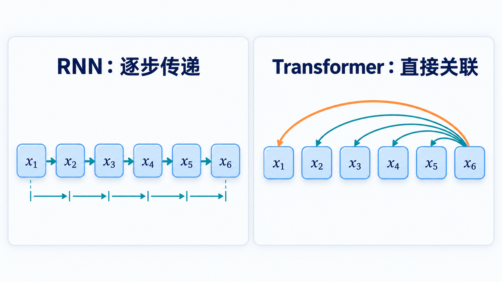

左侧强调同一层 RNN 的顺序依赖；右侧展示自注意力中一个位置可直接关联其他位置。

与 RNN 不同，Transformer 不使用循环结构；与 CNN 不同，它也不依赖卷积来建立序列内部的关联，而是主要通过 Attention 完成信息交互。

需要注意，Transformer 并不是简单地把 Attention 放进神经网络，而是围绕 Attention 设计了一套完整的编码器、解码器和训练架构。

---

## 二、Attention 是如何计算的？

前面我们已经知道，Attention 的目标是：

**根据当前词与其他词之间的关联程度，决定从哪些位置提取信息，以及提取多少信息。**

从计算角度看，这个过程可以拆成三个步骤：

1. 计算当前词与其他词之间的匹配程度；
2. 将匹配程度转换成权重；
3. 根据权重，对其他词提供的信息进行加权求和。

以「苹果」为例，假设句子中有 $n$ 个词，我们希望计算「苹果」对应的新表示。

### 2.1 计算关联程度

模型首先需要判断：「苹果」与句子中其他词之间有多大关联？

例如，「手机」可能与它高度相关，而「今天」的关联程度可能较低。

这个关联程度不能简单地由人工指定，而是需要模型通过可学习的参数计算出来。

为此，Transformer 引入了两个概念：

- **Query（Q，查询）**：表示当前词希望寻找什么信息。
- **Key（K，键）**：表示每个词可以通过什么特征与 Query 进行匹配。

通过比较 Query 和 Key，模型就可以计算当前词与其他词之间的匹配程度。

### 2.2 将匹配程度转换成权重

得到匹配分数后，还不能直接用于信息融合。

模型需要通过 Softmax 函数，将这些分数转换成一组权重：

$$
\alpha_j=\frac{\exp(s_j)}{\sum_{\ell=1}^{n}\exp(s_\ell)}
$$

其中：

- $s_j$：当前词与第 $j$ 个词之间的匹配分数；
- $\alpha_j$：第 $j$ 个词最终获得的注意力权重。

这些权重具有两个特点：

$$
0\leq\alpha_j\leq1,\qquad\sum_{j=1}^{n}\alpha_j=1
$$

也就是说，每个词的权重都在 0 到 1 之间，所有词的权重加起来等于 1。

权重越大，说明模型在更新当前词表示时，会从对应位置提取更多信息。

例如，假设当前词与三个词的匹配分数为 $[2,1,0]$，经过 Softmax 后近似得到 $[0.665,0.245,0.090]$。也就是说，当前词会把约 66.5% 的注意力放在第一个词上，约 24.5% 放在第二个词上，约 9.0% 放在第三个词上。

### 2.3 根据权重融合信息

接下来，模型需要从每个词那里提取真正有用的信息。

这部分由第三个概念负责：

- **Value（V，值）**：表示每个词实际提供给其他词的信息内容。

最终，模型根据前面计算出的权重，对所有 Value 向量进行加权求和：

$$
z_i=\sum_{j=1}^{n}\alpha_{ij}v_j
$$

其中：

- $\alpha_{ij}$：第 $i$ 个词对第 $j$ 个词的注意力权重；
- $v_j$：第 $j$ 个词对应的 Value 向量；
- $z_i$：第 $i$ 个词融合上下文信息后的新表示。

至此，Attention 的计算过程就完整了：

$$
\text{Query 与 Key 匹配}\rightarrow\text{Softmax 权重}\rightarrow\text{Value 加权求和}
$$

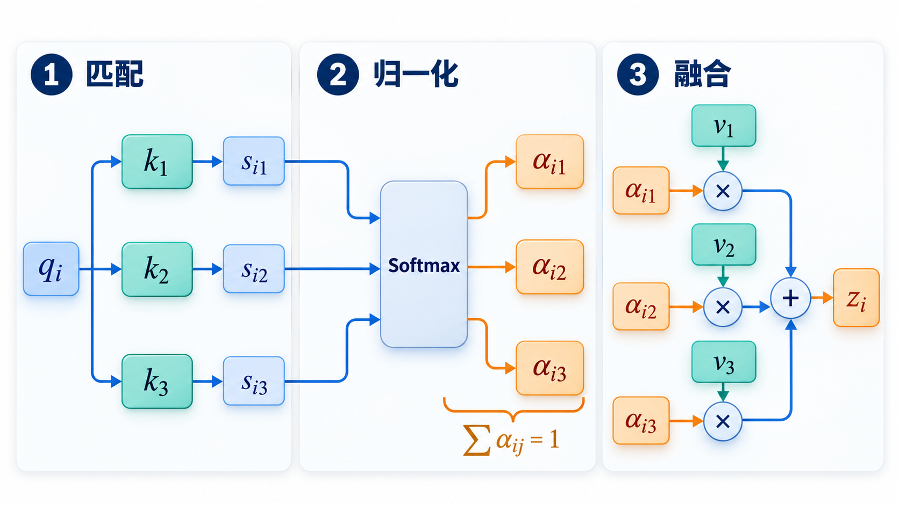

图中每个权重 $\alpha_{ij}$ 与同一位置的 $v_j$ 配对，再汇总成第 $i$ 个位置的新表示。

而 Query、Key、Value 分别承担这三个过程中的不同角色。

下一节，我们将进一步介绍 Q、K、V 是如何从输入向量中计算出来的，以及为什么 Transformer 使用点积来衡量 Query 和 Key 之间的关联程度。

---

## 三、Q、K、V 是如何计算的？

上一节把 Attention 拆成了「匹配 → 权重 → 信息融合」三步，但 Q、K、V 的具体来源和匹配程度的计算方式还没有展开。这一节把它们补上。

### 3.1 从输入向量得到 Q、K、V

假设输入序列的向量矩阵为：

$$
X\in\mathbb{R}^{n\times d_{\text{model}}}
$$

其中：

- $n$：序列长度。
- $d_{\text{model}}$：每个 Token 的向量维度。

Transformer 使用三个不同的线性变换：

$$
Q=XW^Q,\qquad K=XW^K,\qquad V=XW^V
$$

三个投影矩阵的维度为：

$$
W^Q,W^K\in\mathbb{R}^{d_{\text{model}}\times d_k},\qquad W^V\in\mathbb{R}^{d_{\text{model}}\times d_v}
$$

其中：

- $d_k$：Query 和 Key 向量的维度，也就是匹配时所使用的特征维度。
- $d_v$：Value 向量的维度，也就是最终被加权求和的信息维度。

这三个矩阵都是模型训练过程中学习得到的参数。

需要注意，$d_k$ 和 $d_v$ 与输入维度 $d_{\text{model}}$ 并不相同。线性变换把每个 Token 从 $d_{\text{model}}$ 维映射到 $d_k$（或 $d_v$）维，相当于把原始表示投影到专门用于「匹配」或「传递信息」的子空间中。在原始 Transformer 的 Base 模型中，$d_{\text{model}}=512$、$d_k=d_v=64$（每个注意力头）。

为什么要设计三个不同的矩阵？

因为同一个 Token 在不同任务中承担的角色不同。

例如：

- 作为 Query，它需要表达当前 Token 希望寻找什么信息。
- 作为 Key，它需要表达自己具备什么特征，便于其他 Token 匹配。
- 作为 Value，它需要表达自己能够提供什么信息。

通过不同的线性变换，模型可以学习三种不同的表示空间。

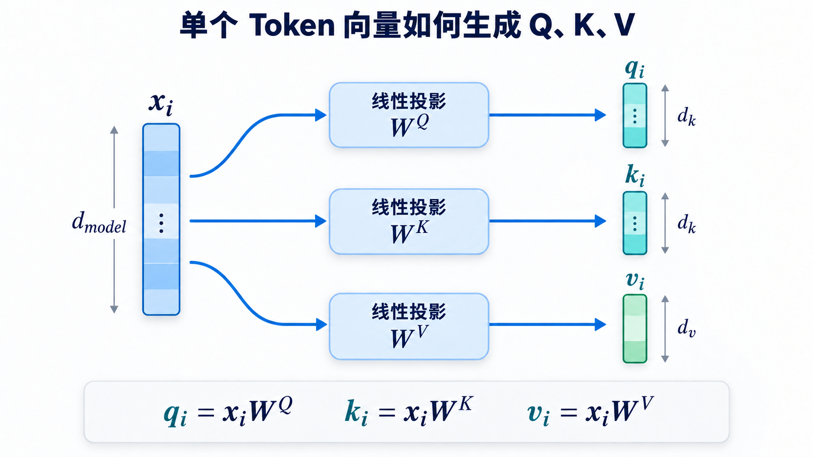

### 3.2 用点积衡量关联程度

有了 Q 和 K，接下来需要计算它们之间的匹配程度。

Transformer 使用点积：

$$
s_{ij}=q_i k_j^\top
$$

对于单个 Query 和多个 Key：

$$
s_i=q_iK^\top
$$

点积越大，通常表示两个向量在当前表示空间中的匹配程度越高。

对于整个序列：

$$
S=QK^\top\in\mathbb{R}^{n\times n}
$$

得到一个 $n\times n$ 的注意力分数矩阵。

其中第 $i$ 行第 $j$ 列表示：

第 $i$ 个 Token 对第 $j$ 个 Token 的注意力匹配分数。

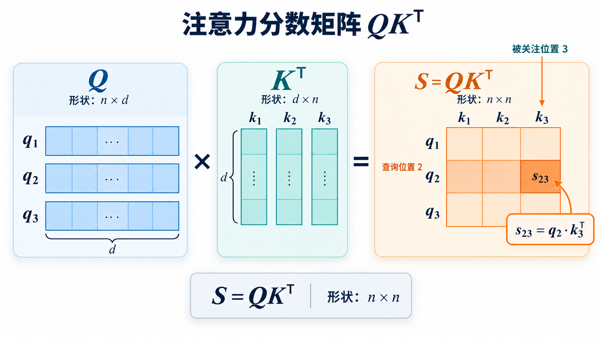

图中维度符号 $d$ 对应本文的 $d_k$；矩阵中的 $s_{23}$ 是第 2 个 Query 与第 3 个 Key 的点积。

### 3.3 为什么要除以 $\sqrt{d_k}$？

这是 Transformer 中一个非常重要的细节。

如果直接使用点积 $q_i k_j^\top$，当向量维度 $d_k$ 增大时，点积的数值通常也会增大。

假设 $q_i$ 与 $k_j$ 的各分量相互独立，均值为 0，方差为 1。

那么点积：

$$
q_i k_j^\top=\sum_{r=1}^{d_k}q_{ir}k_{jr}
$$

其期望为：

$$
\mathbb{E}[q_i k_j^\top]=0
$$

方差为：

$$
\operatorname{Var}(q_i k_j^\top)=d_k
$$

因此，点积的标准差为：

$$
\operatorname{Std}(q_i k_j^\top)=\sqrt{d_k}
$$

随着维度增大，点积数值的波动也会变大。

接下来还要经过 Softmax：

$$
\alpha_{ij}=\operatorname{softmax}_j(s_{ij})
$$

如果输入数值过大，Softmax 容易出现某个位置的概率接近 1，其他位置接近 0 的情况。

这会导致梯度变得很小，不利于模型训练。

因此，Transformer 使用缩放点积：

$$
\operatorname{Attention}(Q,K,V)=\operatorname{softmax}\!\left(\frac{QK^\top}{\sqrt{d_k}}\right)V
$$

其中 $\sqrt{d_k}$ 就是缩放因子。

它的作用是控制点积的数值范围，使 Softmax 的输入更加稳定。

这就是 Transformer 最核心的数学公式之一。

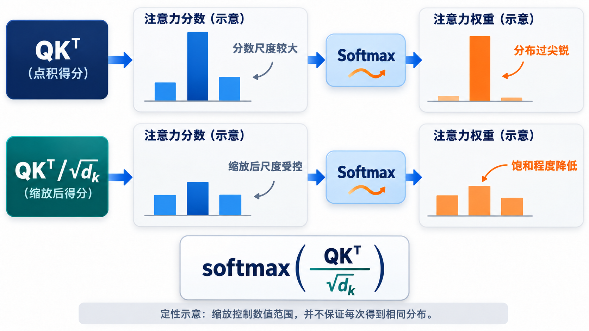

两行柱形图是数值尺度的定性示意，并不表示每次缩放都会得到相同形状的注意力分布。

### 3.4 完整走一遍 Attention 的计算

把前面的步骤串起来，对于第 $i$ 个词：

1. 用 $x_i$ 得到 $q_i$，并由所有输入向量得到各位置的 $k_j$ 与 $v_j$；
2. 计算 $q_i$ 与每个 $k_j$ 的点积，并除以 $\sqrt{d_k}$；
3. 对分数做 Softmax，得到权重 $\alpha_{ij}$；
4. 用权重对 $v_j$ 加权求和，得到 $z_i$。

---

## 四、Multi-Head Attention：多头注意力

前面介绍的 Attention，每个 Token 只用一组 Q、K、V，这称为单头 Attention。

但 Transformer 并没有只使用一个 Attention，而是采用了 Multi-Head Attention。

为什么？

因为一个注意力头可能只学习到某一种关联模式。

例如，在一个句子中：

- 一个注意力头可能关注语法关系。
- 一个注意力头可能关注主谓关系。
- 一个注意力头可能关注语义关联。
- 一个注意力头可能关注距离较远的词语。

当然，这只是帮助理解的直观例子，并不意味着每个头一定具有固定的语言学功能。

### 4.1 多头注意力的基本思想

Transformer 将输入分别映射到多个不同的 Q、K、V 空间。

假设有 $h$ 个注意力头。

第 $r$ 个头的计算为：

$$
\operatorname{head}_r=\operatorname{Attention}(XW_r^Q,XW_r^K,XW_r^V)
$$

每个头都有自己独立的可训练参数。

最后，将所有头的结果拼接：

$$
H=\operatorname{Concat}(\operatorname{head}_1,\ldots,\operatorname{head}_h)
$$

再经过一个线性变换：

$$
\operatorname{MultiHead}(X)=HW^O
$$

其中：

$$
W^O\in\mathbb{R}^{hd_v\times d_{\text{model}}}
$$

在原始 Transformer 的 Base 模型中：

$$
h=8,\qquad d_{\text{model}}=512
$$

每个注意力头的维度为：

$$
d_k=d_v=\frac{d_{\text{model}}}{h}=64
$$

因此，8 个头分别产生 64 维的输出。

拼接后：

$$
hd_v=8\times64=512
$$

最终再经过 $W^O$，输出维度仍然为 512。

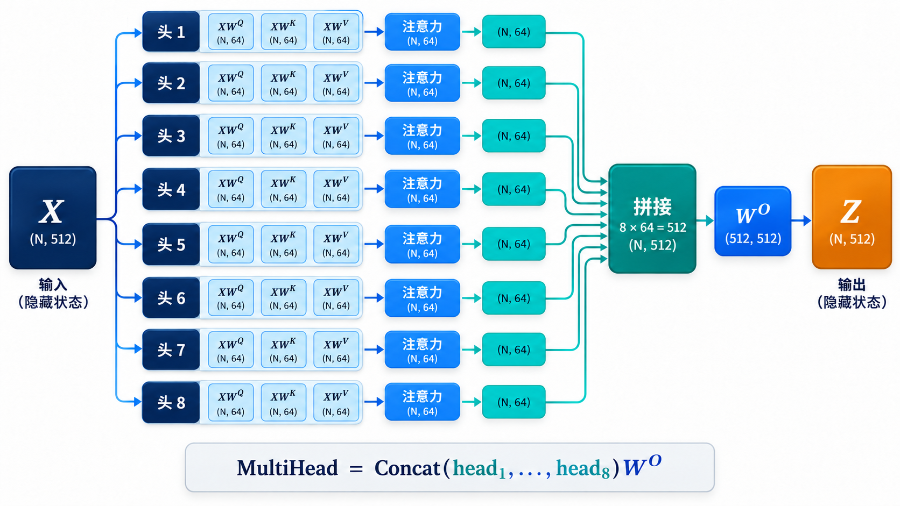

### 4.2 为什么不直接使用一个 512 维的 Attention？

多头机制的价值在于：

**让模型在不同的表示子空间中并行学习不同的注意力关系。**

单头注意力需要用一个注意力分布描述关联关系，而多头注意力允许模型同时学习多个不同的关联分布。

这增强了模型的表达能力。

---

## 五、Transformer 为什么还需要位置编码？

到目前为止，我们已经有了 Attention。

但是，Transformer 还有一个非常重要的问题需要解决。

**Attention 本身并不知道 Token 的先后顺序。**

例如：

$$
[x_{\text{我}},x_{\text{喜欢}},x_{\text{你}}]
$$

与：

$$
[x_{\text{你}},x_{\text{喜欢}},x_{\text{我}}]
$$

如果只考虑 Token 向量之间的注意力计算，模型没有天然的顺序概念。

而自然语言中，词语的顺序往往决定句子的含义。

例如：

- 我喜欢你。
- 你喜欢我。

因此，Transformer 必须向模型注入位置信息。

这就是 Positional Encoding（位置编码）。

### 5.1 最初版本采用正弦和余弦函数

2017 年的原始 Transformer 使用固定的正弦、余弦函数构造位置编码。

公式如下：

$$
\operatorname{PE}_{(p,2i)}=\sin\!\left(\frac{p}{10000^{2i/d_{\text{model}}}}\right),\qquad \operatorname{PE}_{(p,2i+1)}=\cos\!\left(\frac{p}{10000^{2i/d_{\text{model}}}}\right)
$$

其中：

- $p$：Token 在序列中的位置。
- $i$：向量维度对应的索引（$2i$ 与 $2i+1$ 为一对）。
- $d_{\text{model}}$：模型隐藏维度。

偶数维使用 Sin，奇数维使用 Cos。

### 5.2 为什么使用不同频率？

观察公式：

$$
10000^{2i/d_{\text{model}}}
$$

随着维度索引 $i$ 增大，分母也会增大。

因此，不同维度对应不同频率的正弦、余弦函数。

低维度变化较快，高维度变化较慢。

这样，每个位置都可以通过一组不同频率的周期函数表示。

不同位置对应不同的位置编码向量。

### 5.3 位置编码如何加入 Token？

假设 Token Embedding 为：

$$
E_{\text{token}}\in\mathbb{R}^{n\times d_{\text{model}}}
$$

位置编码为：

$$
\operatorname{PE}\in\mathbb{R}^{n\times d_{\text{model}}}
$$

Transformer 直接将二者相加：

$$
X_{\text{input}}=E_{\text{token}}+\operatorname{PE}
$$

这里不是拼接，而是逐元素相加。

这样，输入向量同时包含：

1. Token 的语义信息。
2. Token 的位置信息。

原始论文还将 Embedding 乘以 $\sqrt{d_{\text{model}}}$。

因此，更完整的输入形式为：

$$
X_{\text{input}}=\sqrt{d_{\text{model}}}\,E_{\text{token}}+\operatorname{PE}
$$


图中的 $E(p)$ 表示经过缩放的 Token Embedding，$X(p)$ 是它与位置向量逐元素相加后的输入。

---

## 六、Feed Forward Network：前馈神经网络

现在我们已经理解了：

- Attention：让 Token 获取其他 Token 的信息。
- Multi-Head Attention：从多个表示子空间学习不同的关联。
- Positional Encoding：告诉模型 Token 的位置。

但是，Transformer 还需要一个模块对每个 Token 的特征进行进一步加工。

这就是 Feed Forward Network，简称 FFN。

### 6.1 FFN 的结构

原始 Transformer 使用一个两层全连接神经网络：

$$
\operatorname{FFN}(x)=\max(0,xW_1+b_1)W_2+b_2
$$

其中：

第一层：

$$
u=xW_1+b_1,\qquad W_1\in\mathbb{R}^{d_{\text{model}}\times d_{\text{ff}}}
$$

第二层：

$$
y=\operatorname{ReLU}(u)W_2+b_2,\qquad W_2\in\mathbb{R}^{d_{\text{ff}}\times d_{\text{model}}}
$$

ReLU 函数：

$$
\operatorname{ReLU}(a)=\max(0,a)
$$

在 Base 模型中：

$$
d_{\text{model}}=512,\qquad d_{\text{ff}}=2048
$$

因此：
$512\rightarrow2048\rightarrow512$。

整个过程就是：

$$
x\rightarrow xW_1+b_1\rightarrow\operatorname{ReLU}\rightarrow\operatorname{ReLU}(xW_1+b_1)W_2+b_2
$$

### 6.2 为什么要先升维，再降维？

可以理解为：

第一层将特征映射到更高维度的空间，使网络有更多能力组合和提取特征。

第二层再将结果映射回原来的维度，方便后续网络继续处理。

这里需要注意一个细节：

FFN 是逐位置独立计算的。

也就是说，对于序列中的每一个 Token，都会使用相同的 FFN 参数进行计算，但不同 Token 之间不会在这个模块中直接交换信息。

Token 之间的信息交互主要发生在 Attention 模块中。

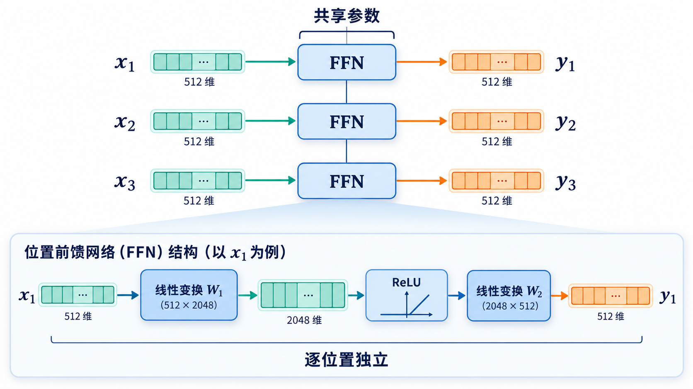

---

## 七、Residual Connection 和 Layer Normalization

原始 Transformer 中，每个子层外面都有两个重要结构：

1. Residual Connection（残差连接）
2. Layer Normalization（层归一化）

### 7.1 残差连接

假设输入为 $x$，经过某个神经网络子层得到 $F(x)$。

普通网络直接输出：

$$
y=F(x)
$$

而残差连接将输入直接加到输出上：

$$
y=x+F(x)
$$

这样，模型不仅可以学习新的特征，也可以保留原始输入的信息。

从反向传播的角度看：

$$
\frac{\partial y}{\partial x}=I+\frac{\partial F(x)}{\partial x}
$$

其中的直接梯度通路有助于缓解深层网络训练中的梯度传播问题。

### 7.2 Layer Normalization

LayerNorm 的作用是对特征维度进行归一化。

假设某个 Token 的向量为：

$$
x=(x_1,\ldots,x_{d_{\text{model}}})
$$

计算均值：

$$
\mu=\frac{1}{d_{\text{model}}}\sum_{r=1}^{d_{\text{model}}}x_r
$$

计算方差：

$$
\sigma^2=\frac{1}{d_{\text{model}}}\sum_{r=1}^{d_{\text{model}}}(x_r-\mu)^2
$$

归一化：

$$
\widehat{x}_r=\frac{x_r-\mu}{\sqrt{\sigma^2+\varepsilon}}
$$

再通过可训练参数进行缩放和平移：

$$
\operatorname{LayerNorm}(x)_r=\gamma_r\widehat{x}_r+\beta_r
$$

其中：

- $\gamma$：可学习的缩放参数。
- $\beta$：可学习的偏移参数。
- $\varepsilon$：数值稳定项。

### 7.3 原始 Transformer 的 Add & Norm

这里有一个很重要的历史细节：

**2017 年原始 Transformer 使用的是 Post-LN 结构。**

也就是先进行残差相加，再执行 LayerNorm：

$$
\operatorname{AddNorm}(x,\operatorname{Sublayer})=\operatorname{LayerNorm}\!\left(x+\operatorname{Sublayer}(x)\right)
$$

这个公式在原始 Transformer 中非常重要。

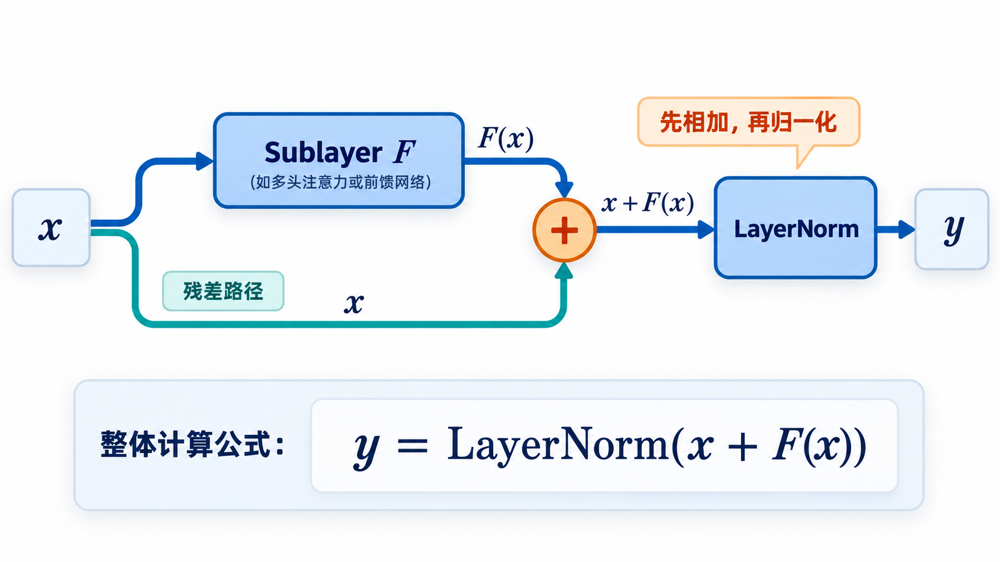

例如，Encoder 的一个 Layer 包含两个子层：

第一个：

$$
a=\operatorname{LayerNorm}\!\left(x+\operatorname{MultiHead}(x)\right)
$$

第二个：

$$
y=\operatorname{LayerNorm}\!\left(a+\operatorname{FFN}(a)\right)
$$

最终：

$$
x\rightarrow a\rightarrow y
$$

后续很多 Transformer 架构采用了 Pre-LN，即先 LayerNorm 再执行子层运算。

但这属于后续架构的演变，不应该与原始版本混淆。

---

## 八、完整理解原始 Transformer 架构

前面已经拆解了 Transformer 的基本组件，现在可以将它们组合起来。

原始 Transformer 采用 Encoder-Decoder 架构。

整体包含两个部分：

- Encoder：编码器，负责理解输入序列。
- Decoder：解码器，负责生成目标序列。

原始论文的 Base 模型中 $N=6$，也就是说，Encoder 和 Decoder 都分别堆叠 6 层。

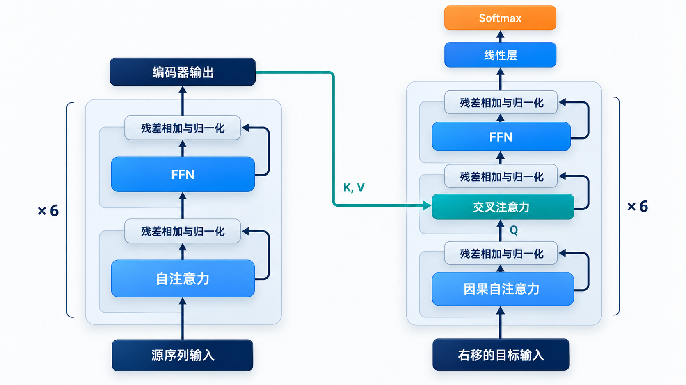

图中的青绿色连线表示：交叉注意力的 Key 和 Value 来自 Encoder 输出，Query 来自 Decoder 当前状态。

### 8.1 Encoder 的结构

每一层 Encoder 包含两个子层。

**第一个子层：Multi-Head Self-Attention**

输入序列中的每个 Token 都可以关注当前输入序列中的其他 Token。

这里：

$$
Q=XW^Q,\qquad K=XW^K,\qquad V=XW^V
$$

因为 Q、K、V 都来自同一个输入序列，所以叫 Self-Attention。

计算：

$$
M=\operatorname{MultiHead}(X)
$$

然后残差连接和归一化：

$$
A=\operatorname{LayerNorm}(X+M)
$$

**第二个子层：Feed Forward Network**

$$
F=\operatorname{FFN}(A)
$$

然后：

$$
Y=\operatorname{LayerNorm}(A+F)
$$

因此，一个 Encoder Layer 可以总结为：

$$
X\rightarrow\operatorname{MultiHeadSelfAttention}\rightarrow\operatorname{AddNorm}\rightarrow\operatorname{FFN}\rightarrow\operatorname{AddNorm}
$$

其中：

$$
X\in\mathbb{R}^{n\times d_{\text{model}}},\qquad Y\in\mathbb{R}^{n\times d_{\text{model}}}
$$

6 层 Encoder 依次堆叠，最终输出 $E$，其中：

$$
E\in\mathbb{R}^{n\times d_{\text{model}}}
$$

### 8.2 Decoder 的结构

Decoder 比 Encoder 多一个子层。

每一层 Decoder 包含三个子层：

1. Masked Multi-Head Self-Attention
2. Encoder-Decoder Attention
3. Feed Forward Network

#### 第一个子层：Masked Self-Attention

Decoder 的任务是逐个生成目标 Token。

假设正在生成：

> I love machine learning

当模型预测第 3 个 Token 时，只允许使用前面已经生成的 Token，而不能提前看到第 4 个 Token。

因此需要引入 Mask。

原始 Transformer 使用的是因果掩码（Causal Mask）。

数学上：

$$
M_{ij}=\begin{cases}0,&j\leq i,\\-\infty,&j>i,\end{cases}\qquad \operatorname{MaskedAttention}(Q,K,V)=\operatorname{softmax}\!\left(\frac{QK^\top}{\sqrt{d_k}}+M\right)V
$$

其中：

- $M_{ij}$ 为第 $i$ 个位置对第 $j$ 个位置的加性掩码；$j>i$ 表示未来位置。

这样，未来位置对应的注意力分数经过 Softmax 后就变成 0。

例如，序列长度为 3：

~~~text
可见位置（1 表示可见）：
1 0 0
1 1 0
1 1 1
~~~

因此：

- 第一个 Token 只能关注第一个位置。
- 第二个 Token 可以关注前两个位置。
- 第三个 Token 可以关注前三个位置。

这保证了生成过程的因果性。

#### 第二个子层：Encoder-Decoder Attention

这个模块也叫 Cross-Attention（交叉注意力）。

它负责让 Decoder 获取 Encoder 对输入序列的理解结果。

与 Self-Attention 不同，这里：

$$
Q=DW^Q,\qquad K=EW^K,\qquad V=EW^V
$$

其中：

- $D$：Decoder 当前的隐藏状态。
- $E$：Encoder 输出。

也就是说：

Query 来自 Decoder。

Key 和 Value 来自 Encoder。

计算：

$$
\operatorname{CrossAttention}(D,E)=\operatorname{softmax}\!\left(\frac{QK^\top}{\sqrt{d_k}}\right)V
$$

然后执行残差连接和 LayerNorm。

这一步让 Decoder 在生成每一个 Token 时，都可以从输入序列中获取相关信息。

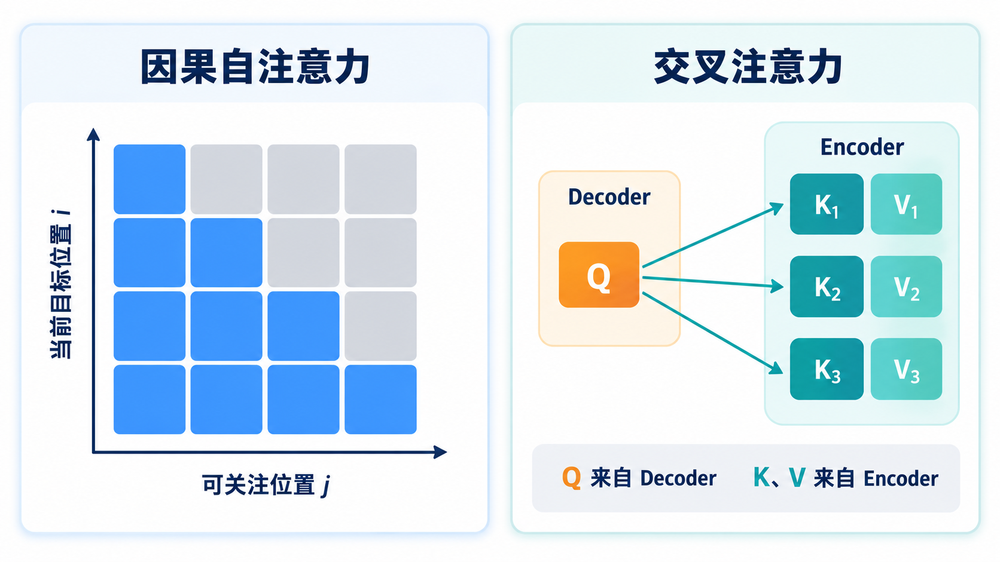

#### 第三个子层：Feed Forward Network

最后仍然使用与 Encoder 相同形式的 FFN：

$$
F=\operatorname{FFN}(C)
$$

并执行：

$$
D_{\text{out}}=\operatorname{LayerNorm}(C+F)
$$

因此，一个 Decoder Layer 可以概括为：

$$
U=\operatorname{LayerNorm}(D+\operatorname{MaskedMultiHead}(D))
$$

$$
C=\operatorname{LayerNorm}(U+\operatorname{MultiHeadCross}(U,E))
$$

$$
D_{\text{out}}=\operatorname{LayerNorm}(C+\operatorname{FFN}(C))
$$

6 层 Decoder 依次堆叠，得到最终的解码结果。

---

## 九、Transformer 如何生成最终结果？

现在，Encoder 和 Decoder 都已经介绍完毕。

还需要解决最后一个问题：

模型如何根据 Decoder 的输出预测下一个 Token？

假设 Decoder 最终输出：

$$
D_{\text{final}}\in\mathbb{R}^{m\times d_{\text{model}}}
$$

首先经过一个线性映射：

$$
L=D_{\text{final}}W_{\text{vocab}}+b_{\text{vocab}}
$$

其中：

$$
W_{\text{vocab}}\in\mathbb{R}^{d_{\text{model}}\times|\mathcal V|}
$$

$|\mathcal V|$ 表示词表大小。

因此：

$$
L\in\mathbb{R}^{m\times|\mathcal V|}
$$

每个位置都得到一个长度为 $|\mathcal V|$ 的分数向量。

然后经过 Softmax：

$$
P(y_i=w\mid y_{<i},x)=\frac{\exp(L_{i,w})}{\sum_{u\in\mathcal V}\exp(L_{i,u})}
$$

最终得到词表中每个 Token 的预测概率。

例如：

| Token   | 概率 |
| ------- | ---: |
| machine | 0.70 |
| deep    | 0.20 |
| neural  | 0.10 |

模型可以选择概率最高的 Token，也可以采用其他解码策略。

在原始机器翻译任务中，通常使用 Beam Search 等方法生成完整序列。

---

## 十、Transformer 是如何训练的？

原始 Transformer 主要通过机器翻译任务进行验证。

假设输入：

> 我喜欢人工智能

目标输出：

> I love artificial intelligence

训练时，Decoder 使用右移后的目标序列作为输入。

例如：

Decoder 输入：

~~~text
<BOS> I love artificial
~~~

预测目标：

~~~text
I love artificial intelligence
~~~

这里 BOS 表示序列开始标记。

这种训练方式叫 Teacher Forcing。

模型在每个位置预测下一个 Token，并将预测结果与真实 Token 进行比较。

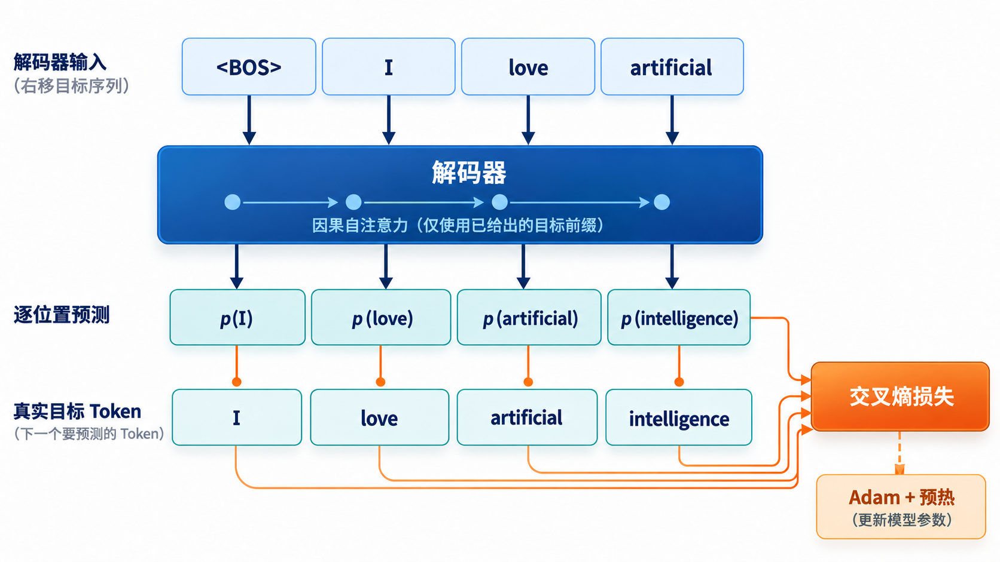

### 10.1 Cross Entropy Loss

假设真实 Token 的概率为 $p_{\text{true}}$，交叉熵损失为：

$$
\ell_i=-\log p_{\text{true}}
$$

如果模型给正确 Token 分配的概率越高，损失越小。

对于整个序列：

$$
\mathcal L_{\text{NLL}}=-\sum_{i=1}^{T}\log P_\theta(y_i\mid y_{<i},x)
$$

其中：

- $x$：输入序列。
- $y_i$：第 $i$ 个真实目标 Token。
- $y_{<i}$：之前已经出现的目标 Token。
- $T$：目标序列长度。

训练的目标就是不断调整模型参数，最小化整个训练数据集上的损失。

这里给出的是基础的负对数似然形式。原始论文训练时还使用了标签平滑（label smoothing，系数为 $0.1$），让目标分布不再是完全独热的形式。

### 10.2 原始 Transformer 使用什么优化器？

原始论文使用 Adam 优化器，并设计了特殊的学习率调度策略：

$$
\operatorname{lr}(s)=d_{\text{model}}^{-1/2}\min\!\left(s^{-1/2},\,s\,w^{-3/2}\right)
$$

其中：

- $s$：当前训练步数。
- $w$：预热步数。
- $d_{\text{model}}$：模型隐藏维度。

在 Base 模型中 $w=4000$。

学习率策略分为两个阶段：

**第一阶段：Warmup**

$$
\operatorname{lr}(s)=d_{\text{model}}^{-1/2}s\,w^{-3/2}\qquad(s\leq w)
$$

随着训练步数增加，学习率逐渐增大。

**第二阶段：Decay**

$$
\operatorname{lr}(s)=d_{\text{model}}^{-1/2}s^{-1/2}\qquad(s\geq w)
$$

达到预热阶段后，学习率逐渐衰减。

这样可以帮助模型在训练初期保持稳定，同时在后期逐渐优化参数。

---

## 十一、原始 Transformer 的核心参数总结

为了完整理解 2017 年的原始 Transformer，需要记住论文中的两个典型配置：

| 参数              | Base |  Big |
| ----------------- | ---: | ---: |
| Encoder 层数      |    6 |    6 |
| Decoder 层数      |    6 |    6 |
| $d_{\text{model}}$ | 512 | 1024 |
| Attention Head 数 |    8 |   16 |
| $d_k$ | 64 | 64 |
| $d_v$ | 64 | 64 |
| $d_{\text{ff}}$ | 2048 | 4096 |
| Dropout           |  0.1 |  0.3 |
| Warmup Steps      | 4000 | 4000 |

这里需要特别注意：

原始 Transformer 的 Big 模型中 $d_k=d_v=64$，并不是简单地将每个头的维度扩大到 128。

由于 Head 数从 8 增加到 16，最终拼接后的维度才达到 1024（即 $16\times64$）。

---

## 十二、从整体上重新理解 Transformer

到这里，我们已经介绍了原始 Transformer 的全部核心组件。

可以把整个模型总结为下面的计算流程。

### Encoder

```text
Input
  ↓
Embedding + PositionalEncoding
  ↓
MultiHeadSelfAttention
  ↓
Add + LayerNorm
  ↓
FeedForwardNetwork
  ↓
Add + LayerNorm
  ↓
（重复 6 次，得到 Encoder 输出）
```

### Decoder

```text
TargetEmbedding + PositionalEncoding
  ↓
MaskedMultiHeadSelfAttention
  ↓
Add + LayerNorm
  ↓
EncoderDecoderAttention
  ↓
Add + LayerNorm
  ↓
FeedForwardNetwork
  ↓
Add + LayerNorm
  ↓
（重复 6 次，得到 Decoder 输出）
```

最后：

```text
DecoderOutput → Linear → Softmax → TokenProbability
```

---

## 十三、为什么 Transformer 能够改变深度学习？

回到最初的问题：

Transformer 为什么能够取代很多传统序列模型，成为现代大语言模型的重要基础？

主要有三个原因。

**第一，Attention 建立了直接的全局信息交互机制。**

RNN 需要通过连续的隐藏状态传递信息，而 Transformer 可以让任意两个位置直接建立注意力联系。

在标准全局 Self-Attention 中，序列长度为 $n$ 时，注意力矩阵大小为 $n\times n$。

因此，每一层都可以直接计算任意两个 Token 之间的关联。

**第二，计算过程更容易并行化。**

对于 Encoder，所有输入 Token 的 Q、K、V 可以通过矩阵运算同时计算。

这充分利用了 GPU 的并行计算能力。

**第三，模型具有良好的扩展能力。**

通过增加层数、隐藏维度、注意力头数量和训练数据规模，可以构建更大规模的模型。

后续的 GPT、BERT 等模型都从 Transformer 架构中发展而来，但它们在 Encoder、Decoder、训练目标和注意力结构等方面存在明显区别。

---

## 十四、总结：真正需要掌握的几个公式

如果希望真正理解原始 Transformer，而不是只记住它的网络结构，建议重点掌握以下公式。

**1. Q、K、V 的线性映射**

$$
Q=XW^Q,\qquad K=XW^K,\qquad V=XW^V
$$

**2. Scaled Dot-Product Attention**

$$
\operatorname{Attention}(Q,K,V)=\operatorname{softmax}\!\left(\frac{QK^\top}{\sqrt{d_k}}\right)V
$$

**3. Multi-Head Attention**

$$
\operatorname{MultiHead}(X)=\operatorname{Concat}(\operatorname{head}_1,\ldots,\operatorname{head}_h)W^O
$$

**4. Positional Encoding**

$$
\operatorname{PE}_{(p,2i)}=\sin\!\left(\frac{p}{10000^{2i/d_{\text{model}}}}\right),\quad \operatorname{PE}_{(p,2i+1)}=\cos\!\left(\frac{p}{10000^{2i/d_{\text{model}}}}\right)
$$

**5. Feed Forward Network**

$$
\operatorname{FFN}(x)=\max(0,xW_1+b_1)W_2+b_2
$$

**6. 原始 Transformer 的 Add & Norm**

$$
\operatorname{LayerNorm}(x+\operatorname{Sublayer}(x))
$$

**7. Masked Attention**

$$
\operatorname{softmax}\!\left(\frac{QK^\top}{\sqrt{d_k}}+M\right)V
$$

**8. 训练目标**

$$
\mathcal L_{\text{NLL}}=-\sum_{i=1}^{T}\log P_\theta(y_i\mid y_{<i},x)
$$

如果把这些公式串联起来，就能理解 Transformer 的完整工作过程：

输入文本首先被映射为向量，通过位置编码获得顺序信息；随后利用 Q、K、V 计算 Token 之间的注意力关系，通过多头注意力完成信息交互，再通过 FFN 进行非线性特征变换；Encoder 负责理解输入，Decoder 负责结合输入信息逐步生成输出，最终通过 Linear 和 Softmax 得到下一个 Token 的概率分布。

**Transformer 最核心的创新，不是某一个独立的公式，而是以 Attention 为核心，构建了一套能够并行计算、建立全局依赖关系并且易于扩展的序列建模架构。**

想继续理解这些模块在后来的模型中如何变化，可接着阅读[从原始 Transformer 到现代大模型：逐项理解架构演进](从原始Transformer到现代大模型：逐项理解架构演进.md)。
