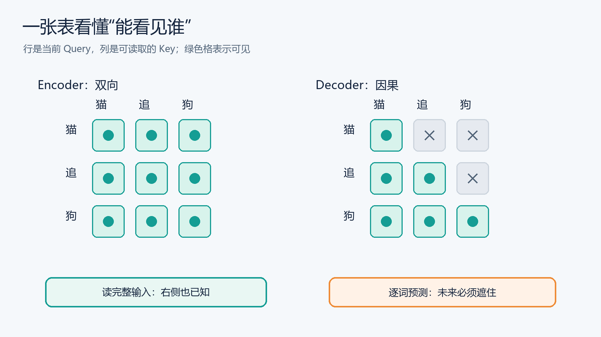
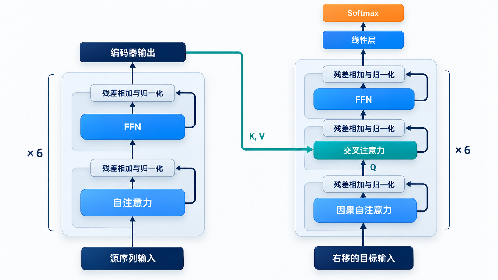

# Encoder-only、Encoder–Decoder、Decoder-only：谁能看见谁？

> [返回总览](../从原始Transformer到现代大模型：逐项理解架构演进.md)｜以[原始 Transformer 笔记](../transform.md)为基线。

这三种名称说的是**信息路径和预测目标**，不是 Attention 计算公式的三种写法。先确定每个位置能读哪些 Token、Query 从哪里来，再讨论 RoPE、GQA 或 MoE 等层内设计。一个模型用了 GQA，仍可能是 Decoder-only；用了相对位置 Bias，也仍可能是 Encoder–Decoder。

## 先把 Transformer 想成一间编辑室

一句话被切成 Token 后，每个 Token 都带着一个向量。Attention 做的事情可以先理解为：**当前这个位置拿着自己的问题（Query），从允许查看的位置寻找线索（Key），取回相应内容（Value）**。至于它“允许查看哪几页”，是另一个问题。即使 Q/K/V 的计算完全一样，改变这张可见名单，模型的用途就可能大不相同。

假设读到「猫追狗」中的「追」。若我们要判断整句话里的动作，右边的「狗」已经存在，让「追」使用它很合理。若任务是一个字一个字续写，当模型还在「猫追」时，「狗」根本没有出现；训练时也必须遮住它。否则模型练习的不是预测，而是抄答案。

图按**行 Query、列 Key**阅读：绿色格表示这一行可以读取该列。左表中的「猫」可看见右边的「狗」，右表中的「猫」不能。右表的下三角形是因果约束；「追」可以读「猫」和自己，不能读「狗」。这张表只讲 Self-Attention 的可见范围，Encoder–Decoder 的 Cross-Attention 还要另外连接两条序列。

从这里可以自己推导三种结构：只有左表，是擅长读完整输入的 Encoder-only；只有右表，是从左到右生成的 Decoder-only；先用左表读完源文，再用右表写目标文，并增加一条目标读源文的通道，就是 Encoder–Decoder。名称中的 Encoder/Decoder 指的是这三条信息路径的组合，不是三套互不相干的数学公式。

### 一个完整任务怎样走过三种结构？

以「把‘猫追狗’翻译成英文」为例。Encoder-only 可以先读完整中文，得到适合分类、检索或标注的上下文表示；若要逐词输出英文，通常还需要另接生成模块。Encoder–Decoder 让 Encoder 读完整中文，Decoder 写到 `The cat` 时，一边看已经写出的英文，一边通过 Cross-Attention 查中文表示。Decoder-only 则把要求和中文放在同一段 Prompt 中，随后在它后面逐词续写英文；当前输出能读取 Prompt，Prompt 中较早位置的隐藏状态不会因后来生成的英文而重新计算。

这不是三种模型能力的排名，而是“哪些信息已经到手、输出要不要一步步写”的不同组织方式。读架构论文时，先在纸上画出**序列有几条、每条序列何时已知、当前位置可读取哪条序列**，再看内部用了什么头数或位置编码。

## 先用同一句话看三种可见范围

假设输入为「小猫 正在 睡觉」，我们关注中间的「正在」。Encoder-only 的这个位置能同时利用「小猫」和「睡觉」；Decoder-only 在因果 Self-Attention 中只能利用左侧前缀和自己。Encoder–Decoder 则有两条序列：Encoder 先双向处理完整源句，Decoder 在生成目标句时看已生成的目标前缀，再向 Encoder 输出取信息。

| 结构 | 当前 Query 来自 | Self-Attention 可见范围 | 是否另有 Cross-Attention | 常见预训练/使用方式 |
| :--- | :--- | :--- | :--- | :--- |
| Encoder-only | 输入序列 | 双向，可见所有未屏蔽输入位置 | 通常无 | Masked Language Modeling、表征、分类 |
| Encoder–Decoder | 源端或目标端各自序列 | Encoder 双向；Decoder 因果 | 有，Decoder Query 读取 Encoder K/V | 条件生成、翻译、摘要 |
| Decoder-only | 提示与输出构成的一条序列 | 因果，只看当前位置及左侧 | 经典形式无 | 下一个 Token 预测、通用生成 |

表中的“能看”由 Attention mask 和数据来源决定。实际输出还取决于训练目标、参数、数据和任务；不能从单个架构标签推断模型能力高低。

先看下图：左侧 Encoder 读完源序列，右侧 Decoder 逐步生成目标序列；绿色线把源端信息送到 Cross-Attention。下文把其中的两侧分别拿出来，就得到另外两种常见架构。图展示的是**最初版本**，后续模型会改变层内组件。

## Encoder-only：以 BERT 为代表

Encoder 中位置 $i$ 通常可以注意到输入中的所有非 Padding 位置，包括它右边的 Token。若任务是判断一句话的情感或抽取实体，这种双向上下文很自然。BERT 用 Masked Language Modeling 等目标预训练这种表示；它不是一个按原样逐 Token 续写的因果语言模型。[BERT 论文](https://arxiv.org/abs/1810.04805)

注意“输入能双向可见”不等于“模型知道被遮住的答案”：训练时某些输入位置被替换或遮蔽，模型要根据**未被遮蔽的上下文**预测它们。与原始 Encoder 相比，BERT 的经典实现使用学习式绝对位置 Embedding 和 GELU FFN，残差之后做 LayerNorm，仍属于 Post-Norm。[BERT 原始实现](https://github.com/google-research/bert/blob/master/modeling.py)

## Encoder–Decoder：原始 Transformer 与 T5

Encoder 先得到完整源序列的表示。Decoder 的第 $t$ 个位置通过因果 Self-Attention 只看目标前缀；随后做 Cross-Attention：**Query 来自 Decoder 当前状态，Key/Value 来自 Encoder 输出**。图中的绿色横线正表示这条源端信息路径。

因此“目标端当前要写什么”和“源序列提供哪些证据”分属两个信息通道。T5 保留 Encoder–Decoder，把多种文本任务统一成 text-to-text；它仍然适合明确给定输入、再产生输出的任务。[T5 论文](https://arxiv.org/abs/1910.10683)

## Decoder-only：以 GPT/Llama 为代表

把提示词和待生成内容放进**同一条序列**。因果掩码只允许位置 $t$ 读取自己和左边的 Token，右边尚未出现或被遮住。阅读图时可以把 Decoder 看成只保留右侧的**因果 Self-Attention → FFN** 主干，不再接左侧 Encoder 的绿色信息线。

这使“阅读提示”和“续写答案”共享一套因果 Attention。它没有独立的 Encoder，也没有原始架构中读取 Encoder 输出的 Cross-Attention。代价是一个 Prompt 内的 Token 也受因果可见性限制；它们不是在每一层都双向交换信息。

**架构与能力不能简单画等号。** Encoder-only 常用于表征任务；Encoder–Decoder 常用于条件生成；Decoder-only 常用于通用自回归生成。但具体能力还受到数据、目标函数、规模和训练方法影响。

## 代表模型出现时间：为什么今天常见的是 Decoder-only？

下表中的时间按**论文首次公开或官方首次发布的月份**记录，不混用后续修订版、模型权重分批开放或产品上线时间；它是帮助建立发展脉络的代表性选例，不是对全部模型的数量统计。

| 架构 | 代表模型 | 首次公开 | 主要定位或架构特征 |
| :--- | :--- | :--- | :--- |
| Encoder-only | [BERT](https://arxiv.org/abs/1810.04805) | 2018-10 | 双向表征，Masked Language Modeling |
| Encoder-only | [RoBERTa](https://arxiv.org/abs/1907.11692) | 2019-07 | 沿 BERT 路线改进预训练 |
| Encoder–Decoder | [原始 Transformer](https://arxiv.org/abs/1706.03762) | 2017-06 | 源序列编码、目标序列自回归生成 |
| Encoder–Decoder | [T5](https://arxiv.org/abs/1910.10683) | 2019-10 | 把多种任务统一为 text-to-text |
| Encoder–Decoder | [BART](https://arxiv.org/abs/1910.13461) | 2019-10 | 去噪预训练与条件生成 |
| Encoder–Decoder | [Flan-T5](https://arxiv.org/abs/2210.11416) | 2022-10 | 对 T5 路线做指令微调 |
| **Decoder-only** | [GPT-2](https://openai.com/index/better-language-models/) | **2019-02** | 因果语言建模、文本续写 |
| **Decoder-only** | [GPT-3](https://arxiv.org/abs/2005.14165) | **2020-05** | 扩大自回归语言模型，展示上下文学习 |
| **Decoder-only** | [LLaMA](https://arxiv.org/abs/2302.13971) | **2023-02** | 开放研究用的 Dense 基础模型系列 |
| **Decoder-only** | [Mistral 7B](https://mistral.ai/news/announcing-mistral-7b/) | **2023-09** | GQA 与滑动窗口 Attention |
| **Decoder-only** | [Mixtral 8×7B](https://mistral.ai/news/mixtral-of-experts/) | **2023-12** | Decoder 主干中的稀疏 MoE |
| **Decoder-only** | [Llama 3](https://ai.meta.com/blog/meta-llama-3/) | **2024-04** | Dense 通用生成模型系列 |
| **Decoder-only** | [Qwen2.5](https://qwenlm.github.io/blog/qwen2.5/) | **2024-09** | 通用文本生成，系列包含多种尺寸 |
| **Decoder-only** | [DeepSeek-V3](https://arxiv.org/abs/2412.19437) | **2024-12** | MLA 与 MoE 组合 |
| **Decoder-only** | [Qwen3](https://qwenlm.github.io/blog/qwen3/) | **2025-04** | 同一 Decoder 路线下有 Dense 与 MoE 型号 |

从这组连续出现的公开模型可以看到：**通用文本生成与对话模型的代表性路线，以 Decoder-only 为主**。它用同一套因果主干处理 Prompt 和生成结果，便于按下一个 Token 的目标进行大规模预训练，并与自回归推理的 KV Cache 配合。表中的近年模型无论采用 Dense FFN 还是 MoE、MHA 还是 GQA/MLA，都仍属于 Decoder-only 的整体架构。这里的“主流”限定于**通用自回归生成模型的架构选择**，不表示 Encoder-only 或 Encoder–Decoder 被淘汰：前者仍适合表征、检索与分类，后者仍适合翻译、摘要等明确的输入到输出任务。

## 为什么训练时的可见范围要和任务一致？

看 Decoder-only 的下一个 Token 训练。给定「小猫 正在」，模型预测「睡觉」；输入位置不能偷看「睡觉」之后的词，否则训练目标会泄露。训练时可以把整段文本一起送入 GPU **并行算出每个位置的损失**，但每一行 Attention 的因果掩码仍遮住右侧位置。推理时未来 Token 尚未生成，模型只能一轮一轮扩展前缀。这解释了“训练可并行”和“生成按 Token 顺序进行”为什么并不矛盾。

Encoder-only 的 Masked Language Modeling 则把某些输入词遮住，让模型利用两边的**可见上下文**预测它。若不遮住目标词，双向 Attention 会直接看到答案。其学习目标偏向获得完整输入的上下文表示；把它直接当成 Decoder-only 续写器，会遇到训练目标与推理方式不一致的问题。[BERT 论文](https://arxiv.org/abs/1810.04805)

Encoder–Decoder 的条件生成还有另一种分工。源句在生成目标前已经完整给定，Encoder 当然可以双向读源句；目标的后半段仍不能提前泄露给 Decoder。Cross-Attention 的 Query 来自目标端，K/V 来自源端。这样既允许充分理解输入，又守住目标端的因果顺序。[Attention Is All You Need](https://arxiv.org/abs/1706.03762)

## 为什么通用生成多选择 Decoder-only？

因果语言建模有一个统一训练接口：给一段文本，预测每个位置的下一个 Token。提示词、续写和对话历史也能排成同一条 Token 序列。模型的主干不必为不同任务另设独立 Encoder 和 Cross-Attention；规模化预训练时，这种统一性很有吸引力。**这是通用生成路线常见的工程和训练取舍，不是证明它在所有任务上优于另两种结构。**

如果任务天然有明确的“读完整输入 → 写输出”边界，例如机器翻译或长文摘要，Encoder–Decoder 的源端双向编码仍有价值。若重点是检索向量或逐位置标注，Encoder-only 能让输入位置充分交换双向信息。选结构时，先问**信息什么时候已知**，再问模型应预测什么。

## 读完本篇应能回答

1. 一个位置看到右侧 Token，是架构决定的，还是注意力掩码和数据流决定的？
2. Decoder 的 Self-Attention 与 Cross-Attention 各自读取哪条序列？
3. 为什么 Decoder-only 可以并行训练，却必须逐步生成？

下一篇讨论在因果 Decoder 内部，多个 Query 头为何要共享历史 KV：[MHA、MQA、GQA](02-MHA-MQA-GQA.md)。
