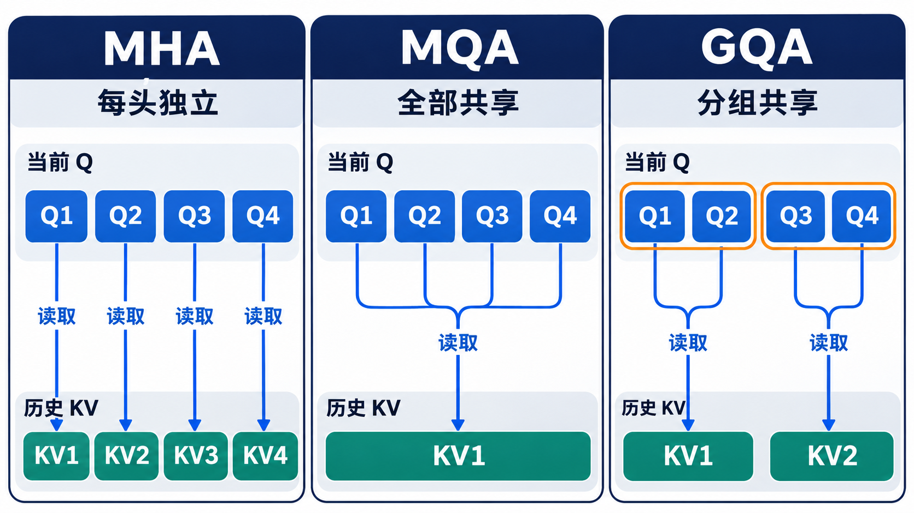
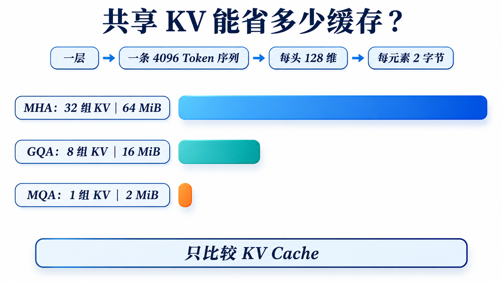

# 生成越久，历史 KV 为什么越占显存？从 MHA 到 MQA、GQA

> [返回总览](../从原始Transformer到现代大模型：逐项理解架构演进.md)｜以[原始 Transformer 笔记](../transform.md)为基线。

## 先看瓶颈：生成一个新 Token 要读多少历史？

先用一本不断续写的笔记来想：写到第 1000 个 Token 时，第 1～999 个 Token 已经写好。模型在每一层都要保存这些旧位置供下一步检索的资料。第 1001 个 Token 来了，模型不必重新写前 999 页，但它仍要翻阅相关的历史资料。**MHA、MQA、GQA 的争论是每页留下几套资料，并非要不要翻历史。**

这里有两个常被混为一谈的“多头”。Query 头是**当前读者的不同提问方式**；KV 头是**历史资料存成几套索引与内容**。可以有 32 个提问者，却只保存 8 套历史资料：每 4 个提问者使用同一套资料，但各自问题不同，所以查出的重点也可能不同。

把一层因果 Self-Attention 想成「当前 Token 提问，历史 Token 提供索引和内容」：当前 Token 产生 Query $q_t$；每个历史位置 $j\le t$ 留下 Key $k_j$ 和 Value $v_j$。先用 $q_t\cdot k_j$ 决定关注程度，再对 $v_j$ 加权求和。**K 用于匹配，V 用于取回信息；两者都要按历史长度保存或重新计算。**

有了 KV Cache，前一步计算过的历史 K/V 不必重算，但每生成一个新 Token，当前 Query 仍要读取它能看到的历史 K/V。缓存长度和每个位置存储的信息量共同决定显存与读取压力；容量的完整估算见[KV Cache 专篇](08-KV-Cache.md)。要分清两个数：**Query 头数决定当前有几种查询；KV 头数决定每个历史 Token 留下几组完整 K/V。**

读这张图时请先固定蓝色的 4 个 Query 头，再只数绿色的 KV 组。MHA 是四人各有一套；MQA 是四人共用一套；GQA 是两人一组。**不要把四条 Query 线误认为四个历史 Token**。若历史已有 1000 个 Token，图中的每一组 KV 都要沿历史长度保存 1000 份。于是缓存体积与“历史长度 × KV 组数”一起增长。

### 从一轮真实的 Decode 看变化发生在哪里

假设当前是第 $t$ 个 Token，三种设计先做共同的事：用这一层的当前隐藏状态生成 Query；按因果规则只允许读取位置 $1$ 到 $t$；算出注意力权重、汇总历史 Value，再投影成层输出。差异集中在两处：**新 Token 要写入几组 K/V**，以及**每个 Query 头应读取哪一组历史 K/V**。MHA 写四组，MQA 写一组，二组 GQA 写两组。下一轮到来时，这些新 K/V 已经成为历史的一部分。

“共享”不等于复制同一个注意力结果。假设两个 Query 面对同一份包含「苹果公司」与「水果苹果」的 K/V：一个 Query 更匹配公司，另一个更匹配水果，两者的 Softmax 权重不同，汇总出的 Value 也不同。这个例子只是帮助理解可表达的机制，不表示模型真的固定分配了这样的语义头。MQA 失去的是**历史侧多个独立投影的自由度**，不是 Query 侧提出不同问题的能力。

图固定 **4 个当前 Q 头**，只改变它们读取历史信息的对应关系。图中的 KV1、KV2 等编号表示**头或组**，不是第 1、2 个历史 Token；实际 Cache 对每个历史 Token、每一层都保存相应的 KV。箭头表示当前 Q **读取**历史 KV。MHA 存 4 组完整 KV，MQA 存 1 组，GQA 存 2 组。若每个 K/V 头宽为 $d$，每历史 Token 分别是 $8d$、$2d$、$4d$ 个元素：**GQA 的 KV 比 MQA 多，目的是在缓存开销与头间信息差异之间折中**。[MQA 论文](https://arxiv.org/abs/1911.02150)、[GQA 论文](https://arxiv.org/abs/2305.13245)

MLA 不是“再减少几组完整 KV”。它改变了历史状态的**存储形式**：保存共享的低维内容表示和单独的位置 Key，见[MLA 专篇](03-MLA.md)。不要把 MHA → MQA → GQA → MLA 画成缓存逐步减小的一条线：同条件下，GQA 的完整 KV 通常比 MQA 多。

## MHA：每个 Query 头都有自己的 K/V 头

标准 Multi-Head Attention（MHA）有 $h_q=h_{kv}=h$。每个头都从当前隐藏状态投影出自己的 Q/K/V。查询时，先拿本头 Q 与历史本头 K 比较，Softmax 得到权重，再用这些权重汇总本头的历史 V；最后拼接各头输出。完整计算见[原始 Transformer 笔记](../transform.md)，这里重点追踪**需要为每个历史位置保存什么**。

拼接后还需经过输出投影 $W_O$。不同头有独立的 Q/K/V 投影，因此可以形成不同的匹配和取值方式；这里的“可以”不保证每个头一定学到人能命名的功能。

用四头示意：$Q_1$ 查自己的 $K_1/V_1$ 历史，$Q_2$ 查 $K_2/V_2$，直到 $Q_4$。每个历史 Token 要存 **4 份 K 和 4 份 V**，即 $8d$ 个元素。上下文越长，Decode 每步读取的历史越多；这就是减少 KV 头数的直接动机。[原始 Transformer 论文](https://arxiv.org/abs/1706.03762)

## MQA：Query 仍有多头，K/V 只存一份

### 为什么先想到减少 KV，而不是减少 Query？

在逐 Token Decode 中，当前步的 Query 只为**眼前这一枚 Token**生成；历史 K/V 却积累了成千上万个位置，而且下一步还要再次被读取。要减轻长上下文的显存和带宽压力，优先缩窄“反复保存和读取的历史侧”更直接。MQA 因此保留多个 Query 头的提问方式，却让它们共用一套历史索引和内容。这里并不保证它在所有任务都更好：压缩历史侧的自由度可能损失质量，GQA 正是为这个取舍留出中间档位。[MQA 论文](https://arxiv.org/abs/1911.02150)、[GQA 论文](https://arxiv.org/abs/2305.13245)

Multi-Query Attention（MQA）保持 $h_q=h$ 个不同 Query 头，却令 $h_{kv}=1$。四头例子变为 $Q_1,Q_2,Q_3,Q_4$ 都访问同一份历史 $K/V$。图中所有蓝色 Q 箭头收敛到一组绿色 KV；共享的是历史资料，当前各头的“问题”仍然不同。

**共享 K/V 不等于四个头的输出相同。** 各头的 Query 不同，得到的匹配分数和权重仍可不同；只是它们都从同一组 Key 中匹配、同一组 Value 中取值。四头示意中每历史 Token 从 $8d$ 个 KV 元素降为 $2d$ 个，理想的 **KV 数量**降为四分之一。Query 投影、输出投影、FFN 和模型权重没有按这个比例缩小。

代价是头之间不再拥有独立的 K/V 投影。共享越激进，表示能力与质量越可能受到影响；实际幅度需要由训练和任务验证。MQA 主要针对增量 Decode 反复读取历史 KV 的带宽瓶颈。[MQA 论文](https://arxiv.org/abs/1911.02150)

## GQA：让一组 Query 头共享一份 K/V

从 MQA 往 GQA 走，看似“又把缓存加回去了”，其实是在回答质量问题。若所有 Query 头只能从同一组 K/V 中选信息，它们仍能以不同 Q 得到不同权重，但历史侧能够提供的表示方式只有一套。把 32 个 Q 头分给 8 组 KV，相当于每 4 个 Query 共用一套；历史端重新拥有 8 套可学习的投影，而不是 1 套。代价是缓存从 1 组增至 8 组。**这是有意用一部分显存和带宽换表达余地**，并不是发现了比 MQA 还小的 Cache。[GQA 论文](https://arxiv.org/abs/2305.13245)

Grouped-Query Attention（GQA）处于两者之间。它把 $h_q$ 个 Query 头分成 $h_{kv}$ 组，每组配一份 K/V。四个 Query 头、两个 KV 组时，$Q_1,Q_2$ 共用第一组 KV，$Q_3,Q_4$ 共用第二组。**一个 Query 头只读所属组的 KV**；同组内仍可凭不同 Q 得到不同权重。

通常让 $h_q$ 可被 $h_{kv}$ 整除，于是每组有 $h_q/h_{kv}$ 个 Query 头。边界很容易记：$h_{kv}=h_q$ 是 MHA，$h_{kv}=1$ 是 MQA。四头两组每历史 Token 保存 $4d$ 个 KV 元素，正好落在 MHA 的 $8d$ 与 MQA 的 $2d$ 之间。

用上面的三栏图回看：MHA → MQA 是把 4 组完整 KV 变成 1 组；GQA 则在共享的基础上保留多组 KV。变化的是历史 KV 的头数，**Query 头数和因果掩码的可见范围都没有因此改变**。

再看一个统一算例：固定 $h_q=32,d=128,S=4096$，只比较**一层、一条序列、每元素 2 字节**的历史缓存。

| 方案 | 完整 KV 组数 | 每个历史 Token 存储的元素 | 这层 4096 个 Token 的缓存 |
| :--- | ---: | ---: | ---: |
| MHA | 32 | $2\times32\times128=8192$ | 64 MiB |
| MQA | 1 | $2\times1\times128=256$ | 2 MiB |
| GQA | 8 | $2\times8\times128=2048$ | 16 MiB |

图只把上表的**一层 KV Cache**画成长条：32 个 Query 头一直不变，MHA、8 组 GQA、MQA 各存 64、16、2 MiB。它没有比较模型权重、FFN、算子效率和输出质量，因此不能把长条比例读成整机速度比例。更少的 KV 组通常节省缓存，却也让更多 Query 头共用同一套历史投影；GQA 正是对这两个目标做折中。

从数字可以直接看出：MQA 的 2 MiB 小于 GQA 的 16 MiB。若模型有 32 层且各层尺寸相同，再把表中数值乘 32；多条并发序列还要按各自长度累计。GQA 的 16 MiB 是 MHA 的四分之一，**整个模型显存或生成时间不会因此自动缩成四分之一**。GQA 论文展示了在其测试设置中的质量与速度折中；Llama 2 的部分较大模型与 Llama 3 系列采用 GQA，具体头数按版本核查。[GQA 论文](https://arxiv.org/abs/2305.13245)、[Llama 2 论文](https://arxiv.org/abs/2307.09288)、[Llama 3 论文](https://arxiv.org/abs/2407.21783)

## 另一条独立的变化：全量 Attention 与滑动窗口

MHA/MQA/GQA/MLA 讨论“**每个 Query 头使用哪份 K/V**”；滑动窗口讨论“**一个 Query 位置能看到多远**”。两者可以组合。对窗口宽度 $w$ 的因果 Self-Attention，一个简单可见范围是 $\max(0,t-w+1)\le j\le t$。这样单层当前位置不直接读取全部历史位置，推理时也可能只需保留该层窗口所需的 KV，但窗口外的信息能否通过多层间接传递，取决于具体结构与任务。

Mistral 7B 结合 GQA 与 Sliding Window Attention；Longformer 还把局部窗口与少量全局 Attention 位置组合起来。局部机制降低长序列的成本，但“支持输入很长”不能直接等同于“能可靠找回任意远处细节”。[Mistral 7B 论文](https://arxiv.org/abs/2310.06825)、[Longformer 论文](https://arxiv.org/abs/2004.05150)

这些方法优化的是**头和 KV 表示**；FlashAttention 等主要改变 Attention 的计算与内存访问方式，通常属于**算子实现**，不能把“用了 FlashAttention”当作一种模型架构或新的注意力可见规则。

## 同一份 K/V，为什么多个 Q 头仍会得到不同结果？

MQA 最容易产生的误解是“四个头读取同一份 K/V，所以四个头等价”。试想历史只有两个位置，省略缩放，仅看 Softmax 前的分数：第一个 Query 头给两个位置的分数是 $[2,0]$，第二个头是 $[0,2]$。Softmax 后，前者约为 $[0.88,0.12]$，后者约为 $[0.12,0.88]$。即使 Value 完全相同，两头取回的信息比例也不同。

但共享仍有代价：Q 头可以用不同方式**提问**，历史侧却只留下同一组**可供匹配的 K 和可取回的 V**。MHA 的各头还能学习不同的 K/V 投影；MQA 把这部分自由度合并。GQA 让一组 Query 头共享，而不是所有头共享，因此在缓存变多的同时恢复部分历史侧的差异。论文在其模型与评测设置中验证了这种折中，不能从结构本身保证所有任务质量排序。[MQA 论文](https://arxiv.org/abs/1911.02150)、[GQA 论文](https://arxiv.org/abs/2305.13245)

## 改动发生在模型的哪里？

设当前层输出要维持 32 个 Query 头，MHA、MQA 和 GQA 可以在输出端都保持 32 个头，再拼接、投影回同一模型维。变化主要发生在**K/V 的投影宽度、缓存布局和 Q 头到 KV 组的映射**。它没有把 32 个 Q 合并成一个，也没有改变每个 Query 能看见哪些历史位置。可见范围由因果掩码或窗口掩码决定。

把三种设计放进一次 Decode：先为新位置生成 32 个 Q 头，以及该设计所需的 K/V 头；把本步 K/V 追加到各层 Cache；各 Q 头读取自己的 K/V 组并算权重；最后合并各 Q 输出。降低 KV 头数减少了**每历史 Token 的存储与读取**，但新位置的 Query、FFN、输出投影仍要计算。大 Batch、长上下文时，KV 带宽往往更受关注；小 Batch 或短序列下，收益取决于整个推理过程的瓶颈。

## GQA 是怎样从 MHA 走出来的？

GQA 不只是运行时把若干 MHA 头的 Cache 指针设成同一个地址。模型的 K/V 投影参数必须与新的组数匹配。GQA 论文给出一种从 MHA checkpoint 转换并继续训练的路径：把将要共享一组 KV 的原头投影做平均以初始化新 KV 头，再用额外训练让模型适应共享。这是论文的具体方法；从头训练 GQA 模型也可以采用不同实现。[GQA 论文](https://arxiv.org/abs/2305.13245)

这解释了“结构省缓存”与“模型质量不受影响”是两件事。共享关系改变了可表达的信息，必须通过训练和任务评测判断损失与收益。

## 检查自己是否理解

1. 四个 Q 头时，MHA、MQA、两组 GQA 分别需要缓存几组完整 K/V？
2. 为什么 MQA 的缓存最小，却仍可能选择 GQA？
3. 把全量 Attention 改为滑动窗口，改变的是 KV **头数**还是可见的**历史位置数**？

头共享改变了“历史资料有几套”；下一篇改问“顺序与距离怎样影响匹配分数”：[位置编码](04-位置编码.md)。
