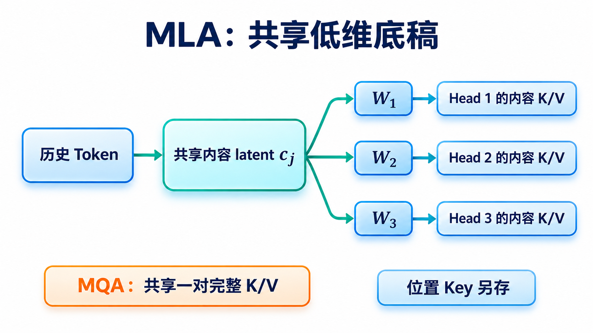
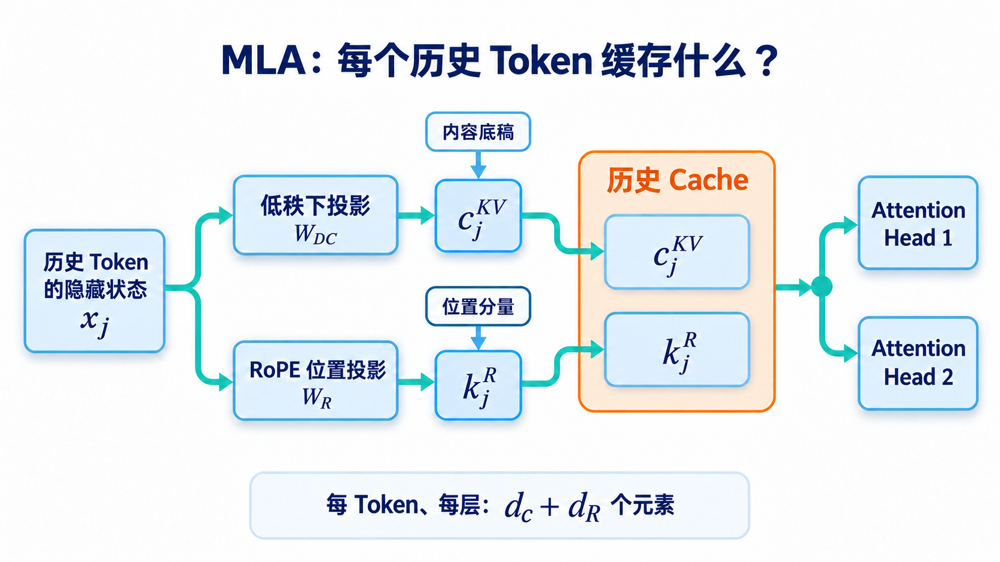

# 历史信息一定要存成完整的 K/V 吗？理解 MLA 的低维底稿

> [返回总览](../从原始Transformer到现代大模型：逐项理解架构演进.md)｜以[原始 Transformer 笔记](../transform.md)为基线。

读这篇之前，只需记住[MHA/MQA/GQA](02-MHA-MQA-GQA.md)的一点：它们改变**几组 Query 头共享一对完整 K/V**。MLA 试图进一步改变“历史 Token 必须把什么留在 Cache 中”。它仍有多个 Query 头，也仍要计算 Query 对历史的注意力分数。

## 为什么“减少份数”之后还要改“存储格式”？

GQA 像一间资料室：以前每个读者都有一整套档案，现在几个人共用一套。每套档案仍包含已经展开的 Key 和 Value。MLA 换了思路：资料室先留一份比较窄的**共同底稿**，不同读者用不同的读取规则从底稿中提取所需信息。历史位置越多，“每页窄一点”的节约就越明显。

图只画**内容**路径。左边每个历史 Token 写一份 $c_j^{KV}$；$W_1,W_2,W_3$ 表示训练得到的不同头的读取参数，**它们不是由 latent 生成的**。右侧“各头内容 K/V”是理解参数化方式的概念图；高效 Decode 可以重排线性运算，避免对每个历史位置逐头显式展开完整 K/V。与 MQA 的差别是：MQA 让多个 Query 头使用同一对已经形成的 K/V；MLA 让多个头从同一份低维输入取得不同内容信息。实际 MLA 还需单独缓存带 RoPE 的位置 Key，后面会说明。

先消除一个误会：这不是把旧模型的缓存拿来做 ZIP 压缩，再原样解开。模型在训练时就学习怎样把隐藏状态写成低维底稿，也学习各头怎样读。低维表示可能舍弃信息，模型必须在训练中适应这种限制。因此“缓存更窄”是架构选择带来的容量收益，质量和速度都需要实验验证。

## MLA：历史 Token 存一份压缩表示，各头按需使用

先暂时不管 RoPE，只问一个问题：**历史 Token $j$ 到来时，模型要为未来的 Query 留下什么？**

- **MHA**：为每个头分别留下 $K_j^{(1)},V_j^{(1)},K_j^{(2)},V_j^{(2)},\ldots$。未来每个头直接读取自己的那一对。
- **GQA**：几个 Query 头共用一对完整 K/V；缓存中仍然是一组组已经展开的 K/V。
- **MLA**：先把这一层的隐藏状态 $x_j$ 投影成一份较窄的向量 $c_j^{KV}$，未来各头用**不同的投影矩阵**从这份向量获得自己需要的内容信息。缓存主要保存这份共享的压缩表示。

可以把 $c_j^{KV}$ 理解成一份共同的“资料摘要”。它不是把一个已经训练好的 MHA Cache 原封不动地压缩成无损文件；**模型训练时就学习了如何写这份摘要，以及各头怎样读取它**。它也不是 MQA：MQA 的多个头直接共用**同一对完整 K/V**；MLA 的不同头可通过各自的上投影，从**同一个 latent**得到不同的内容 K/V。

把流程分成“写入”和“读取”：历史 Token $j$ 的隐藏状态先经降维投影，写入宽度为 $d_c$ 的共享 $c_j^{KV}$；未来不同头用各自的上投影，从同一份 $c_j^{KV}$ 取得内容 Key/Value。图中蓝色的 latent 是**一份共同底稿**，右侧两个 Head 的读取参数可以不同；这正是它与 MQA 直接共用完整 KV 的区别。

图还多画了一项 $k_j^R$。先记住结论：**实际 Cache 中是“内容摘要 $c_j^{KV}$ + 位置 Key $k_j^R$”两部分**；下文解释为什么需要第二部分。图只画历史侧，当前 Token 的 Query 由当前隐藏状态另行计算。

### 第一步：为什么存 latent 能减少 Cache？

取同一个**纯教学配置**：32 个 Query 头，每头内容维 128，所有历史位置的存储精度相同。对一个历史 Token、一层，四种设计可以这样比较：

| 设计 | 本例缓存的元素数 | 历史侧保存的东西 |
| :--- | ---: | :--- |
| MHA | $2\times32\times128=8192$ | 32 对完整 K/V |
| GQA（8 组） | $2\times8\times128=2048$ | 8 对完整 K/V |
| MQA | $2\times128=256$ | 1 对完整 K/V |
| MLA（示意） | $512+64=576$ | 512 维内容 latent + 64 维位置 Key |

$d_c=512,d_R=64$ 取自 [DeepSeek-V2 的维度设置](https://arxiv.org/html/2405.04434v5)，但表中的 32 个 Query 头**不是** DeepSeek-V2 的实际头数；原论文配置使用 128 个头。这个例子有意显示：MLA 可以显著小于某种 MHA/GQA 配置，却**不一定比 MQA 小**。比较真实模型时还要统一层数、序列长度、精度和并行分片。

“压缩”也不是事后对任意 MHA Cache 做无损压缩。模型从训练开始就学习降维投影，以及各头如何使用这份低维表示；换成 MLA 是改变 Attention 模块的参数化方式。

### 第二步：每次查询都把历史 K/V 完整恢复出来吗？

先用一个没有位置编码的微型例子想明白乘法重排。历史底稿是两个数 $c_j=[a,b]$，某头的 Key 读取矩阵把它变成四个数；如果历史有一万页，逐页展开就产生四万个中间数。另一种做法是先把**这一轮唯一的 Query**通过该矩阵的转置变到两维，再直接与每页的 $[a,b]$ 比较。需要读的一万页没有消失，但每页读取的是两维底稿，不必为每一页临时制造四维 Key。下面的式子只是证明这两种乘法顺序等价；读者先抓住“把重复的一万次展开移到当前 Query 一侧”这个动作即可。

若每次 Decode 都为所有历史 Token、所有头展开完整 $k_j^{C,(a)}$ 和 $v_j^{C,(a)}$，虽然 Cache 小了，却会增加大量计算和中间数据。MLA 的关键是**改变乘法顺序**。先只看不带位置编码的内容匹配：

$$
q_t^{C,(a)\top}k_j^{C,(a)}
=q_t^{C,(a)\top}W_{\mathrm{up},K}^{(a)}c_j^{KV}
=\bigl(W_{\mathrm{up},K}^{(a)\top}q_t^{C,(a)}\bigr)^\top c_j^{KV}.
$$

左边看似“先为历史 Token 恢复 Key，再和当前 Query 点积”；右边是“先变换**当前这个 Query**，再直接和历史的压缩向量点积”。两个式子相等，因为这里只涉及线性投影和点积。这样就无需为**每个历史位置**显式恢复完整内容 Key；Value 与输出投影也可以按线性运算的结合关系重排。这里仍有当前 Query 的投影和 Attention 计算，绝非“免费解压”。

Value 一侧可以用同样的线性分配律理解。某头先给历史位置算好注意力权重 $\alpha_{t,j}^{(a)}$，再取加权和：

$$
\sum_j\alpha_{t,j}^{(a)}W_{\mathrm{up},V}^{(a)}c_j^{KV}
=W_{\mathrm{up},V}^{(a)}\left(\sum_j\alpha_{t,j}^{(a)}c_j^{KV}\right).
$$

右边先对**小的 latent**求加权和，再对这一份结果做上投影。每个头的权重仍可不同，所以不是把所有头合成一个头。推理实现可以把相邻线性映射进一步合并；关键节省是无需对**全部历史位置**反复展开完整 V。[DeepSeek-V2 论文第 2.1 节](https://arxiv.org/html/2405.04434v5)

### 第三步：为什么还要额外保存位置 Key？

上一步能重排，有一个条件：$W_{\mathrm{up},K}^{(a)}$ 是**与历史位置无关的固定矩阵**。RoPE 却要按 Token 位置旋转 Q/K。若把位置 $j$ 的旋转直接套在完整内容 Key 上，位置相关的旋转矩阵会夹在投影与点积之间；不同 $j$ 要用不同旋转，便不能用一组固定矩阵把上一步的重排做完。

DeepSeek-V2 因此将匹配分成两部分：内容部分继续走可压缩、可重排的 $c_j^{KV}$ 路径；位置部分另算一个带 RoPE 的 Key $k_j^R$。当前 Token 的 Query 也有对应的位置分量。**内容匹配分数与位置匹配分数相加**，随后才做缩放和 Softmax；图中的两条缓存路径正对应这两部分。这里省略各头下标，完整定义见[DeepSeek-V2 论文第 2.1 节](https://arxiv.org/html/2405.04434v5)。

因此 DeepSeek-V2 式 MLA 的**每层、每历史 Token**缓存元素数是 $d_c+d_R$，而非仅 $d_c$，也不能套用 GQA 的 $2h_{kv}d$。它的 Query 侧还用了低秩投影，但那主要影响训练激活内存，不会再减少历史 KV Cache。以上描述按 [DeepSeek-V2 论文第 2.1 节](https://arxiv.org/html/2405.04434v5)解释；[DeepSeek-V3 技术报告](https://arxiv.org/abs/2412.19437)沿用 MLA 路线。具体模型的维度和实际推理收益要看配置与实现。

**一句话回顾：GQA 是“少放几对完整 K/V”；MLA 是“保存一份可供多头使用的压缩内容表示，并为 RoPE 另存一份位置 Key”。**

## 为什么不能把 RoPE 直接塞回底稿？

这是 MLA 最值得慢慢想的一步。内容 Key 可以由“固定的上投影 × 历史 latent”得到。因为上投影对所有历史位置都相同，计算时可以把它挪到**当前 Query 一侧**：当前 Query 只变换一次，便可逐个与历史 latent 比较。若完整 Key 又在位置 $j$ 上接受 RoPE 旋转，那么第 1 页、第 2 页……各自夹着不同的旋转；原来可共用的一次变换不能直接挪过去。若为了省事把每页都展开成完整 Key，Cache 虽窄，Decode 却可能重新付出大量展开成本。

DeepSeek-V2 式设计把问题拆开：**内容**留在可重排的 latent 中，**位置**另存较窄的旋转 Key。当前 Query 也分内容和位置两部分：内容分数看 latent，位置分数看额外 Key，两项相加后再决定注意力权重。它像把“这页写了什么”和“这页在第几页”分成两张卡，查询时共同参与判断。这个比喻只解释数据分工；具体实现仍按模型的线性投影和点积运算进行。[DeepSeek-V2 论文](https://arxiv.org/html/2405.04434v5)

## 它把代价移到了哪里？

读 MLA 图时可问三个问题。

首先，历史每个位置到底存了什么？答案是内容 latent 和位置 Key，不能只数 latent。其次，各头还独立吗？Query 头以及读取 latent 的参数仍可不同，但都受共享低维表示限制。最后，为什么容量小未必总是快？因为当前 Query 变换、位置分数、Softmax、latent 汇总与输出映射都仍要算；不同 Batch 与上下文长度会改变缓存带宽和计算之间的主次。若只看一张“压缩比例”表，就无法回答这三个问题。

历史 Cache 变窄，长上下文 Decode 时的显存占用和读带宽压力通常会下降；但当前 Query 需要额外投影，位置路径也要计算。具体内核还要处理低秩表示、各头的匹配与输出投影。因此“每 Token 缓存元素更少”不能直接推出“任意负载下延迟更低”。短上下文、不同 Batch、不同硬件上的瓶颈可能不同。

**Prefill 与 Decode 也要分开看。** Prefill 一次处理 Prompt 的许多位置，矩阵乘法和 Attention 可批量执行；Decode 每步通常只增加一个位置，却要读增长的历史 Cache。MLA 的缓存优势主要对准后者的历史状态压力，不能把它当成对所有训练和推理计算统一乘一个加速比。

## 检查自己是否理解

1. MLA 缓存 $c_j^{KV}$ 后，各 Query 头为何仍能不同？
2. 为什么先变换当前 Query，可以避免为每个历史 Token 展开完整内容 Key？
3. 为什么 DeepSeek-V2 式 MLA 还要缓存位置 Key？

Attention 这条演化线到此先告一段落。下一篇把视线移到每个 Token 的局部加工：[FFN 与门控](05-FFN与门控.md)。
