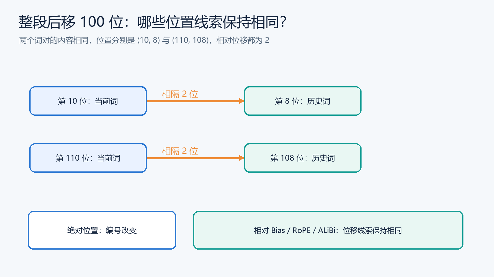
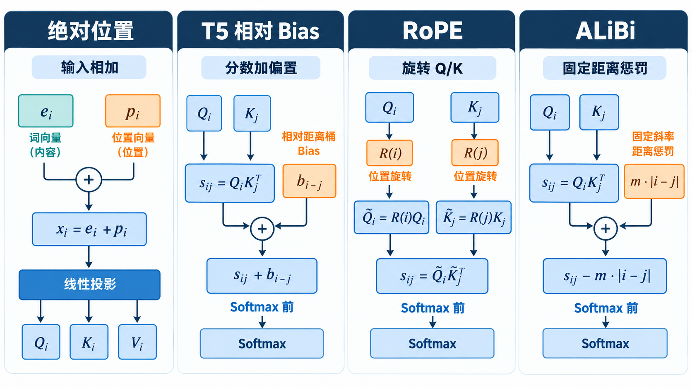

# 位置编码如何演化：绝对位置、相对 Bias、RoPE 与 ALiBi

> [返回总览](../从原始Transformer到现代大模型：逐项理解架构演进.md)｜以[原始 Transformer 笔记](../transform.md)为基线。

本篇只追一个问题：**同样两个 Token 相隔 2 位，模型怎样知道？** 没有位置线索时，自注意力能比较内容，却没有显式距离特征。绝对位置相加、T5 相对 Bias、RoPE 和 ALiBi 把位置放进了不同的计算环节，因此它们的能力和边界也不同。[原始 Transformer 论文](https://arxiv.org/abs/1706.03762)、[T5 论文](https://arxiv.org/abs/1910.10683)、[RoFormer 论文](https://arxiv.org/abs/2104.09864)、[ALiBi 论文](https://arxiv.org/abs/2108.12409)

## 如果把词卡片洗牌，模型会发现吗？

先不考虑因果掩码。Attention 的内容匹配只看各 Token 的向量：把「狗咬人」和「人咬狗」的词卡片交换位置，计算也跟着交换位置，但模型没有额外线索说明**第一位**和**第三位**有什么不同。语言却很在意顺序。位置编码就是给模型一套“坐标”，让它能区分谁在前、隔多远。

不过“给坐标”有不同层次。最早可以把写着位置的标签贴在每张词卡上；后来有人觉得，“当前词与被查看词相隔几格”才是 Attention 当下更需要的信息，于是把距离直接送到匹配分数；再后来，RoPE 让位置改变 Q/K 的几何方向，使内容匹配本身感知相对位移。ALiBi 则选择更朴素的固定距离惩罚。这几条路线是**对同一困难的不同取舍**，不是必须依次升级的版本号。

看例子「小猫 吃 鱼」与把整段前面插入 100 个 Token 后的同一短语。短语内部的「吃」与「鱼」仍相隔一格，但绝对编号变了。若任务重视局部关系，模型最好能利用这份共同性；若任务要精确知道“这是开头第几个字”，绝对位置信息又可能有用。不同方法在这两种需求间采取不同策略。

图中箭头是**当前 Query 读取历史 Key**，不是文本从左往右生成的方向。两行都相隔 2 位：绝对位置标签由 10/8 变为 110/108；T5 相对 Bias 的同一距离桶、RoPE 的相对旋转关系、ALiBi 的同一距离惩罚仍可共享位移线索。注意“共享相对位移线索”不等于两行最终 Attention 分数相等：真实 Q/K 还取决于上下文内容，且长距离的实际效果受训练范围等因素影响。

先抓住一个共同问题：在 Self-Attention 中，位置 $i$ 是否关注位置 $j$，最终由 **Softmax 之前的分数**决定。若只给一层无掩码的 Self-Attention 词向量，而完全不提供位置，交换两个 Token 的顺序会使输出跟着交换，却不会让模型知道“谁在谁前面”。因果掩码能限制未来位置不可见，但它本身仍没有明确告诉模型两个可见 Token **相隔多远**。因此要在计算中加入位置线索。

下面始终看同一对位置：当前位置 $i=10$ 要读取历史位置 $j=8$，两者相隔 $2$；若把整段文本整体后移，变成 $i=110,j=108$，相隔仍是 $2$。位置方法回答的是：模型如何利用这个“第几位”和“相隔几位”？

读图先看橙色的位置线索进入哪里：最左栏在 Q/K/V 生成前进入输入；T5 与 ALiBi 在 Softmax 前给分数加项；RoPE 先旋转 Q/K，再让相对位移影响点积。图省略了各方法共有的缩放和因果掩码，ALiBi 一栏的距离惩罚应按**负值**理解。四栏是不同路线，不要求模型按顺序采用。

## 第一步：把绝对位置加到 Token 表示上

原始 Transformer 把位置向量 $p_i$ 加到词向量 $e_i$：$x_i=e_i+p_i$。这样两个相同的词出现在不同位置时，输入向量也不同。位置编码只在底部加入一次，但此后的每一层都能通过隐藏状态间接使用它。原始论文使用不同频率的正弦、余弦；另一类实现把每个位置的 $p_i$ 作为可学习参数。[最初版本笔记](../transform.md)给出了完整公式。[原始 Transformer 论文](https://arxiv.org/abs/1706.03762)

**它怎样影响 Attention？** 图中 $e_i$ 与 $p_i$ 相加后才投影成 Q/K/V，因此点积里既有“内容对内容”，也有“内容对位置”“位置对内容”“位置对位置”的交互。说“绝对位置编码不能表达相对距离”并不准确：**模型有可能从这些交互中学到相对关系**。只是它必须从绝对向量的组合中学到这一点，而不是直接收到“两个位置相隔 2”的信号。正弦编码的设计还让固定位置偏移对应可表示的线性关系。

它留下两个问题。其一，模型没有直接收到“$i-j=2$”这个特征；它需要从 $p_{10},p_8$ 等绝对向量的组合中学会用距离。训练时常见的 $(10,8)$ 与很少见或没见过的 $(110,108)$ 虽然距离相同，绝对位置输入仍不同。其二，**学习式绝对位置表**通常只为有限位置建参数，超出表的范围需要扩展或另做处理；**正弦位置可以继续计算新位置**，但能计算不代表模型在未训练长度上必然表现好。

## 第二步：把“相隔几位”直接加到 Attention 分数上

若我们认为 $i=10,j=8$ 与 $i=110,j=108$ 至少应共享一部分“相隔 2 位”的信息，可以不先把位置混入词向量，而是在比较 Query 与 Key 时，额外给这一对位置一个偏置。T5 使用的简化相对位置方法可写为：

$$
s_{ij}^{(a)}=
\underbrace{\frac{q_i^{(a)}k_j^{(a)\top}}{\sqrt{d_k}}}_{\text{内容匹配}}
+\underbrace{b_{\text{bucket}(i-j)}^{(a)}}_{\text{相对位置偏置}}
+M_{ij},\qquad
\alpha_{ij}^{(a)}=\text{softmax}_{j}(s_{ij}^{(a)}).
$$

$a$ 是 Attention 头；$M_{ij}$ 是可见范围的掩码，作用与位置偏置不同。两个位置对只要落入同一个距离桶，就会得到同一项 $b$；例如前面的 $(10,8)$ 与 $(110,108)$ 都对应距离 $2$ 的桶。偏置是**加在 Softmax 前的 logits 上**，因此可直接提高或降低某个距离的注意力倾向，而不必完全依赖内容向量间接推断。

为什么要“分桶”？近距离的 $1$、$2$、$3$ 往往值得细分；很远的距离可以用更粗的桶覆盖，避免为每个可能的距离都学习独立参数。T5 的论文实现使用有限个桶，远到一定范围以外会落到同一桶。这样节省了位置参数，也带来限制：**单层位置偏置无法区分同一远距离桶内的精确距离**；模型仍可能通过其他层的内容传播获得更复杂的信息。[T5 论文第 2.1 节](https://arxiv.org/html/1910.10683)

这里解决的是绝对位置输入**没有显式共享相同位移**的问题；它并没有解决所有长上下文问题。偏置 $b$ 对同一个头、同一个距离桶是相同的，不会因为当前两个 Token 的具体内容不同而改变。内容匹配仍由 $q_i k_j^\top$ 决定；两部分是在分数上相加。

## 第三步：RoPE 让相对距离进入内容匹配本身

T5 的相对 Bias 是给点积分数**另加一项**。Rotary Position Embedding（RoPE）追求另一种形式：把 Q/K 的通道两两配对，位置 $t$ 对应旋转角度 $t\theta$，先按各自位置旋转，再做点积。记旋转后的向量为 $q'_i=R(i\theta)q_i$、$k'_j=R(j\theta)k_j$；图中间两条橙色路径就是这一步，V 不需要同样旋转。

旋转不改变向量长度。更重要的是，两个旋转后的向量做点积时，角度会相减：

$$
(q'_i)^\top k'_j
=q_i^\top R(i\theta)^\top R(j\theta)k_j
=q_i^\top R((j-i)\theta)k_j.
$$

于是 $(i,j)=(10,8)$ 与 $(110,108)$ 都让旋转部分看到 $j-i=-2$。举个只为说明几何关系的特例：若未旋转的 $q_i=k_j=(1,0)$，两者旋转后的点积就是 $\cos((j-i)\theta)$。真实模型里的 Q/K 取决于 Token 内容，因此分数同时取决于**内容向量与相对位移**，并非只由距离决定。

实际头维度远大于 2，RoPE 把通道两两配对，为不同通道对使用不同频率。它通常作用在 Q/K 上，不把位置向量直接加到输入，也不要求对 V 做同样旋转。这样避免把所有距离压进有限个可学习 Bias 桶，同时保留多频率的相对位置结构。[RoFormer 论文](https://arxiv.org/abs/2104.09864)

**RoPE 没有自动解决“训练短、推理无限长”。** 未训练过的巨大位移会带来未见过的旋转组合；不同频率还有周期性。上下文能否扩展，取决于训练长度、频率配置、是否做位置缩放或继续训练，以及实际任务评测。它与 T5 Bias 是不同路线，不能简单说一个在所有任务上都更先进。

## 另一条路线：ALiBi 用固定距离惩罚强调近期

Attention with Linear Biases（ALiBi）也直接改分数，但不学习每个距离桶的 $b$。对因果 Attention 的某个头，它在 Softmax 前给越远的历史位置越大的**负偏置**：距离乘以该头固定的正斜率，再从内容分数中减去。

记某个头的固定斜率为 $m_a$，它不是由训练学习出的距离表。例如只为直观理解，若 $m_a=0.1$ 且两处内容点积分数相同，距离 $1$ 的位置被减 $0.1$，距离 $10$ 的位置被减 $1.0$；Softmax 前者因此更有优势。不同头使用不同斜率，有的更偏向近处，有的惩罚远处较轻。[ALiBi 论文第 3 节](https://arxiv.org/html/2108.12409)

它针对的是**位置外推与训练长度成本**：线性距离公式对训练时未见过的更远位置也有定义，不需要扩展位置 Embedding 表或新增距离桶。论文在其语言建模设置中验证了“较短序列训练、较长序列推理”的效果。不过，“公式有定义”仍不是对任意长度任务的效果保证；固定的近期偏好也可能不适合必须精确找回远处信息的任务。ALiBi 与 T5 Bias 都是“给 logits 加项”，但前者是**固定线性距离规则**，后者是**按距离桶学习偏置**。

回看四栏图，T5 与 ALiBi 都在 Softmax 前改分数，但一个学习距离桶的偏置，一个使用固定线性惩罚。RoPE 则让位移进入 Q/K 的内容匹配。

## 把递进关系放在同一张表中

| 方法 | 相比前一类主要想解决什么 | 位置进入哪里 | 新的取舍 |
| :--- | :--- | :--- | :--- |
| 绝对位置相加 | 无位置时无法明确使用 Token 顺序 | 输入向量 $e_i+p_i$ | 相对距离需由模型从绝对信号中学到；学习式表有长度边界 |
| T5 相对 Bias | 让相同相对位移直接共享位置线索 | Softmax 前的分数，学习式分桶偏置 | 桶外或同桶内的远距离精度有限，偏置与内容独立 |
| RoPE | 让相对位移参与 Q/K 的内容匹配，而非另加桶偏置 | 先旋转 Q/K，再做点积 | 长度外推仍受训练和频率设置限制 |
| ALiBi | 用无位置表的规则探索更长长度 | Softmax 前的分数，固定线性惩罚 | 有明确的近期偏好，远距离检索要实测 |

这张表表达的是**问题推动出的设计分支**，不是所有模型都会按这四步依次升级。绝对位置、相对 Bias、RoPE 与 ALiBi 分别提供不同的归纳偏置；任务、训练长度与模型结构会决定取舍。还要始终把**位置机制**与**因果掩码**分开：前者告诉模型位置关系，后者规定哪些位置根本不能被看到。

## 一个两位置例子：位置 Bias 会怎样改变权重？

假设当前 Query 只看两个合法历史位置，它们的**内容匹配分数都为 0**。若位置方法给第一个位置加 $1$、第二个加 $0$，Softmax 后前者权重约 $0.73$，后者约 $0.27$。位置 Bias 因此能在内容相同的情况下改变偏好。

但 Bias 不是掩码：如果第二个位置的内容分数比第一个高很多，它仍可能获得更高权重。掩码则把不可见位置排除在 Softmax 外。T5 Bias 与 ALiBi 都在分数上起作用，区别是**前者学习每个距离桶的偏置，后者按固定斜率惩罚距离**。这也解释了为什么同一个 Bias 值不能单独说明模型最终关注了哪个词。

## 从“有位置”到“能外推”，中间还隔着什么？

读长上下文宣传时，至少区分三件事：位置规则能否对新位置**给出数值**；模型训练时是否**见过类似距离**；任务要求的是大致利用远处背景，还是**精确找回某个远处 Token**。

- 学习式绝对位置表若只建到某个最大位置，超出后需扩表、插值或另行处理。
- 正弦编码对新位置仍可计算，但网络不必然学会在远超训练长度时使用它。
- T5 的相对距离桶能覆盖更远位置，但多个很远的距离可能落入同一桶。
- RoPE 对新位置可以继续旋转，频率周期与未见过的位移组合仍会影响效果。
- ALiBi 的线性惩罚对更远位置有定义，同时也持续增强近期偏好。

所以“公式能算到 100 万位置”与“模型能在 100 万 Token 中可靠检索证据”不是同一个结论。应结合训练设置和具体任务评测，而不是只看位置编码名称。

## 检查自己是否理解

1. 为什么 $(10,8)$ 和 $(110,108)$ 能在 T5 Bias 中共享位移线索，而学习式绝对位置表不直接共享？
2. RoPE 改变的是输入向量、Attention 分数的加项，还是点积前的 Q/K？
3. 一个远处位置有位置编码，却被因果掩码遮住时，它能贡献 Attention 输出吗？

位置机制与 Query/KV 头数互不替代。若想理解另一条演化线，读[MHA、MQA、GQA](02-MHA-MQA-GQA.md)。
