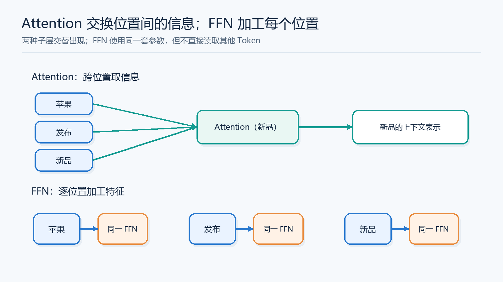
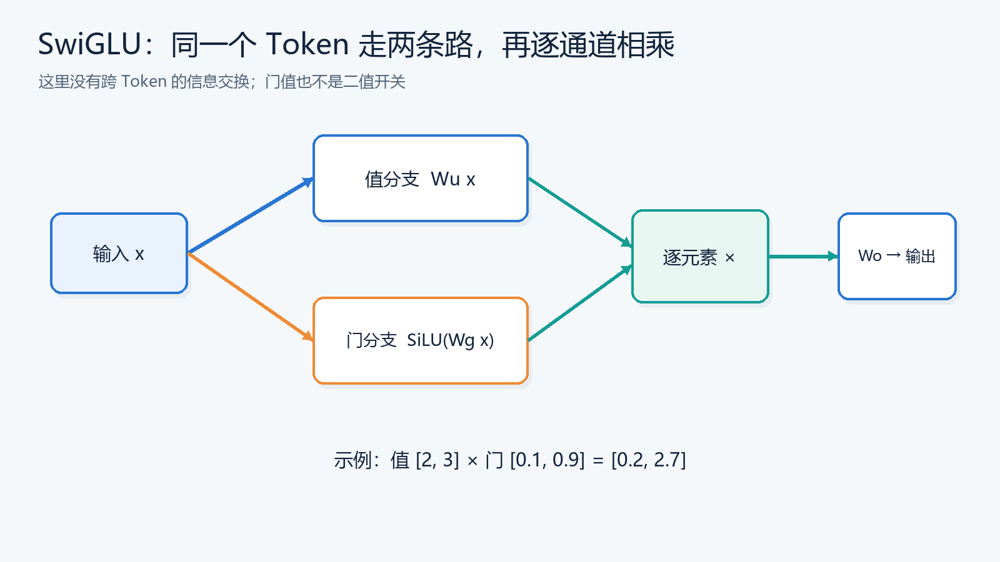
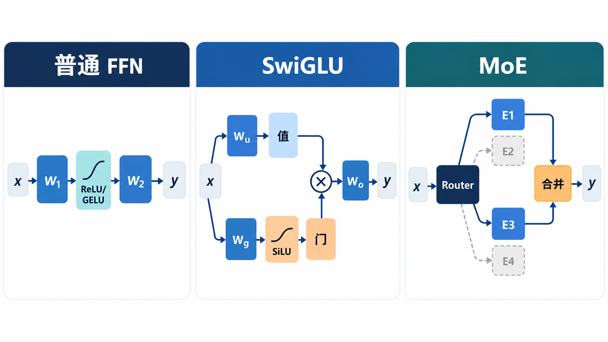

# FFN 与门控：从 ReLU、GELU 到 SwiGLU

> [返回总览](../从原始Transformer到现代大模型：逐项理解架构演进.md)｜以[原始 Transformer 笔记](../transform.md)为基线。

Attention 负责让 Token 从其他位置取得信息；FFN 负责对**每个位置已经得到的向量**做非线性特征变换。它对序列中不同 Token 使用同一套参数，却不会在 FFN 内直接把不同 Token 混合。先把这个分工弄清，再看为何从 ReLU 换到 GELU、又为何增加门分支。

## 先想一个只有两个 Token 的场景

输入是「苹果 发布」。Attention 让「苹果」能够参考「发布」，于是它的表示可能更适合后续判断“公司”相关语境。接下来 FFN 只接收**这个位置已经融合上下文的向量**，把其中的特征重新组合；「发布」也单独经过同一套 FFN 参数。FFN 并不会在内部再次查找另一个 Token。可以把 Attention 看作“到别处取材料”，FFN 看作“在本地加工材料”。

上半图只跟踪最后一词「新品」的输出：它从自己和左侧位置汇集信息，符合因果 Attention 的可见范围。下半图中三个 Token 都使用**同一套** FFN 参数，却各自加工自己的向量；图中的三只 FFN 框表示三次应用同一组权重，不是三套不同模型参数。这个区分解释了为什么换激活函数或增加门分支，不能代替 Attention 的跨位置通信。

为什么不只做一次线性投影？如果两次线性变换中间没有非线性，它们可以合并为一次线性变换，表达能力有限。中间的 ReLU、GELU 或门控乘法让模型能按输入情况改变特征组合。升维给中间通道更多空间，降维则把结果送回主干统一的隐藏维，以便残差相加和进入下一层。升维比例是模型设计与参数预算的选择，不是数学规定的四倍。

按图从左到右追踪一个 Token：两条分支**同时**读同一个输入，蓝色分支提供值，橙色分支计算连续的调节系数；青色乘法按通道对应相乘，再经输出投影回主干维度。图底的数值只演示乘法，不代表任何训练模型的实际激活。这里的“门”不是一个决定整枚 Token 去留的开关，也不等于下一篇 MoE 的 Router。

三栏从左到右分别改变了不同的东西：普通 FFN 只有一条扩维、激活、投回的路径；SwiGLU 在同一个 FFN 内增加一条门分支；MoE 在多套 FFN 中选择本次运行的 Expert。图中 MoE 的 E1/E3 仅是一次 Token 路由的示意，别的 Token 可以选其他 Expert。

## 普通 Dense FFN：换激活函数

原始 FFN 对每个 Token 的向量 $x\in\mathbb R^H$ 做同一套变换：$W_1$ 把隐藏维从 $H$ 扩到 $D$，ReLU 激活，再由 $W_2$ 投回 $H$。图的左栏就是这一条路径。

通常 $D>H$。序列中所有 Token 共用 $W_1,W_2$，但输入不同，输出自然不同。ReLU 对中间结果的负值通道直接输出 0，对正值原样通过。其优点是简单；代价是阈值附近不平滑，负值侧没有渐进的保留空间。

GELU 把门限改成随输入连续变化的权重：输入 $z$ 乘上标准正态分布的累计概率 $\Phi(z)$。比如 $z=-1$ 时，ReLU 输出 0，GELU 约为 $-0.159$；$z=1$ 时，GELU 约为 $0.841$。这说明它不是简单地“只保留正数”，而是平滑地调节通道贡献。**换激活函数没有改变 FFN 的连接方式**：仍是两次投影、所有 Token 共用一套权重，计算量仍主要来自两个矩阵乘法。[GLU Variants 论文](https://arxiv.org/abs/2002.05202)

## 门控 FFN：GEGLU 与 SwiGLU

门控结构将输入投影成**值分支**和**门分支**，逐元素相乘后再投回原维：

$$
\text{GatedFFN}(x)=W_o\bigl[\phi(W_gx)\odot(W_ux)\bigr].
$$

$\phi=\text{GELU}$ 常称 GEGLU；$\phi=\text{SiLU}$（$\text{SiLU}(z)=z\,\sigma(z)$）常称 SwiGLU。可按三个动作读公式：$W_ux$ 生成要传递的值；$\phi(W_gx)$ 为每个中间通道计算调节系数；两者逐元素相乘，再经 $W_o$ 合成输出。门的值并非只能取 0 或 1，也可能为负，因此“门控”表示连续调节，不能理解为硬开关。

为何需要额外的值分支？普通 FFN 的每个中间通道只由本通道激活后的数值决定；门控结构让一条投影的结果调制另一条投影的结果，形成更丰富的逐元素交互。代价是多一次大矩阵投影。忽略偏置时，普通 FFN 的主要参数量约为 $2HD$，门控 FFN 约为 $3HD_g$。若原本 $D=4H$，为了接近相同参数预算，可取 $D_g\approx 2D/3=8H/3$，而不是继续取 $4H$。这是预算推算，不是所有模型必须使用的宽度；实际效果还要看训练与具体配置。[GLU Variants 论文](https://arxiv.org/abs/2002.05202)

## 用两个中间通道看门控在做什么

假设值分支输出为 $[2,3]$，门分支经过激活后输出为 $[0.1,0.9]$。逐元素相乘得到 $[0.2,2.7]$：第一个通道被压低，第二个基本保留。这里的数字只为说明乘法，不代表某个训练模型的真实输出。实际 SiLU 门值也可能为负或超过这个示例范围，所以不能把它当成概率或二进制开关。

这与“换激活函数”有一个结构区别：ReLU → GELU 仍是**一条投影路径**；GEGLU/SwiGLU 是**两条由同一个输入产生的路径相互调节**。但门控也不是 Attention：在这一层 FFN 里，每个 Token 只变换自己的向量，没有在序列位置之间计算 QK 匹配。

## 为什么常见 512 → 2048 → 512，又为什么不能照搬？

原始 Transformer 的一个典型配置是模型隐藏维 $H=512$、FFN 中间维 $D=2048$。前一投影让每个 Token 在更宽的特征空间里组合，后一投影回到 $H=512$，以便下一层继续处理同维向量。[原始论文](https://arxiv.org/abs/1706.03762) 选择的是当时的结构配置；“四倍扩维”不是 Transformer 的数学定律。

门控 FFN 多了一个宽矩阵。若仍把两个分支各设成 2048，中间投影参数与主要乘法会比两矩阵 FFN 增多。要在相近预算下比较，应调整门控中间维，再观察任务效果。换句话说，**比较 ReLU、GELU、SwiGLU 时，最好同时写明中间维和总参数预算**，否则容易把“激活设计更好”与“给了更多参数”混在一起。

## 三次变化分别在补哪一块短板？

**ReLU → GELU** 主要动的是中间通道如何被激活。ReLU 在 0 左边直接归零，GELU 让靠近 0 的值按平滑程度贡献，负值也可能保留一部分。它们没有让不同 Token 相互通信，也没有添加第二条投影路径。可以想成同一条加工流水线换了一个筛选规则。

**普通 FFN → GEGLU/SwiGLU** 才是结构上的变化。值分支给出候选特征，门分支依据同一个 Token 的输入调节候选特征。一个通道的候选值大，不代表它一定通过；门分支也必须给它足够的系数。两条投影之间的逐元素乘法使输出对输入的依赖更丰富，但也带来第三个主要矩阵。因此比较效果时，若不给门控模型缩小中间宽度，就是给它更多参数和计算，难以判断收益来自结构还是预算。

**Dense FFN → MoE** 解决的是另一件事：模型想拥有很多套加工参数，却不想让每个 Token 都走完所有加工线。Expert 自己仍可以采用 SwiGLU；Router 选择的是哪套 FFN 被执行，门分支调节的是选中 FFN 内部哪些中间通道贡献更大。两级选择可以同时出现。

一个判断题能帮助区分它们：如果把句子长度从 10 个 Token 变成 100 个，单个 Token 在普通 FFN 或 SwiGLU 内会直接读取另外 99 个 Token 吗？不会。上下文信息应先由 Attention 等模块进入该 Token 的向量；FFN 再在本地处理这个向量。MoE 也通常遵守这个分工，只是把本地加工分配给不同 Expert。

[MoE 专篇](06-MoE.md)接着沿一枚 Token 追踪 Router、Expert、合并及跨卡通信。

## 检查自己是否理解

1. FFN 会直接把两个不同 Token 的向量相乘或求和吗？
2. ReLU → GELU 与普通 FFN → SwiGLU，哪一个改变了投影分支数？
3. 为什么比较两种 FFN 时必须同时看中间维与参数预算？
