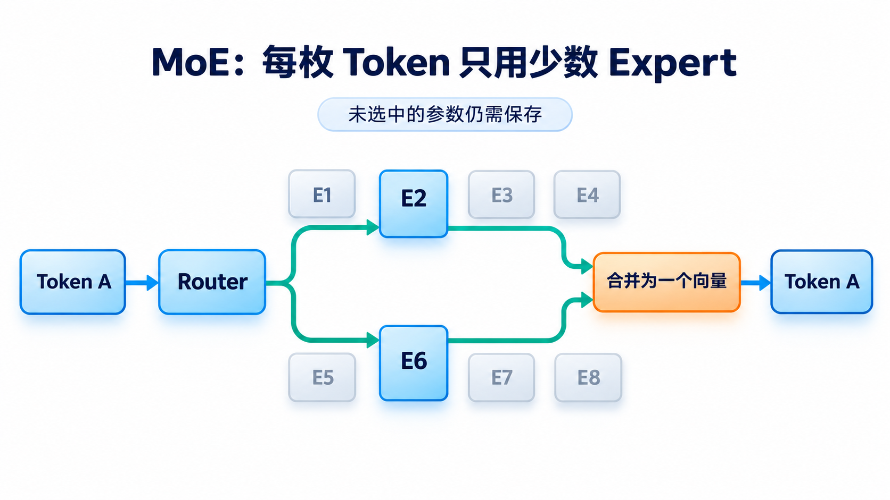
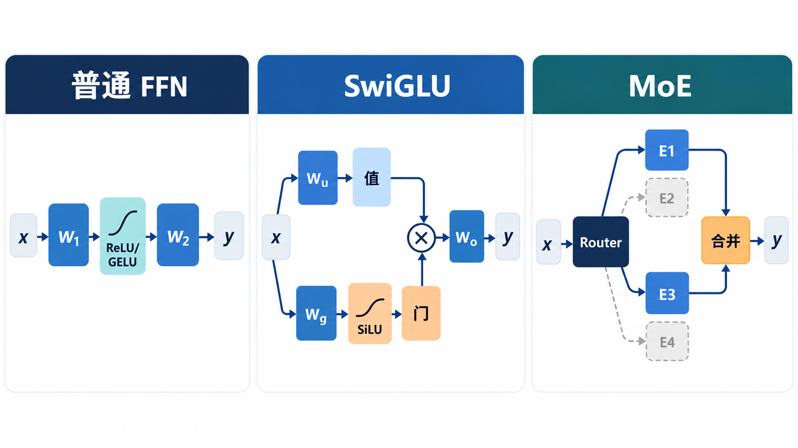
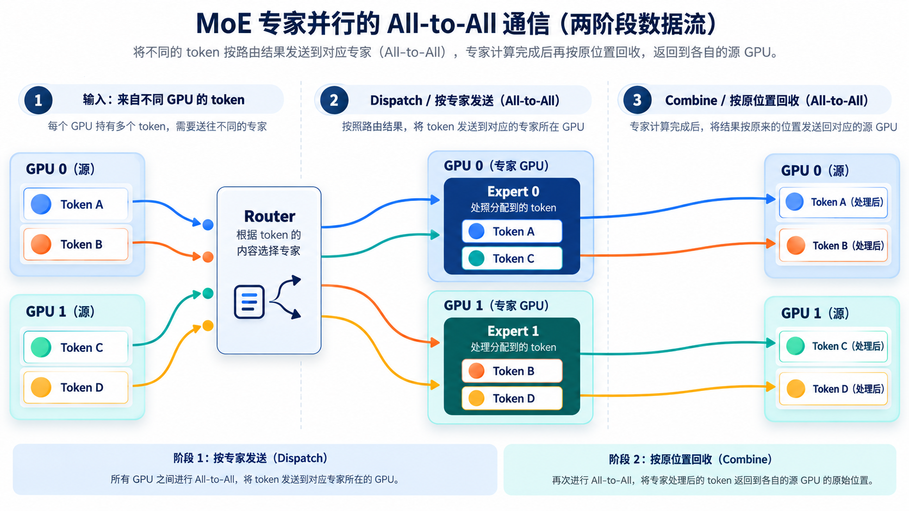

# MoE：为什么把一套 FFN 变成多套 Expert？

> [返回总览](../从原始Transformer到现代大模型：逐项理解架构演进.md)｜以[原始 Transformer 笔记](../transform.md)为基线。

先看[FFN 与门控](05-FFN与门控.md)：普通 Dense FFN 让每个 Token 经过同一套参数。若希望增加模型可存的特征与知识，却不让**每个 Token**都执行全部新增 FFN，便出现了稀疏 Expert 选择。MoE 的重点是**按 Token 选择参数路径**，不是改变因果 Attention 的可见范围。

## 先从“所有人都去同一个柜台”说起

普通 Dense FFN 像一个窗口：任何 Token 都交给同一套参数处理。把窗口做得更大，确实增加了模型容量，但每个 Token 都要做更多乘法。如果一次请求只有一些 Token 真正需要某类特征，也仍然要对所有 Token 执行全部参数。MoE 的想法是准备多套 FFN，让一个轻量 Router 为**每个 Token、在每个 MoE 层**选出少数几套。

图示八套 Expert 中选两套。浅灰 Expert **本次未计算**，但模型仍要存放其参数，因为下一个 Token 可能选中它。选中的两个 Expert 分别处理**同一个 Token 的当前向量**，结果按路由权重合并成一个向量。这里没有把一条句子固定分给某一个 Expert，也没有把 Attention 换成 Expert；通常被替换的是 Block 内的 FFN 位置。

### 跟着一个 Token 走完 Router 到合并

第一步，当前 Token 已经过本层 Attention，获得融合上下文的表示。第二步，Router 根据这个表示给 Expert 打分并选择 Top-$k$。第三步，若 Expert 分布在不同 GPU，系统把 Token 的表示送到相应设备；每个选中的 Expert 独立计算。第四步，将各 Expert 输出按模型规定的权重合并，送回原来的序列位置，继续残差与下一层。下一层可以再次路由，选择可能不同。

这个流程解释了“参数多但每 Token 计算少”的来历，也暴露了新的问题：热门 Expert 排队、冷门 Expert 闲置；跨卡来回发送 Token；每个 Expert 收到的 Token 太少时，矩阵乘法批量效率差。所以评估 MoE 时，除了参数量，还要看**每 Token 激活量、路由分布、通信和实际吞吐**。

本篇重点看右栏：Router 为一个 Token 选出两套 Expert，再合并两个输出。左栏的 Dense FFN 每次都走同一套参数；中栏 SwiGLU 是同一套 FFN 内部的门控。图中的 E1/E3 只是一轮示意，不代表固定 Expert 编号。

## MoE：把一套 FFN 换成可选择的多套 Expert

Mixture of Experts（MoE）在某些层把 Dense FFN 换成 $E$ 个 Expert（通常各自是 FFN）。Router 对每个 Token 产生分数，选择其中 $k$ 个；只有选中的 Expert 执行本次 FFN 计算，输出再按路由权重合并。图的右栏画的是四选二。

若 $E=8,k=2$，一个 Token 只运行两个选中的 Expert，而模型存有八套 Expert 参数。这使**总参数量**和**每 Token 激活的参数/计算量**不再同比增加。不能把“8 个 Expert”理解为“推理只需存 2 个 Expert”：不同 Token 的选择不同，服务仍需容纳可被路由到的权重。也不能把 “8×7B” 简单乘成总参数，因为 Attention 等非 Expert 参数通常是共享的。

这与[SwiGLU](05-FFN与门控.md)不同：SwiGLU 在**同一个 FFN 内调节中间通道**，MoE 在**多套 FFN 之间选择计算路径**。两者也可叠加，Expert 自身可以采用门控 FFN。

这里的“稀疏”主要指 Expert 计算。Router 仍需打分，公共 Attention 仍要运行；总权重仍需存放或在设备间分布。若大量 Token 都选同一 Expert，该 Expert 会拥塞，其他 Expert 闲置。实际训练/服务要处理负载均衡、Expert 容量、跨卡 Token Dispatch、Expert 批量大小与训练稳定性；增大 Expert 数不会自动带来等比例吞吐提升。Mixtral 使用每 Token top-2 的稀疏专家，Switch Transformer 探索 top-1，DeepSeekMoE 还引入更细粒度与共享 Expert 等设计。具体是否丢弃超容量 Token、如何平衡负载，依实现而异。[Mixtral 论文](https://arxiv.org/abs/2401.04088)、[Switch Transformer 论文](https://arxiv.org/abs/2101.03961)、[DeepSeekMoE 论文](https://arxiv.org/abs/2401.06066)

**MoE 是模型层的计算选择，EP 是把 Expert 分布到不同 GPU 的并行部署策略。** 两者不是同义词。跨卡 Token 如何发送，见[分布式并行策略](../大模型分布式并行策略_DP_TP_SP_PP_EP%20%281%29.md)和[GPU 通信篇](../大模型_GPU通信方式_NCCL与性能优化.md)。

## Router 的一次具体工作

### Router 到底是在选“知识”，还是选“计算路径”？

读者容易把 E1 想成“数学专家”、E2 想成“翻译专家”。训练后的 Expert 可能呈现某些偏好，但模型没有被要求把每个 Expert 固定成这样的人类学科分类。Router 看的是当前层的 Token 向量，输出的是本次要运行哪些参数路径；同一个词出现在不同上下文、不同层，路径都可能不同。选中某个 Expert 也不表示 Attention 只看那个 Expert 的 Token：跨 Token 的信息交换已经由 Attention 处理，MoE 在 FFN 位置对**当前 Token**做条件计算。

换成系统视角，Router 的决定还有物理后果。若 E3 在另一张 GPU，这枚 Token 的向量就要被发送过去，计算完再送回原序列位置；若同一批次太多 Token 都选 E3，它会成为排队瓶颈。于是路由不仅关乎质量，还影响负载均衡、Expert 批量和通信。这里的瓶颈无法仅靠“总参数很多、每 Token 只激活两个 Expert”这句话判断。

假设某层有四个 Expert，一个 Token 的 Router 分数按大小排为 $E_3>E_1>E_4>E_2$。若采用 top-2，本次只把这个 Token 送入 $E_3$ 与 $E_1$；两个输出按路由权重合并后，仍得到**一个** Token 向量交给下一层。下一层有自己的 Router，也可能选择别的 Expert；序列中另一个 Token 的选择也可能完全不同。

若这四个 Expert 的路由概率分别为 $E_3:0.60$、$E_1:0.25$、$E_4:0.10$、$E_2:0.05$，一种实现会在选中的 $E_3,E_1$ 内重新归一化，得到约 $[0.706,0.294]$ 后加权合并。这个数字仅解释“选择后合并”，**不是所有 MoE 模型统一使用的权重规则**；Top-$k$、Softmax 顺序和归一化细节需要看具体论文或代码。

Router 的输入是当前 Token 在这一层的隐藏状态，不是先读完一个 Expert 的输出再决定选谁。Router 通常只占很小的计算量，但它的选择会决定 Expert 的批量分布，进而影响效率和训练。

## 总参数与每 Token 计算为什么可以分开？

假设一个普通 FFN 有 $P$ 个参数，换成 8 个同规模 Expert 后，Expert 部分总共约 $8P$；top-2 让一个 Token 执行其中约 $2P$ 的 Expert 参数。还要加公共 Attention、Norm、Router 等参数与计算，所以全模型既不是“总参数乘 8”，也不是“每 Token 计算只剩四分之一”。真正的好处是**可用参数容量增长得比每 Token Expert 计算更快**。[Mixtral 论文](https://arxiv.org/abs/2401.04088)

| 数量 | 由什么决定 | 会怎样影响部署 |
| :--- | :--- | :--- |
| 总 Expert 参数 | Expert 数量与各自大小 | 需要存储或分布到设备上 |
| 每 Token 激活的 Expert | Router 的 Top-$k$、共享 Expert 规则 | 决定本次主要 FFN 计算量 |
| 每 Expert 收到的 Token 数 | 当前批次的路由分布 | 决定负载、批量效率与等待 |

DeepSeekMoE 一类设计还可能有**共享 Expert**：它们不受普通 top-$k$ 路由选择的同一规则约束，与路由 Expert 一起提供输出。读参数表时必须分清“总 Expert”“路由激活 Expert”和“共享 Expert”，不能只看一个 top-$k$ 数字。[DeepSeekMoE 论文](https://arxiv.org/abs/2401.06066)

## 为什么 Expert 很多也可能跑不快？

### 训练时 Router 会自然均匀分配吗？

不会保证。Router 的选择由当前参数和输入共同决定。假设 8 个 Expert 中有一个一开始稍擅长处理常见 Token，越来越多 Token 被送过去，它得到更多训练机会，可能进一步变热门；其他 Expert 的训练信号反而少。这类不平衡使“大量参数”变成“少数参数忙碌”。不同 MoE 设计因此引入负载均衡目标、容量限制或其他路由控制，但这些额外规则会影响训练行为，不能从 Top-$k$ 三个字符推断。[Switch Transformer](https://arxiv.org/abs/2101.03961)、[DeepSeekMoE](https://arxiv.org/abs/2401.06066)

以一个批次 800 个 Token、8 个 Expert、每 Token 选 1 个为纯示意，理想平均每 Expert 接收 100 个。若实际某个 Expert 接收 400 个，而另一个只接收 10 个，前者决定等待时间，后者的大部分计算能力闲置。Top-2 时总分配次数变为 1600，但每个 Token 最终仍合并回一个向量；真实分布依 Router 决定。训练中还需考虑梯度怎样传回 Router 与被选中的 Expert，未被选中 Expert 不会因为这一枚 Token 的 FFN 输出获得同样的更新。

### 为什么“激活参数少”还不足以说明速度？

Dense FFN 在一张 GPU 上通常能把一批 Token 合成大矩阵计算。MoE 先按目的地拆散 Token，Expert 若在不同 GPU，还需发送表示；算完再送回原位置。拆分、通信与合并都有开销，每个 Expert 的小批量也可能让矩阵乘法效率下降。于是 MoE 的优点更准确地说是**在一定每 Token 计算预算下扩大可用参数容量**；是否更快，取决于 Batch、Expert 放置、负载和互联。[Mixtral 论文](https://arxiv.org/abs/2401.04088)

第一个原因是**负载不均**。若大多数 Token 都选择同一个 Expert，热门 Expert 的队列长，其他 Expert 闲置。训练常需负载均衡机制；不同实现对 Expert 容量、溢出 Token、辅助损失的处理并不相同。[Switch Transformer 论文](https://arxiv.org/abs/2101.03961)

第二个原因是**通信和小批量**。Expert 分布在不同 GPU 时，Token 必须按目的地 Dispatch，计算后再 Combine 回原序列位置。这可能形成两次跨设备交换；如果每个 Expert 收到的 Token 很少，矩阵乘法也难以形成高效批量。

图只画每个 Token 分配给**一个** Expert 的通信路径。若是 Mixtral 这样的 top-2，单个 Token 会到两个被选中的 Expert，再把两路输出合并；通信量与路由分布因此也要重新考虑。它解释的是**跨卡部署路径**，模型在一张足够大的设备上运行 MoE 时仍可采用相同的 Router/Expert 数学结构。[Mixtral 论文](https://arxiv.org/abs/2401.04088)

## 检查自己是否理解

1. 为什么 8 个 Expert、top-2 不等于只需存 2 个 Expert 的权重？
2. SwiGLU 的“门”和 MoE Router 的“路由”各在什么层次发生？
3. 什么情况下增加 Expert 数可能让吞吐受通信或负载限制？

最后把这些独立变化放回具体模型，沿着一个 Token 的完整路径阅读：[按模型组合架构](09-按模型组合架构.md)。
