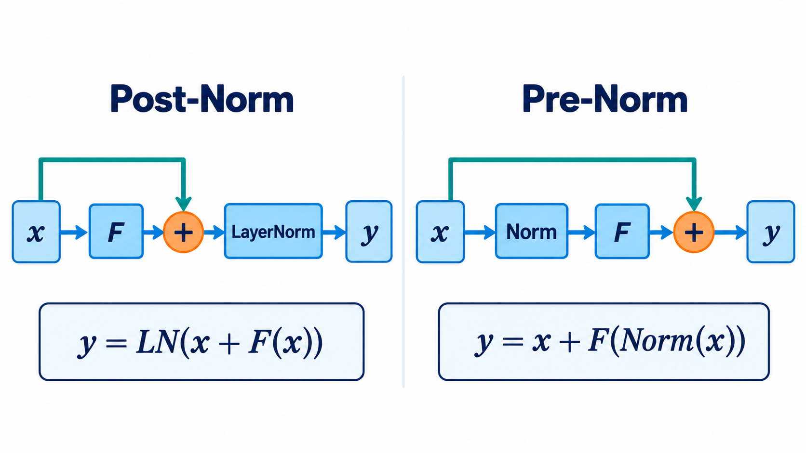
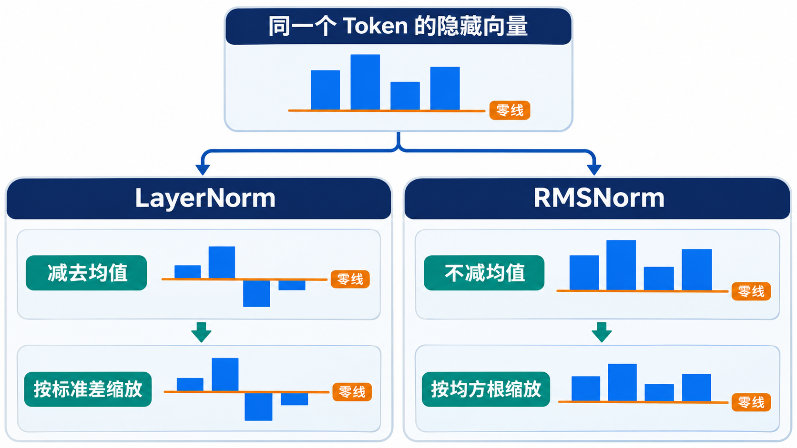

# 归一化与残差：Post-Norm、Pre-Norm、LayerNorm、RMSNorm

> [返回总览](../从原始Transformer到现代大模型：逐项理解架构演进.md)｜以[原始 Transformer 笔记](../transform.md)为基线。

这里有两道**独立选择题**：Norm 放在子层前还是残差相加后？Norm 对一个向量究竟做什么计算？“Pre-Norm RMSNorm”只是两道题的一个组合，不能把 Pre-Norm 当成 RMSNorm 的别名。

## 先看深层网络遇到的两个麻烦

想象一条消息要连续经过几十个编辑站。每站的 Attention 或 FFN 都可以改写它；若每次都只能接受改写结果，原信息和训练时的梯度都容易在长路径中被改变。**残差连接**给每站一条直接转发原消息的通道，让子层学的是“在原消息上加什么”。另一边，向量数值在反复变换后可能变得尺度不合适；**Norm** 把输入或输出调到更可控的尺度。

二者结合时出现一个关键顺序问题：先改写并与原消息相加，再调尺度（Post-Norm）；还是先调好送进子层的副本，子层的改写结果再加回未改写的原消息（Pre-Norm）？下图中的蓝色直通线能帮你看到差别。讨论这一顺序时先暂时把 Norm 当成一个黑盒；随后才打开它，比较 LayerNorm 与 RMSNorm 的内部计算。

## Post-Norm 与 Pre-Norm 的路径差别

对一个子层 $F$，原始 Transformer 的 Post-Norm 是：

$$
y=\text{LN}(x+F(x)).
$$

Pre-Norm 则先归一化再送入子层：

$$
y=x+F(\text{Norm}(x)).
$$

两条路径的区别在于 Norm 位于残差相加之后还是子层计算之前；图中 $F$ 代表 Attention 或 FFN 子层。

先看前向信息流。Pre-Norm 让原输入 $x$ 不经改写就进入残差加法，子层只提供增量 $F(\text{Norm}(x))$；Post-Norm 则先把增量与输入相加，再把总和归一化。两者即使用同一个 LayerNorm、同一个 Attention，得到的函数也不相同。

反向传播时，沿图中的残差主线往回看：Pre-Norm 的梯度有一条不经过 Norm 的直通路径；Post-Norm 的残差相加之后仍要穿过 Norm。多层叠加时，这个路径差别会影响初始化阶段的梯度。已有分析发现，在其研究设置下 Post-LN 的靠近输出层梯度可能较大，学习率 warm-up 对其更关键；Pre-LN 的初始化梯度更容易控制。**这只是解释训练稳定性的一个机制**，并不保证任意深度都稳定，也不能单凭 Norm 顺序判断最终质量。[LayerNorm 位置分析论文](https://arxiv.org/abs/2002.04745)

一个 Pre-Norm Block 通常先做 **Norm → Attention → 残差相加**，再做 **Norm → FFN → 残差相加**。第二个 Norm 的输入是第一次残差相加后的表示，不是最初的 $x$。因此“Pre-Norm”也不表示整个模型只在最开始归一化一次；每个子层前仍有自己的 Norm。

## LayerNorm 与 RMSNorm 的计算差别

对于单个 Token 的隐藏向量，LayerNorm 先减去**该向量的均值**，再除以标准差，最后做可学习的缩放和平移。RMSNorm 不做减均值，只按该向量的均方根调整尺度，再做可学习缩放。两种运算的差别是“是否中心化”，与上一小节的 Pre/Post 位置选择相互独立。需要精确实现式时可读[RMSNorm 论文](https://arxiv.org/abs/1910.07467)和[原始 Transformer 笔记](../transform.md)。

图中的柱高只表达归一化步骤，省略了后续可学习缩放与平移，不代表某次真实模型输出；两栏处理的是**同一个 Token 的隐藏向量**，并非跨 Token 统计。下方的小例子给出可核算的数值差别。

两者都通常沿**单个 Token 的隐藏维**计算，而不是在不同 Token 之间求全局均值。RMSNorm 少了中心化这一步，但“少一步”不自动推出任何硬件上固定的加速比例。Llama 2 采用 Pre-Norm RMSNorm；原始 Transformer 是 Post-Norm LayerNorm。T5 则有自己的归一化实现，不能仅因它是 Pre-Norm 就说它与 Llama 完全一样。[RMSNorm 论文](https://arxiv.org/abs/1910.07467)、[Llama 2 论文](https://arxiv.org/abs/2307.09288)

一个二维小例子能看出差别。先忽略 $\epsilon$，设 $\gamma=1,\beta=0$，输入 $x=[1,3]$：LayerNorm 减去均值 2，再除以标准差 1，得到 $[-1,1]$；RMSNorm 用均方根 $\sqrt5$ 缩放，得到 $[1/\sqrt5,3/\sqrt5]$。如果把两个分量都加 10，LayerNorm 的结果仍是 $[-1,1]$，RMSNorm 的结果会变化。前者同时消除整体平移与尺度变化；后者主要控制尺度，保留均值信息。这就是 RMSNorm 简化计算时选择放弃的性质。[RMSNorm 论文](https://arxiv.org/abs/1910.07467)

读模型配置时要做两个独立判断：**Pre/Post 决定 Norm 在残差块中的位置；LayerNorm/RMSNorm 决定这个 Norm 对向量做什么运算。** “Pre-Norm RMSNorm”是两个选择的组合，不是一种不可拆开的新算子。

## 把两个子层连起来看残差路径

一个典型 Block 不只有 Attention，还包含 FFN。Pre-Norm 的读取顺序是：输入 $x$ → Norm → Attention → 加回 $x$，得到中间表示 $u$；然后 $u$ → 第二个 Norm → FFN → 加回 $u$。所以第二次 Norm 看到的是已经融合了 Attention 输出的表示，不是原始输入。[Llama 2 论文](https://arxiv.org/abs/2307.09288)

若堆叠很多层，Pre-Norm 每次加法都保留一条从输入直接通向下一层的路径。反向传播时，梯度可以沿这些加法路径回到较早层；这就是图中“残差直通线”在训练中的意义。Post-Norm 虽然也有残差加法，但每次相加后的总和都会经过 Norm，所以同一条梯度路径还受 Norm 导数影响。论文在特定初始化与训练设置下分析到 Post-LN 输出附近的梯度可能偏大，并解释了 warm-up 的作用；**不能由此断言所有 Post-Norm 都训练失败，或所有 Pre-Norm 都无需 warm-up**。[Pre-LN/Post-LN 分析论文](https://arxiv.org/abs/2002.04745)

从前向传播看，顺序也影响“残差保留了什么”：Pre-Norm 让原向量直接相加，子层提供增量；Post-Norm 会在相加后重新调整整体向量。二者即使使用同样的 Attention、FFN 和训练数据，也不是同一个函数。比较模型时不要只看 Norm 名称，还要看**加法发生在它前面还是后面**。

## 用平移例子看 LayerNorm 与 RMSNorm 的取舍

上面的 $[1,3]$ 例子里，LayerNorm 先减去均值 2，得到 $[-1,1]$；RMSNorm 不减均值，所以两个分量仍为正。现在把输入整体加 10，变成 $[11,13]$：LayerNorm 在忽略 $\epsilon$ 且固定可学习参数的条件下，标准化部分仍是 $[-1,1]$；RMSNorm 的分母与输出都会改变。

这揭示了两种不同的不变性：LayerNorm 对整体平移不敏感，同时控制尺度；RMSNorm 保留整体偏移，只控制均方根尺度。RMSNorm 少做中心化并不表示“更正确”，而是以更简单的计算换一种归纳偏置。实际速度还要看硬件、内核融合、张量大小与训练配置，不能从公式少一步直接推定固定百分比。[RMSNorm 论文](https://arxiv.org/abs/1910.07467)

## 沿着一次反向传播再读 Pre-Norm

训练时，模型要从最终 Loss 往前给每层参数传递“怎样改会更好”的信号。对 Pre-Norm 的一步 $y=x+F(\mathrm{Norm}(x))$，输出包含一份直接的 $x$。反向走到加号时，一路进入 $F$，另一路可以直接回到 $x$。很多层串起来，便存在一条连续的直通路径。它不表示子层不参与学习，也不表示梯度大小永远不变；它说明至少有一条路径不必每层都先通过 Norm 与子层的导数。

Post-Norm 的 $y=\mathrm{Norm}(x+F(x))$ 则把相加后的结果再送进 Norm。反向信号即使走残差支路，也先经过这一层 Norm。深层训练的稳定性受初始化、学习率、warm-up 等因素共同影响，不能把两种路径简化成“一个能训练、一个不能”。原始 Transformer 成功使用了 Post-LN；后来许多深层语言模型采用 Pre-Norm，是对训练路径做不同取舍。[原始 Transformer](https://arxiv.org/abs/1706.03762)、[Pre-LN/Post-LN 分析](https://arxiv.org/abs/2002.04745)

再看 LayerNorm 与 RMSNorm。它们处理的是**同一枚 Token 的不同隐藏通道**，通常每枚 Token 各算一次。若把一个向量的所有分量同时加 10，LayerNorm 的中心化会抵消这次整体平移；RMSNorm 不中心化，仍能感知均值改变。RMSNorm 以更简单的统计量控制尺度，具体模型是否选它，取决于效果与实现成本。把“Norm 放在哪里”和“Norm 算什么”分开，才读得懂例如 Pre-Norm + RMSNorm 这样的组合。

## 常见误读

| 说法 | 应怎样理解 |
| :--- | :--- |
| “Pre-Norm 就是 RMSNorm” | Pre-Norm 是位置，RMSNorm 是计算；也能有 Pre-Norm LayerNorm。 |
| “Norm 在所有 Token 上求均值” | 这里讨论的 LN/RMSNorm 通常沿**单个 Token 的隐藏维**统计。 |
| “有残差就一定容易训练” | 残差路径如何经过 Norm、初始化与学习率配方都会影响梯度。 |
| “RMSNorm 总比 LayerNorm 快固定比例” | 算子与硬件实现会改变实际差距。 |

## 检查自己是否理解

1. 对 Attention + FFN 的 Pre-Norm Block，第二个 Norm 的输入是谁？
2. 哪种放置方式让残差加法之后还必须经过 Norm？
3. $[1,3]$ 整体加 10 后，哪种归一化的标准化部分保持不变？
