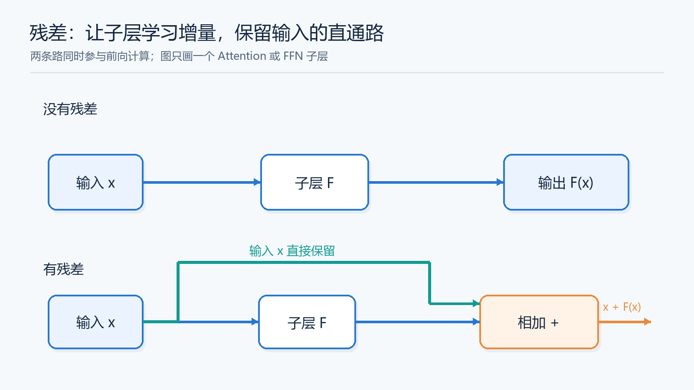
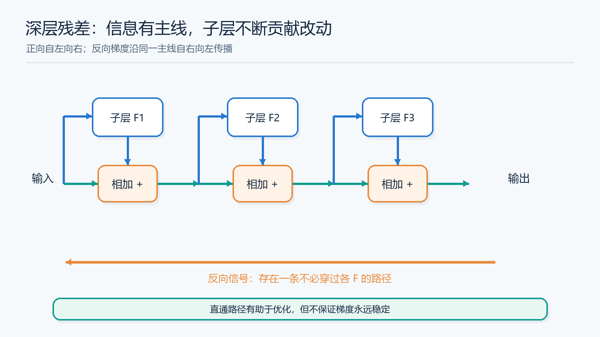
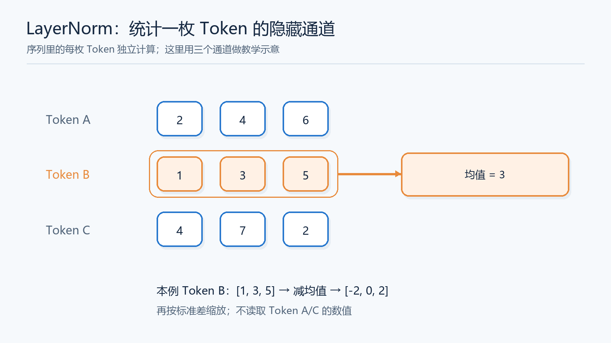

# 残差与归一化：深层 Transformer 为什么需要两条“安全通道”？

> [返回总览](../从原始Transformer到现代大模型：逐项理解架构演进.md)｜前置知识只需知道：Attention 负责读取其他 Token，FFN 负责加工当前 Token。本文的 $F$ 代表其中任意一个子层。

假设要让一条信息经过几十个编辑员。每个编辑员都能改写它。理想情况是：确实发现新线索时才修改；没必要修改时，原样传下去。深层网络也有这个需要，但它还多了两件麻烦：训练信号要从最后一层逆行回第一层，各层看到的向量尺度也可能随训练而变。**残差连接**和**归一化**分别从“保留通路”和“控制输入尺度”切入；它们不是一回事，后来又因先后顺序出现 Post-Norm 与 Pre-Norm 两种写法。

## 第一关：为什么直接堆很多子层不好学？

先看没有残差的网络：$x_1=F_1(x_0)$，$x_2=F_2(x_1)$，一路到 $x_N$。如果某层对当前任务帮不上忙，最理想的是让它暂时**什么也不改变**。但普通子层必须靠内部许多参数共同学出近似恒等映射；对复杂的 Attention/FFN 来说，这并不是自动发生的。更棘手的是反向传播：最后的 Loss 想告诉最早的层如何修改，信号必须连续经过每层的导数。某些方向反复缩小，早期层得到的信号就弱；反复放大，也可能难以稳定优化。

残差把每站改成 $y=x+F(x)$。现在 $F$ 只需学习“应该补多少”，而不必从零重造整份 $x$。若这一站暂时没学到有用改动，让 $F(x)$ 接近 0，输出就接近输入。图中的上路保留 $x$，下路计算增量，最后相加。**“接近 0”是可能的学习目标，不表示训练后每个 Block 都不做事。** 残差思想来自更早的深层网络研究，原始 Transformer 把它用在 Attention 和 FFN 子层周围。[ResNet 论文](https://arxiv.org/abs/1512.03385)、[原始 Transformer 论文](https://arxiv.org/abs/1706.03762)

读图时不要把上路当成“跳过本层计算的开关”：实际前向中两条路同时存在，输出是两者之和。它给模型一个保留已有信息的便利路径，也给反向传播一条不必经过 $F$ 内部所有导数的路径。

### 一枚 Token 的小例子

设当前向量只画两维 $x=[2,1]$。某层学出的增量是 $F(x)=[0.1,-0.2]$，输出便是 $[2.1,0.8]$：第一项略增强，第二项略减弱。如果它要完全保留原状，只需输出 $[0,0]$。这比要求整个复杂子层恰好把 $[2,1]$ 原样复制出来更容易形成一条可优化的路径。实际模型的向量有成百上千维，增量也不一定小；这个两维例子只帮助理解**学习改动**的含义。

### 残差为什么有助于梯度？

看一步 $y=x+F(x)$：输出对输入的变化，包含一份来自加号的直接贡献，以及一份经过 $F$ 的贡献。多层连接时，至少存在“沿各层加号直走”的路径。下图把它画成一条蓝色主线，旁边每个 $F_i$ 都可以向主线注入信息、接收训练信号。这并不保证梯度总是合适，也不能替代初始化、学习率等设计；它说明深层网络为什么不必让**所有**信号都穿过一长串复杂变换。[Identity Mappings in Deep Residual Networks](https://arxiv.org/abs/1603.05027)

## 第二关：有了直通线，为什么还要 Norm？

残差保留了信息，但每层仍要读取一个向量去计算 Q/K/V 或 FFN。训练中，前面层的参数一直在更新，后面子层看到的数值范围也可能改变。举个纯数值例子：同一个 FFN 的输入有时是 $[1,2,3]$，有时整体放大成 $[100,200,300]$；相同的权重会产生截然不同的中间数值，非线性激活和优化过程也会处在不同尺度。**Norm 给每个位置的隐藏向量建立较可控的尺度**，让子层不必对任意数值范围都同样敏感。它并不会让所有 Token 变成同一个向量，也不会阻止模型通过可学习参数保留有用差异。[Layer Normalization 论文](https://arxiv.org/abs/1607.06450)

注意统计范围：Transformer 中讨论的 LayerNorm/RMSNorm 通常对**一枚 Token 的隐藏通道**计算统计量。若一批有 20 个 Token，每枚 Token 各自算自己的均值或均方根；不是把 20 个 Token 混成一组求平均。这一点与依赖 Batch 统计的 BatchNorm 不同，也让同一 Token 在训练和单条推理时使用一致的归一化规则。

这张图只解释统计范围与数值尺度；其余 Token 不参与这枚 Token 的均值计算。Attention 仍可在前后层让 Token 互相交换信息，Norm 本身只处理当前向量。

## LayerNorm 到底怎么算？RMSNorm 又省掉什么？

LayerNorm 对一枚 Token 的向量先求隐藏通道的均值，再把每一维减去这个均值，最后按标准差缩放；后面还有可学习的逐维缩放与平移。用 $x=[1,3]$ 做一个不计稳定项、可学习参数取默认值的例子：均值是 2，减均值得到 $[-1,1]$，标准差是 1，结果仍是 $[-1,1]$。若把输入整体加 10 变成 $[11,13]$，标准化结果依然是 $[-1,1]$。也就是说，它**消除整体平移，并调整尺度**。

RMSNorm 省掉减均值，只用平方平均后开根号得到尺度。对 $[1,3]$，均方根是 $\sqrt5$，所以标准化部分为 $[1/\sqrt5,3/\sqrt5]$；整体加 10 后，结果会改变。它保留了与整体偏移有关的信息，主要控制尺度，再乘可学习的逐维缩放参数。它不是“算错的 LayerNorm”，而是有意舍弃中心化，换来不同的计算与归纳偏置。[RMSNorm 论文](https://arxiv.org/abs/1910.07467)

图把“减均值”与“只按均方根缩放”的区别画出来，省略了可学习参数。完整实现还会加一个很小的 $\epsilon$，避免分母过小。这里讨论的归一化不是把向量长度一律变成 1，也不是 Softmax；后两者的运算目标不同。

| 给一枚 Token 的向量做什么 | LayerNorm | RMSNorm |
| :--- | :--- | :--- |
| 减去该向量的通道均值 | 是 | 否 |
| 根据该向量的尺度归一化 | 是，使用标准差 | 是，使用均方根 |
| 可学习参数 | 通常有逐维缩放和平移 | 通常有逐维缩放 |
| 整体加同一个常数后，标准化部分 | 不变 | 一般会改变 |

**“RMSNorm 少一步所以一定快固定比例”是不成立的。** 实际时间取决于张量形状、内核融合与硬件；效果也必须看模型和任务。Llama 系列的一些版本采用 RMSNorm，不意味着所有 Transformer 都必须替换 LayerNorm。[Llama 2 论文](https://arxiv.org/abs/2307.09288)

## 第三关：Norm 放在残差加法之前，还是之后？

这里要把两道选择题分开：**LayerNorm/RMSNorm 是 Norm 的算法；Pre/Post-Norm 是把它放在哪里。** 同一种 LayerNorm 可以被放在前，也可以放在后。原始 Transformer 的 Post-Norm 先让子层读取 $x$，把结果加回 $x$，最后 Norm：$y=\mathrm{Norm}(x+F(x))$。Pre-Norm 先 Norm 出一份送给子层的输入，再把子层结果加回未经过这次 Norm 的 $x$：$y=x+F(\mathrm{Norm}(x))$。

请沿蓝色残差线读图。Pre-Norm 的蓝线到加号之前没有穿过 Norm，因此从输出往回传梯度时，这条线也不必先经过该 Norm。Post-Norm 虽也有残差相加，但加号之后还有 Norm，输出和回传信号都经过它。一个 Block 有 Attention、FFN 两个子层时，Pre-Norm 通常各放一处 Norm：先 Norm → Attention → 加回；再对**第一次加回后的表示**做 Norm → FFN → 加回。第二次 Norm 读的不是本 Block 最初的输入。

为什么会从 Post-Norm 走向 Pre-Norm？原始 Transformer 用 Post-Norm 成功训练，但模型更深时，训练初期的梯度与学习率安排变得更敏感。对特定初始化和设置的分析发现，Post-LN 靠近输出的参数梯度可能较大，学习率 warm-up 很重要；Pre-LN 在该分析中使初始化梯度更易控制。直通残差路径是理解这一差别的核心直觉。**它不是“Post-Norm 无法训练”的证明，也不是“Pre-Norm 绝对稳定”的保证。**[Pre-LN/Post-LN 分析论文](https://arxiv.org/abs/2002.04745)

## 用一张“选择表”读模型配置

| 问题 | 可选项 | 它改变什么 |
| :--- | :--- | :--- |
| 如何让原信息与梯度有较直接的路径？ | 残差相加 | $x$ 与子层增量一起进入下一步 |
| Norm 的内部规则是什么？ | LayerNorm / RMSNorm | 对当前 Token 的隐藏通道如何调整中心和尺度 |
| Norm 放在哪里？ | Post-Norm / Pre-Norm | 子层输入与残差主线怎样经过 Norm |

因此“Pre-Norm RMSNorm”只是后两行的一个组合；“Post-Norm LayerNorm”是原始 Transformer 的组合。二者的注意力头数、位置编码或 FFN 激活函数还可以继续独立选择。看到一个现代模型配置时，请先画出**输入、Norm、Attention/FFN、加号**的顺序，再去看归一化名字。

## 读完后试着自己解释

1. 如果某层暂时不需要修改输入，没有残差和有残差时，各要怎样做到“近似原样传递”？
2. 残差提供直通路径后，为什么后续子层看到的向量尺度仍可能是问题？
3. $[1,3]$ 整体加 10 后，LayerNorm 与 RMSNorm 的标准化部分哪一个保持不变？
4. 在 Pre-Norm 的 Attention + FFN Block 中，第二个 Norm 的输入是谁？

下一篇把这些 Block 放进逐词生成，解释为什么要保存历史状态：[KV Cache](08-KV-Cache.md)。
