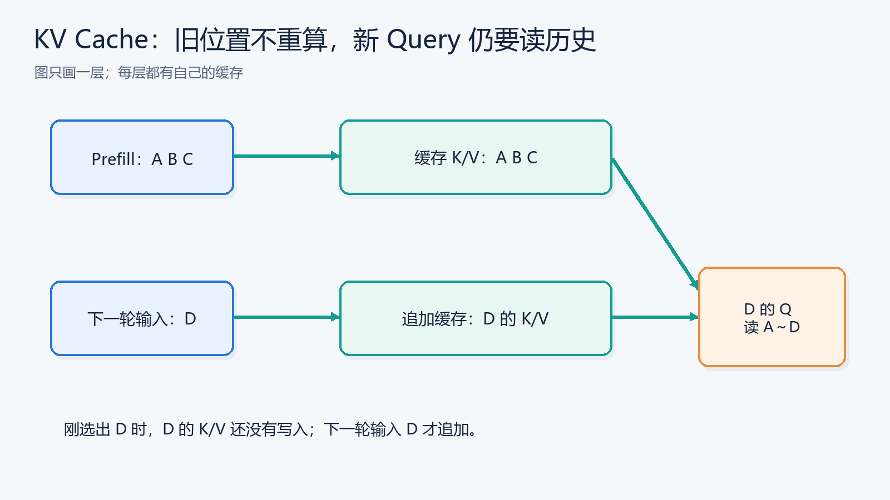
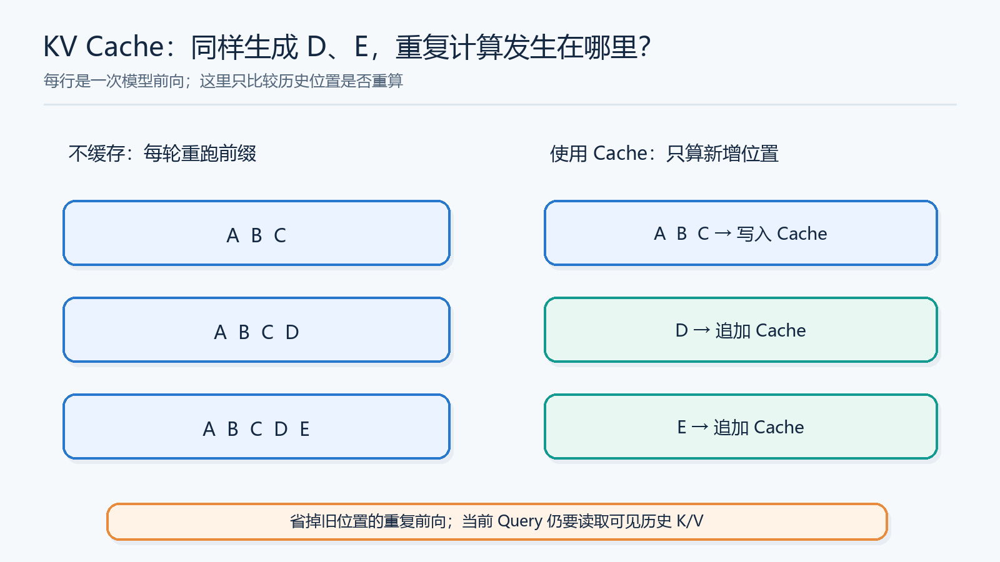
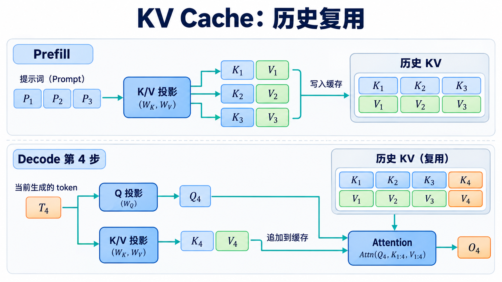

# KV Cache：为什么生成时要留下历史 K/V？

> [返回总览](../从原始Transformer到现代大模型：逐项理解架构演进.md)｜以[原始 Transformer 笔记](../transform.md)为基线。

理解 KV Cache 时先把问题缩小到**一次自回归生成**：Prompt 已有一串 Token，模型每轮追加一个新的 Token。由于因果掩码，过去位置不依赖未来位置；同一层、同一前缀的历史 K/V 可以留待下一轮使用。这是缓存成立的关键条件。[Attention Is All You Need](https://arxiv.org/abs/1706.03762)

KV Cache 是**自回归推理的执行状态**，不是另一个训练好的 Attention 机制。它与 MHA/GQA/MLA 可以组合：后者决定要缓存哪些形状的数据，Cache 决定不重复计算历史数据。

## 从「你好」续写开始：缓存是在什么时候写入的？

模型读完 Prompt「你 好」后，已经为每一层、每个位置算过用于 Attention 的 Key 和 Value。它从 Prompt 最后一个位置的输出选出新 Token「呀」。**此刻「呀」只是被选出来，还没有作为输入穿过模型各层**，所以它的各层 K/V 尚未写入 Cache。下一轮把「呀」送进模型，算出它的 Q/K/V，追加 K/V；它的 Query 才读取「你、好、呀」对应的历史。这一处时间顺序若弄错，就会以为 Cache 直接保存“未来答案”。

图中 Prompt `A B C` 在 Prefill 后形成一层的缓存；预测并选出 `D` 后，下一轮输入 `D` 才计算并追加它的 K/V。Cache 是每层的中间向量，不是文本副本。只要使用因果 Attention、前缀和模型设置保持一致，旧位置不会因新 Token 出现而改变，因此旧 K/V 可以复用。新 Query 仍要读取可见的旧 K/V，历史越长，读取的资料通常越多。

## 不缓存会重复什么？

从上往下读三轮：第一次 Prefill 处理 `A B C`；选出 `D` 后，下一轮若无 Cache 要重跑 `A B C D`，有 Cache 只把 `D` 送入并追加它的 K/V；再选出 `E` 后同理。右栏没有省掉“当前 Query 查历史”的工作，它省的是旧位置穿过各层的重复前向。图中的箭头是“写入或追加缓存”的动作，不表示旧 K/V 被重新生成。

先区分两个阶段。**Prefill** 把完整 Prompt 一次送入模型；因果掩码保证每个位置只能使用自己及以前的 Token，同时为每一层得到 Prompt 的 K/V。**Decode** 已知全部前缀，每一步只输入一个刚生成的新 Token，并预测再下一个 Token。

例如 Prompt 是 $A,B,C$。Prefill 在某层保存 $K_A,V_A,K_B,V_B,K_C,V_C$。模型生成 $D$ 后，下一步只需由 $D$ 的该层表示计算 $q_D,k_D,v_D$，把 $k_D,v_D$ 追加到 Cache；$q_D$ 与 $A$ 到 $D$ 的 K 比较，再对对应 V 求加权和。每一层都重复这个过程。之所以可以复用旧 K/V，是因为因果掩码让历史位置的表示**不依赖后来出现的 Token**；模型权重、历史前缀和位置条件保持相同时，历史 K/V 不会因 $D$ 到来而改变。

如果不用 Cache，每生成一个 Token 都把增长后的完整前缀重新送入模型，历史位置的投影和各层前向会反复计算。有了 Cache，当前步只算新位置的隐藏状态：把本步的 $k_t,v_t$ 追加到历史 K/V，当前 $q_t$ 再读取可见的整个缓存。下面的图把 Prefill 的写入和 Decode 的追加分开画出。

这里省掉的是**历史位置的重复前向计算**，不只是少做一次 K/V 投影；当前 Query 仍要读取可见历史的 K/V 做 Attention。对于全量因果 Attention，单步读取量随上下文长度增长，缓存本身也随生成长度增长，因此 KV Cache 不让单步成本变成常数。对于滑动窗口等有限可见范围机制，增长规律还取决于具体窗口与缓存实现。

图中 $T_4$ 是本步输入 Token，$O_4$ 是其 Attention 输出；实际每一层都维护各自的 Cache，图中只画一层。

## 容量怎样估算？

对 Decoder-only MHA/GQA，一个粗略的未压缩 KV 容量公式为：

$$
M_{KV}\approx 2\,L\,B\,S\,h_{kv}\,d_k\,b.
$$

$L$ 为层数，$B$ 为并发序列数，$S$ 为当前缓存长度，$h_{kv}$ 为 KV 头数，$d_k$ 为每头维度，$b$ 为每元素字节数。式子未计分配碎片、页表、对齐、量化元数据、滑动窗口及并行分片。例：$L=32,B=1,S=4096,h_{kv}=8,d_k=128,b=2$ 时，约 $512$ MiB；同形状 MHA 若 $h_{kv}=32$，约 $2$ GiB。这个**仅是 KV 部分**，不是总显存。

这个算例也说明两种优化如何配合：**Cache** 让历史计算只做一次；**GQA** 让每个历史位置需要存和读取的 KV 头更少。前者改善重复计算，后者改善 Cache 容量与带宽压力。MLA 进一步改变所存的表示，不能直接把上式中的 $h_{kv}$ 改小来估算 MLA；要按其 latent 与位置分量的实际存储形状计算。显存节约也要结合权重、激活、并发数和分配器开销看。

## Encoder–Decoder 的 Cache 与 Decoder-only 有何不同？

Encoder–Decoder 推理有两种来源不同的可复用状态。Decoder 的**Self-Attention K/V** 来自已生成的目标前缀，每生成一个目标 Token 就追加一次；**Cross-Attention K/V** 来自固定的 Encoder 输出，给定源序列后可计算一次，在整个目标生成过程中复用。前者的长度随目标增长，后者主要由源长度决定。不能把两者合并成“Decoder 只有一份 KV Cache”，否则会混淆 Query 从哪里来、K/V 从哪里来。

Prefix Cache 复用相同前缀的已计算状态；Paged KV Cache 改善缓存的分配与管理；KV 量化减少字节数。这些主要是**推理系统设计**，不应与 GQA 或 RoPE 这样的模型结构变化混为一谈。是否能复用还取决于模型版本、Token 序列、位置、注意力掩码等是否一致。

## 把 Prefill 与连续两轮 Decode 画成时间线

假设 Prompt 是 `A B C`，模型先预测出 `D`，再预测出 `E`。下面只看**一层**，真实模型每层都维护自己的状态：

| 时刻 | 本轮送入该层的当前位置 | 本轮之后缓存的历史 | 当前 Query 可读的 K/V |
| :--- | :--- | :--- | :--- |
| Prefill | A、B、C 一起处理 | A、B、C 的 K/V | 各位置只读其因果前缀 |
| 生成 D 后的 Decode | D | A、B、C、D 的 K/V | D 读 A 到 D |
| 生成 E 后的 Decode | E | A、B、C、D、E 的 K/V | E 读 A 到 E |

这里“生成 D 后的 Decode 输入 D”很容易绕晕：Prefill 已用 Prompt 末位置的输出分布**预测 D**；随后才把选出的 D 作为下一轮输入，算出 D 自己在各层的 K/V，以预测 E。Cache 保存的是模型层中的**中间状态**，不是把生成的文本再存一份。

| 比较 | 不使用历史 KV Cache | 使用历史 KV Cache |
| :--- | :--- | :--- |
| 每轮输入 | 增长后的整个前缀 | 本轮新增 Token |
| 历史位置的层计算 | 反复执行 | 复用已算状态 |
| 当前 Query 与历史 K/V 的匹配 | 仍需计算 | 仍需计算 |
| 持久显存 | 不留完整历史 KV | 随缓存长度增长 |

所以 Cache 是一种**以显存换重复计算**的推理执行方式。它解决了“历史位置反复算”，没有解决“当前 Query 要读越来越长的历史”。后一个问题才会推动 MQA/GQA/MLA、滑动窗口等设计；它们与 Cache 可以组合。[MHA/MQA/GQA 专篇](02-MHA-MQA-GQA.md)、[MLA 专篇](03-MLA.md)

## 为什么长度与并发会一起推高显存？

前面的容量式可以按乘法读：每层、每个请求、每个历史位置，都要存 K 和 V；每份有 $h_{kv}$ 个头，每头 $d_k$ 个元素，每元素 $b$ 字节。长度 $S$ 增长一倍，在其他条件固定时，这部分未压缩缓存约增长一倍；并发请求数 $B$ 增长一倍，也近似增长一倍。**这是 Cache 本身的估算**，不包括模型权重、临时激活或分配器开销。

例如文中的 32 层、4096 Token、8 个 KV 头、每头 128 维、FP16/BF16 两字节示例为约 512 MiB。把 8 个 KV 头改为 32 个，缓存约为 2 GiB。可见 GQA 减少的是**每历史位置的宽度**；它不让历史长度消失。MLA 存 latent 和位置分量，其容量要另按实际维度算，不能直接把 $h_{kv}$ 改成 1。

## 为什么 Cache 既能省时间，又会吃显存？

没有 Cache 时，生成第一个新 Token 读一次 Prompt；生成第二个时又把 Prompt 和第一个新 Token 重新跑一遍；越往后，已处理过的前缀被重复送入各层。Cache 把“历史 K/V 已经算好”写在显存里，下一步只算新位置。它用空间保存过去的计算结果，换掉大量重复前向。这个取舍在交互式生成中特别自然，因为前缀每轮只增加一点点。

但它没有删除 Attention 的查阅工作。当前 Query 若要从 4096 个历史位置找线索，仍需对可见的历史 Key 计算分数，并汇总对应 Value。缓存使**旧位置不用重新生成 K/V**，不使“读取历史”消失。因此长上下文和高并发又把问题推向 MQA/GQA/MLA：这些方法减少**每个历史位置要存和读的宽度**；PagedAttention 则管理这份不断增长的存储空间。三者各管不同一段成本。

一个服务同时处理 100 个请求时，每个请求都有自己的前缀与 Cache。即使每条只占一点显存，乘上层数、长度和并发数也会变大。若模型权重已经占了很多显存，能同时服务多少请求就可能先被 KV Cache 限制。因此缓存容量不只是“最大上下文长度”的问题，也直接关系吞吐和部署成本。

## 再往下：缓存怎么管理？

服务系统同时处理长短不一的请求，缓存会不断增长、释放，可能出现内存碎片。PagedAttention 一类方案把 KV 缓存分块管理，让逻辑上的连续历史映射到可灵活分配的物理块；它改变的是**存储管理与访问实现**，并不改变模型训练出来的 Q/K/V 语义。[PagedAttention 论文](https://arxiv.org/abs/2309.06180)

Prefix Cache 则尝试在**两个请求具有完全相同且可复用的前缀状态**时共享已计算部分。模型版本、Token 化结果、位置、掩码和相关推理设置不一致，就不能随意把一个请求的 KV 借给另一个请求。KV 量化改变每元素的存储精度，需要额外评估解码质量与量化/反量化成本。三种手段分别针对**分配浪费、重复前缀计算、每元素字节数**。

## 检查自己是否理解

1. Prompt 为 `A B C`，模型刚选出 `D` 时，D 的各层 K/V 已经写入 Cache 了吗？
2. 为什么 KV Cache 仍需要读取历史 K/V，不能让每步 Attention 变成常数成本？
3. GQA、PagedAttention 与 Prefix Cache 分别改变缓存的哪个方面？
