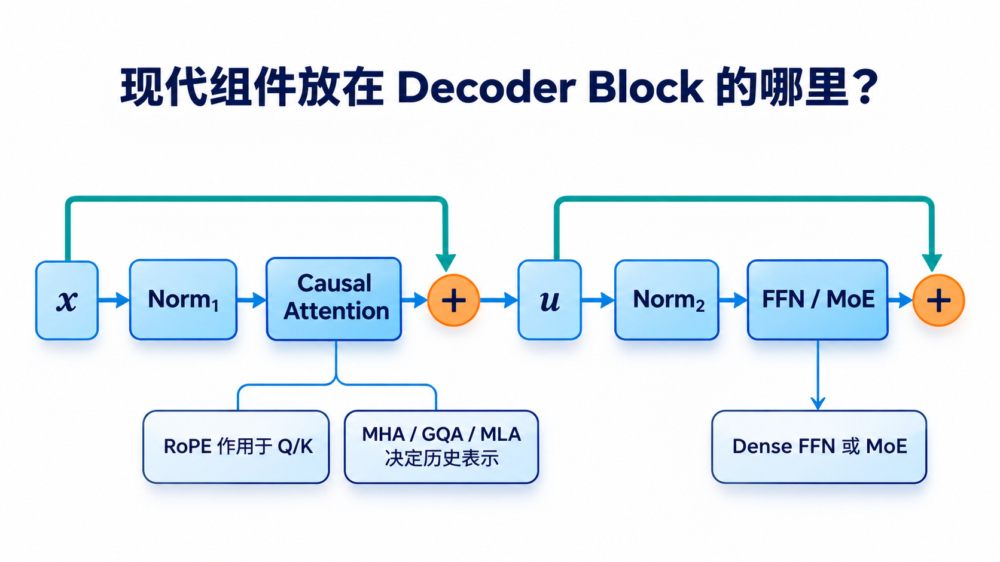
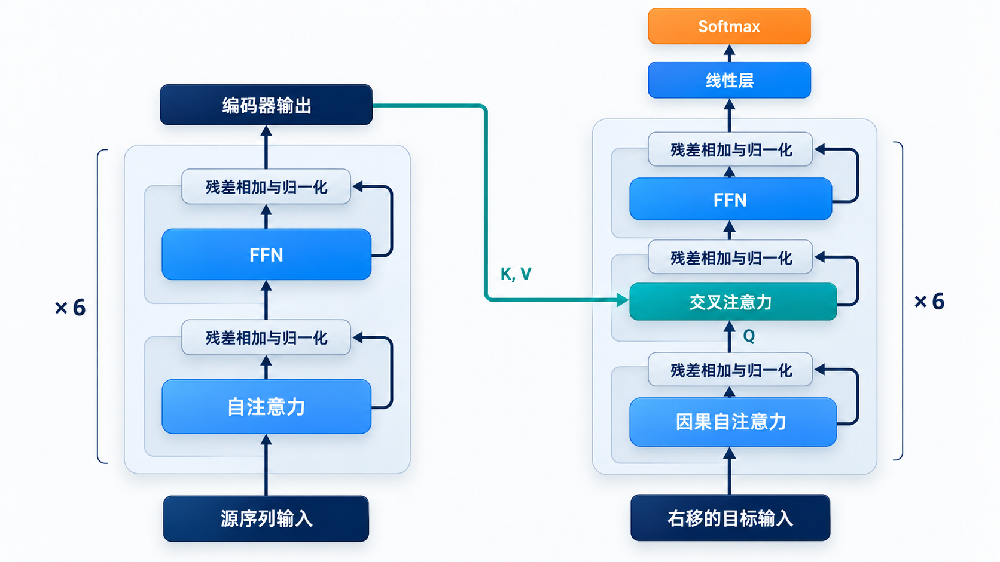

# 把组件放回模型：T5、Llama、Mistral、Mixtral 与 DeepSeek

> [返回总览](../从原始Transformer到现代大模型：逐项理解架构演进.md)｜以[原始 Transformer 笔记](../transform.md)为基线。

前面各专题分别解释了模型的可见范围、Attention、位置、FFN、Norm 和推理状态。现在沿着**一个输入如何穿过模型**来重组它们：先确定 Token 可以读取哪些上下文，再看每个 Block 如何交换信息和变换特征，最后看生成时要留下哪些状态。下表仅列**代表性公开模型**，同一系列内不同版本、尺寸可能不完全相同。

## 不背部件清单，先跟踪一枚 Token

假设用户给出「请把这段话压缩成一句摘要」。在任何模型里，先问输入是**一条序列还是两条序列**：材料与摘要前缀分开，会出现 Encoder 输出与 Cross-Attention；接在一起，则通常走因果 Decoder。接着问当前 Token **能看到哪些位置**；再问它在 Attention 里产生多少 Q、历史保存什么 K/V；最后看 Attention 后的 FFN 是人人经过同一套参数，还是 Router 选 Expert。Norm 与残差包裹这些子层；KV Cache 则决定下一轮生成能复用哪些历史计算。

这样读，一长串缩写才会变成有前后顺序的动作。RoPE 改的是匹配时怎样知道位置，GQA/MLA 改的是历史状态的组织，SwiGLU/MoE 改的是逐 Token 特征加工，Pre-Norm 改的是子层与残差的顺序。一个模型可以同时采用它们，因为它们插在**不同的环节**。下表把这些环节放回几个具体模型；实际选型和配置须以对应版本为准。

这张图以**Pre-Norm Decoder Block** 为例：橙色上方路径是两次残差旁路；RoPE 在 Attention 内作用于 Q/K，MHA/GQA/MLA 决定 Attention 历史表示如何组织；FFN 或 MoE 位于第二个子层。它不是所有模型的统一蓝图：原始 Transformer 用 Post-Norm，Encoder–Decoder 还另有 Cross-Attention。生成阶段保存历史状态的 KV Cache 也属于运行过程，不是图里的一次前向子层。

| 模型/路线 | 整体结构 | Attention/位置 | FFN | Norm | 推理时的关键状态 |
| :--- | :--- | :--- | :--- | :--- | :--- |
| 原始 Transformer | Encoder–Decoder | MHA；绝对正弦位置 | Dense ReLU | Post-LN LayerNorm | Decoder Self-Attn 与 Cross-Attn 可复用历史/源端 K/V |
| BERT | Encoder-only | 双向 Self-Attention；学习式绝对位置 | Dense GELU FFN | Post-Norm LayerNorm | 主要用于整段输入的表征 |
| T5 | Encoder–Decoder | MHA；相对位置 Bias | Dense FFN；不同版本可有门控变种 | Pre-Norm 风格 | Decoder 历史与 Encoder 输出分别复用 |
| Llama 2/3 代表配置 | Decoder-only | 因果 Attention；RoPE；部分版本 GQA | Dense SwiGLU | Pre-Norm RMSNorm | 自回归 KV Cache，GQA 降低 KV 头数 |
| Mistral 7B | Decoder-only | GQA 与 Sliding Window Attention | Dense FFN | 按具体模型实现 | 单层历史可见范围受窗口约束 |
| Mixtral 8×7B | Decoder-only | 因果 Attention；沿用该模型的 Attention 配置 | 稀疏 MoE，8 选 2 | 按具体模型实现 | KV Cache 加 Expert 路由 |
| DeepSeek-V2/V3 | Decoder-only | MLA；分离的位置路径 | DeepSeekMoE | 按具体版本实现 | 压缩 latent/位置分量的 Cache 加 Expert 路由 |

## T5：保留 Encoder–Decoder，但改训练和位置信息

假设任务是把源句翻译成目标句。先把**完整源句**交给 Encoder：每个源 Token 可通过双向 Self-Attention 汇集源句上下文，得到一列 Encoder 输出。生成目标句时，Decoder 的因果 Self-Attention 只能看已生成的目标前缀；随后 Cross-Attention 让当前目标 Query 从固定的 Encoder 输出取信息。这解释了为何它有两套不同的 Attention 上下文：一套随目标长度增长，一套来自已读完的源句。

图是原始 Transformer 的 Block 示意：绿色路径为 Encoder 输出提供的 K/V，Decoder 当前状态提供 Query。T5 保留这类整体信息路径，但位置机制、Norm 和训练任务设计已有变化，不能把图中的所有层内细节直接当成 T5 配置。

T5 在这种结构里把位置关系作为相对 Bias 加到 Attention 分数，把 Norm 放到子层计算之前；这些变化分别解决**如何表示距离**和**如何训练残差块**，并没有取消 Encoder 与 Cross-Attention。训练时，T5 又把多种任务统一成“输入文本 → 输出文本”的形式。读模型时先追踪源和目标数据流，再看每个 Attention 内部如何加 Bias，才不会把整体架构和局部算子混在一起。[T5 论文](https://arxiv.org/abs/1910.10683)

## Llama：Dense Decoder-only 的一组组合

一个典型 Llama Block 可以读成两次连续的 **Pre-Norm → 子层 → 残差相加**：第一次的子层是因果 Attention，第二次是 Dense SwiGLU。第一次相加后的表示再进入第二次 Norm。

沿一个 Token 进入 Block 的路线读：先 RMSNorm，再投影 Q/K/V；对 Q/K 施加 RoPE，按因果掩码计算 Attention；若该版本采用 GQA，多个 Q 头共用一组 KV 头，否则按 MHA 一一对应；Attention 输出加回原输入；再做 RMSNorm、Dense SwiGLU，最后再次残差相加。于是位置、头共享、门控与 Norm 分别作用在**不同位置**，不是四种互相替代的“Attention 优化”。

训练时，因果掩码允许整段序列并行计算各位置的预测损失；推理时，下一个 Token 尚未出现，只能逐步生成并维护每层 KV Cache。采用 GQA 的版本会减少这份 Cache 的头数，SwiGLU 改变逐 Token 特征变换，却不决定 Cache 的长度。Llama 家族的具体头数、位置扩展方法与版本有关，不能把上式当成所有尺寸的逐项配置清单。[Llama 2 论文](https://arxiv.org/abs/2307.09288)、[Llama 3 论文](https://arxiv.org/abs/2407.21783)

## Mistral：头共享与可见窗口可以同时改变

在 Llama 一类 Dense Decoder 的基础上，Mistral 7B 进一步调整两个不同维度：GQA 减少每个位置的 KV 头数；Sliding Window Attention 限制当前 Token 在**单层**能直接读到的历史范围。若窗口宽度是 $W$，单层当前 Query 只与附近最多 $W$ 个历史位置做匹配；较远位置的信息仍可能经多层的局部传递间接影响当前表示，但这不等于当前层能直接随机访问任意远处 Token。

因此分析长上下文时，应分别问：每层保存多少 KV？当前 Query 直接看哪些位置？多层传播能否满足任务所需的远距离检索？窗口机制与 GQA 可以叠加，却解决不同问题。缓存能否限制在窗口内还要结合滚动缓存等具体实现；不能只凭“支持长度”推断实际检索能力。[Mistral 7B 论文](https://arxiv.org/abs/2310.06825)

## Mixtral：保留 Decoder 主干，把 Dense FFN 改为 MoE

沿 Mixtral 的一个 Block 走一遍：先做因果 Self-Attention，得到已经融合上下文的 Token 表示；到 FFN 位置时，Router 对**每个 Token 分别**选出两个 Expert；两个 Expert 各自变换同一 Token 的表示，再把输出按路由权重合并。这里被路由的是逐 Token 的 FFN 计算，Attention 仍承担 Token 间的信息交换。相邻 Token 即使互相注意，也可能选择不同 Expert。

这种设计扩大了可用参数容量，同时让每个 Token 只执行少数 Expert；代价是权重存储、路由负载与 Expert 间通信。若 Expert 分布在多张 GPU 上，Token 可能跨卡发送，实际速度不只由“每 Token 激活多少参数”决定。它也说明 MoE 与 KV Cache 作用在不同阶段：前者选 FFN 路径，后者复用生成时的历史 Attention 状态。[Mixtral 论文](https://arxiv.org/abs/2401.04088)

## DeepSeek-V2/V3：同时改变 Attention 缓存与 FFN 容量

DeepSeek-V2/V3 把两条前面分别讨论的路线放进同一 Decoder 主干。走到 Attention 时，MLA 让历史位置主要保存压缩 latent，并单独处理承载位置的信息路径；当前 Query 利用这些缓存状态计算历史匹配。走到 FFN 时，DeepSeekMoE 让 Router 为当前 Token 选择少量路由 Expert，并结合共享 Expert 处理公共信息。两种选择发生在 Block 的不同子层，不是同一个“稀疏机制”。

因此可以分别检查收益和代价：**MLA 对准 KV Cache 的容量与读取；MoE 对准参数容量与每 Token 计算分配。** MLA 的推理实现要处理 latent/位置分量，MoE 的部署要处理 Expert 放置、Token 分发和负载。某一配置是否更快，要连同批量、序列长度、KV 实现与硬件互联一起衡量，不能从“用了 MLA + MoE”直接推出。[DeepSeek-V2 论文](https://arxiv.org/abs/2405.04434)、[DeepSeek-V3 技术报告](https://arxiv.org/abs/2412.19437)

## 用一套问题读懂任何新模型架构

看到一个新的模型名称时，先不要背部件清单，按数据流问：

1. **可见范围**：是 Encoder-only、Encoder–Decoder 还是 Decoder-only？每个 Attention 的 Query/Key/Value 来自哪里，是否有因果掩码？
2. **头与 Cache**：有多少 Query 头、KV 头？缓存完整 K/V、共享 K/V，还是压缩 latent？
3. **位置**：位置信息加在输入、Attention logits，还是 Q/K 上？超过训练长度时怎么处理？
4. **FFN**：是普通 Dense、门控 Dense，还是有 Router 的 MoE？每 Token 激活几个 Expert？
5. **Norm 与残差**：Norm 在加法前还是后？用 LayerNorm 还是 RMSNorm？第二个子层的输入是谁？
6. **运行状态**：Prefill 与 Decode 各需要保存什么？Cache 是模型定义的一部分，还是系统为同一模型做的内存管理优化？

这些问题把“架构是什么”和“如何高效运行”分开。进一步理解 GPU 间的专家分发、张量切分和通信代价，可接着读[分布式并行策略](../大模型分布式并行策略_DP_TP_SP_PP_EP%20%281%29.md)与[GPU 通信和 NCCL](../大模型_GPU通信方式_NCCL与性能优化.md)。

## 用同一个输入场景比较五种模型

假设任务是「给出一段材料，生成一句摘要」。**T5** 先由 Encoder 双向读完材料，Decoder 用已写出的摘要前缀作 Query，再通过 Cross-Attention 取 Encoder 输出。**Llama** 把材料与摘要前缀接在同一条因果序列里：材料中的较早位置不会因后来的摘要 Token 改写，当前 Token 逐步读取历史 Cache。两者都能做条件生成，但源端信息流不同。[T5 论文](https://arxiv.org/abs/1910.10683)、[Llama 2 论文](https://arxiv.org/abs/2307.09288)

**Mistral 7B** 仍是因果 Decoder，GQA 改变每个历史位置保留多少 KV 头，滑动窗口改变一个 Query 在**单层**直接能看多远。**Mixtral** 保留 Decoder 的 Attention 路线，在 FFN 位置让 Router 为每个 Token 选 Expert。**DeepSeek-V2/V3** 则同时在 Attention 侧使用 MLA 压缩历史表示，在 FFN 侧使用 MoE 扩大参数容量；两条变化分别发生在不同子层。[Mistral 7B 论文](https://arxiv.org/abs/2310.06825)、[Mixtral 论文](https://arxiv.org/abs/2401.04088)、[DeepSeek-V2 论文](https://arxiv.org/abs/2405.04434)

| 看模型时先问 | T5 路线 | Dense Decoder 路线 | MoE + 压缩 Attention 路线 |
| :--- | :--- | :--- | :--- |
| 输入上下文在哪里 | 源端 Encoder 输出与目标前缀分开 | Prompt 与生成前缀在同一因果序列 | 同一因果序列 |
| 历史状态怎样复用 | 目标 Self-Attn Cache；源端 Cross-Attn 可复用 | 每层目标 Self-Attn KV Cache | 每层压缩历史表示，另有 Expert 路由 |
| FFN 如何执行 | 依具体版本的 Dense FFN | 每 Token 同一套 Dense FFN | 每 Token 选择部分 Expert，可能有共享 Expert |

这张表按**信息流**概括，不替代具体模型配置。特别是“同一系列”可能跨尺寸改变 KV 头数、上下文扩展方法或 FFN 设置；做性能或质量比较前，应查对应版本的论文和配置。[Llama 3 论文](https://arxiv.org/abs/2407.21783)、[DeepSeek-V3 技术报告](https://arxiv.org/abs/2412.19437)

## 一次性能判断应怎样避免混淆？

先写清指标：**训练吞吐、Prefill 延迟、Decode 单步延迟、并发容量、最大可用上下文、任务质量**并不是同一个数。GQA/MLA 更直接影响历史状态的宽度；KV Cache 避免反复计算历史位置；MoE 把大量参数分散到 Expert，可能增加路由和通信；Pre-Norm 改训练路径。一个模型同时使用这些机制，仍须分别看各自作用的成本项。

最后可把新模型拆成一张“数据流卡片”：输入序列和可见掩码 → 位置线索进入哪里 → Q/K/V 或 latent 如何生成与缓存 → Attention 输出 → Norm/残差顺序 → Dense FFN 或 Expert 路由 → 推理阶段的 Cache 管理。卡片填不出来时，通常意味着某个模型宣传词尚未被还原成可检验的计算过程。

## 专题回看

- [整体架构与可见范围](01-整体架构与可见范围.md)
- [MHA、MQA、GQA](02-MHA-MQA-GQA.md)与[MLA](03-MLA.md)
- [位置编码](04-位置编码.md)
- [FFN 与门控](05-FFN与门控.md)及[MoE](06-MoE.md)
- [归一化与残差](07-归一化与残差.md)
- [KV Cache](08-KV-Cache.md)
