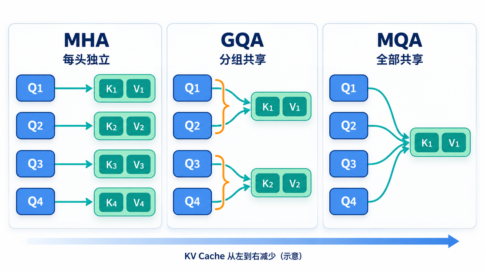
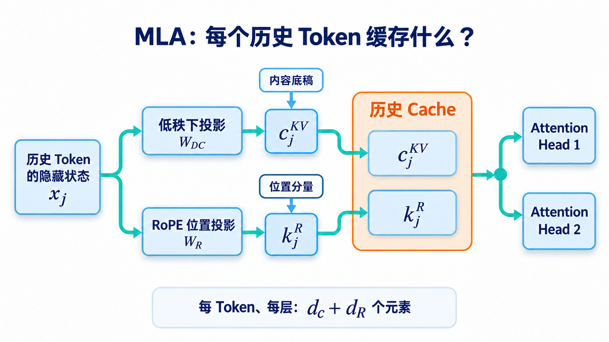
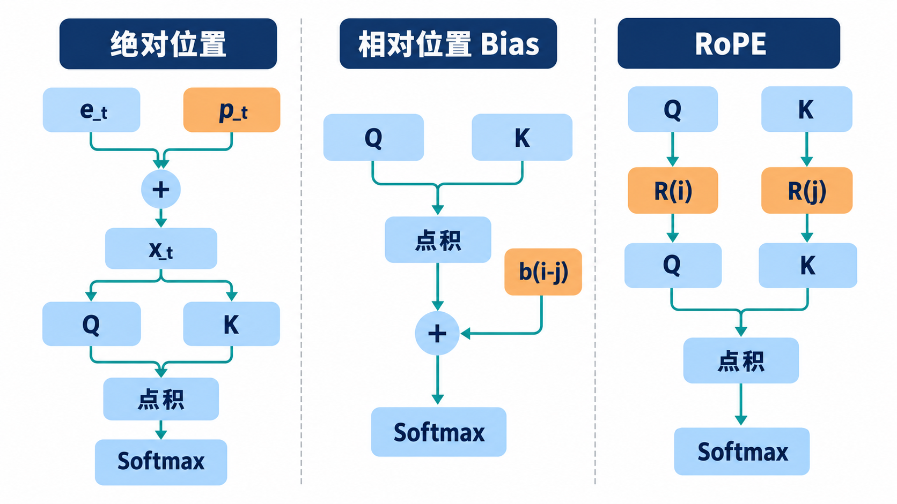
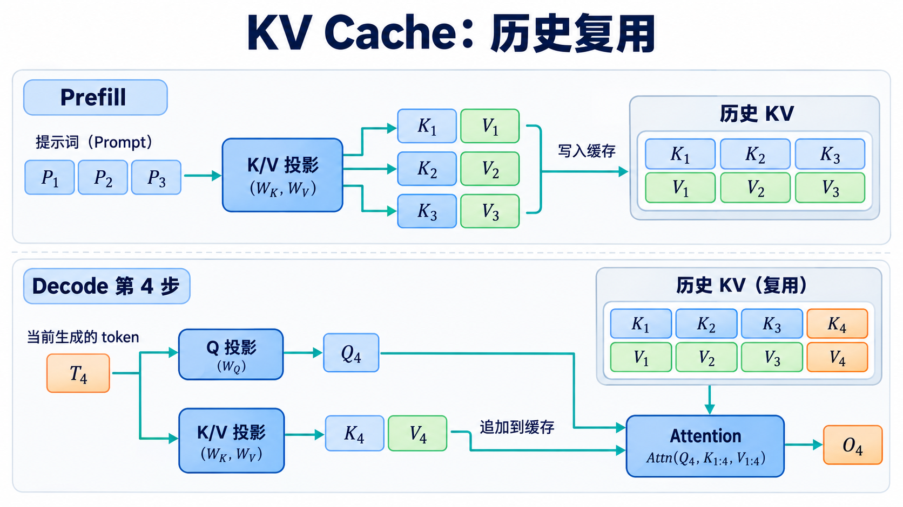

# 从原始 Transformer 到现代大模型：逐项理解架构演进

> 阅读路线：先以[原始 Transformer 学习笔记](transform.md)为基线，逐项解释架构变化，再看这些组件怎样组合成不同模型。本文讨论公开论文中的代表性设计，不把某个模型的做法当成所有大模型的统一标准。

原始 Transformer 是为序列到序列翻译设计的：Encoder 双向读取源序列，Decoder 通过因果 Self-Attention 生成目标序列，并用 Cross-Attention 读取 Encoder 输出。每层的主要结构是 Multi-Head Attention、两层 ReLU FFN、残差连接和 **Post-Norm**；位置由加到输入上的正弦位置编码提供。

现代大模型保留了“用 Attention 交换 Token 信息，再用逐 Token 的 FFN 变换表示”的骨架，但围绕**任务形态、训练稳定性、参数规模和生成时的显存/带宽**改了许多细节。先用一张总表建立坐标：

| 技术轴 | 最初版本中的做法 | 后来的代表性变化 | 主要动机 |
| :--- | :--- | :--- | :--- |
| 整体架构 | Encoder–Decoder | Encoder-only、Decoder-only，以及保留 Encoder–Decoder 的 T5 类模型 | 匹配理解、生成或条件生成任务 |
| Attention 头 | 每个 Query 头配自己的 Key/Value 头，即 MHA | MQA、GQA、MLA | 减少自回归生成时的 KV 读取或存储 |
| 位置 | 输入加绝对正弦编码 | 学习式绝对位置、相对位置 Bias、RoPE、ALiBi | 让 Attention 更直接表达位置关系，适应不同长度 |
| FFN | $\text{ReLU}(xW_1+b_1)W_2+b_2$ | GELU、GEGLU、SwiGLU、MoE | 改进非线性表达，或扩张总参数而保持稀疏计算 |
| 归一化 | Post-Norm LayerNorm | Pre-Norm LayerNorm、Pre-Norm RMSNorm | 改善深层训练的梯度传播；简化归一化计算 |
| 生成状态 | 原论文主要说明自回归解码 | KV Cache、Prefix 复用、分组或压缩 KV | 避免反复计算历史 K/V，缓解长上下文显存与带宽压力 |

这些变化并不是一条“旧版升级为新版”的直线。架构、Attention、位置、FFN、归一化与推理缓存是不同维度；某个模型可以在一个维度采用新设计，在另一个维度保留旧设计。

## 一、先分清三种整体架构：谁能看到哪些 Token？

同样的 Self-Attention 公式，只要**可见范围**和**训练目标**不同，就会形成不同模型。

### 1.1 Encoder-only：以 BERT 为代表

Encoder 中位置 $i$ 通常可以注意到输入中的所有非 Padding 位置，包括它右边的 Token。若任务是判断一句话的情感或抽取实体，这种双向上下文很自然。BERT 用 Masked Language Modeling 等目标预训练这种表示；它不是一个按原样逐 Token 续写的因果语言模型。[BERT 论文](https://arxiv.org/abs/1810.04805)

注意“输入能双向可见”不等于“模型知道被遮住的答案”：训练时某些输入位置被替换或遮蔽，模型要根据**未被遮蔽的上下文**预测它们。与原始 Encoder 相比，BERT 的经典实现使用学习式绝对位置 Embedding 和 GELU FFN，残差之后做 LayerNorm，仍属于 Post-Norm。[BERT 原始实现](https://github.com/google-research/bert/blob/master/modeling.py)

### 1.2 Encoder–Decoder：原始 Transformer 与 T5

Encoder 先得到源序列表示 $H_{\mathrm{enc}}$。Decoder 的第 $t$ 个位置通过因果 Self-Attention 只看目标前缀，再以自己的状态产生 Query，以 $H_{\mathrm{enc}}$ 产生 Key/Value 做 Cross-Attention：

$$
Q=H_{\mathrm{dec}}W_Q,\qquad K=H_{\mathrm{enc}}W_K,\qquad V=H_{\mathrm{enc}}W_V.
$$

因此“目标端当前要写什么”和“源序列提供哪些证据”分属两个信息通道。T5 保留 Encoder–Decoder，把多种文本任务统一成 text-to-text；它仍然适合明确给定输入、再产生输出的任务。[T5 论文](https://arxiv.org/abs/1910.10683)

### 1.3 Decoder-only：以 GPT/Llama 为代表

把提示词和待生成内容放进**同一条序列**。位置 $t$ 只能读取不晚于 $t$ 的位置：

$$
\text{score}_{t,j}=\frac{q_t k_j^\top}{\sqrt{d_k}}+M_{t,j},\qquad
M_{t,j}=\begin{cases}0,&j\le t,\\-\infty,&j>t.\end{cases}
$$

这使“阅读提示”和“续写答案”共享一套因果 Attention。它没有独立的 Encoder，也没有原始架构中读取 Encoder 输出的 Cross-Attention。代价是一个 Prompt 内的 Token 也受因果可见性限制；它们不是在每一层都双向交换信息。

**架构与能力不能简单画等号。** Encoder-only 常用于表征任务；Encoder–Decoder 常用于条件生成；Decoder-only 常用于通用自回归生成。但具体能力还受到数据、目标函数、规模和训练方法影响。

### 1.4 代表模型出现时间：为什么今天常见的是 Decoder-only？

下表中的时间按**论文首次公开或官方首次发布的月份**记录，不混用后续修订版、模型权重分批开放或产品上线时间；它是帮助建立发展脉络的代表性选例，不是对全部模型的数量统计。

| 架构 | 代表模型 | 首次公开 | 主要定位或架构特征 |
| :--- | :--- | :--- | :--- |
| Encoder-only | [BERT](https://arxiv.org/abs/1810.04805) | 2018-10 | 双向表征，Masked Language Modeling |
| Encoder-only | [RoBERTa](https://arxiv.org/abs/1907.11692) | 2019-07 | 沿 BERT 路线改进预训练 |
| Encoder–Decoder | [原始 Transformer](https://arxiv.org/abs/1706.03762) | 2017-06 | 源序列编码、目标序列自回归生成 |
| Encoder–Decoder | [T5](https://arxiv.org/abs/1910.10683) | 2019-10 | 把多种任务统一为 text-to-text |
| Encoder–Decoder | [BART](https://arxiv.org/abs/1910.13461) | 2019-10 | 去噪预训练与条件生成 |
| Encoder–Decoder | [Flan-T5](https://arxiv.org/abs/2210.11416) | 2022-10 | 对 T5 路线做指令微调 |
| **Decoder-only** | [GPT-2](https://openai.com/index/better-language-models/) | **2019-02** | 因果语言建模、文本续写 |
| **Decoder-only** | [GPT-3](https://arxiv.org/abs/2005.14165) | **2020-05** | 扩大自回归语言模型，展示上下文学习 |
| **Decoder-only** | [LLaMA](https://arxiv.org/abs/2302.13971) | **2023-02** | 开放研究用的 Dense 基础模型系列 |
| **Decoder-only** | [Mistral 7B](https://mistral.ai/news/announcing-mistral-7b/) | **2023-09** | GQA 与滑动窗口 Attention |
| **Decoder-only** | [Mixtral 8×7B](https://mistral.ai/news/mixtral-of-experts/) | **2023-12** | Decoder 主干中的稀疏 MoE |
| **Decoder-only** | [Llama 3](https://ai.meta.com/blog/meta-llama-3/) | **2024-04** | Dense 通用生成模型系列 |
| **Decoder-only** | [Qwen2.5](https://qwenlm.github.io/blog/qwen2.5/) | **2024-09** | 通用文本生成，系列包含多种尺寸 |
| **Decoder-only** | [DeepSeek-V3](https://arxiv.org/abs/2412.19437) | **2024-12** | MLA 与 MoE 组合 |
| **Decoder-only** | [Qwen3](https://qwenlm.github.io/blog/qwen3/) | **2025-04** | 同一 Decoder 路线下有 Dense 与 MoE 型号 |

从这组连续出现的公开模型可以看到：**通用文本生成与对话模型的代表性路线，以 Decoder-only 为主**。它用同一套因果主干处理 Prompt 和生成结果，便于按下一个 Token 的目标进行大规模预训练，并与自回归推理的 KV Cache 配合。表中的近年模型无论采用 Dense FFN 还是 MoE、MHA 还是 GQA/MLA，都仍属于 Decoder-only 的整体架构。这里的“主流”限定于**通用自回归生成模型的架构选择**，不表示 Encoder-only 或 Encoder–Decoder 被淘汰：前者仍适合表征、检索与分类，后者仍适合翻译、摘要等明确的输入到输出任务。

## 二、Attention 头怎样变化：MHA → MQA → GQA → MLA

### 2.1 先看瓶颈：生成一个新 Token 要读多少历史？

把一层因果 Self-Attention 想成「当前 Token 提问，历史 Token 提供索引和内容」：当前 Token 产生 Query $q_t$；每个历史位置 $j\le t$ 留下 Key $k_j$ 和 Value $v_j$。先用 $q_t\cdot k_j$ 决定关注程度，再对 $v_j$ 加权求和。**K 用于匹配，V 用于取回信息；两者都要按历史长度保存或重新计算。**

有了 KV Cache，前一步计算过的历史 K/V 不必重算，但每生成一个新 Token，当前 Query 仍要读取它能看到的历史 K/V。设序列长度为 $S$、层数为 $L$、Query 头数为 $h_q$、KV 头数为 $h_{kv}$，每个 K/V 头维度暂设为同一个 $d$，每个元素占 $b$ 字节。忽略分片、对齐和元数据，完整因果 Attention 的 KV Cache 大小约为：

$$
M_{KV}\approx 2LS h_{kv}db \quad\text{（单条序列；有 $B$ 条时再乘 $B$）}.
$$

前面的 $2$ 分别是 K 和 V。Decode 一步至少需要读取与可见历史相关的 KV 数据；真实耗时还受权重读取、计算、缓存布局、并行分片和硬件带宽影响。MHA、MQA、GQA、MLA 的关键区别就是：**为了保留多个 Query 头的能力，每个历史 Token 究竟保存什么。**

### 2.2 MHA：每个 Query 头都有自己的 K/V 头

标准 Multi-Head Attention（MHA）有 $h_q=h_{kv}=h$。第 $a$ 个头用自己的投影把隐藏状态 $x_t$ 变成 $q_t^{(a)},k_t^{(a)},v_t^{(a)}$，对历史分别计算：

$$
o_t^{(a)}=\sum_{j\le t}\alpha_{t,j}^{(a)}v_j^{(a)},\qquad
\alpha_{t,j}^{(a)}=\text{softmax}_{j}\!\left(
\frac{q_t^{(a)}\cdot k_j^{(a)}}{\sqrt d}+M_{t,j}\right).
$$

最后拼接各头结果并乘输出投影 $W_O$。不同头有独立的 Q/K/V 投影，因此可以形成不同的匹配和取值方式；这里的“可以”不保证每个头一定学到人能命名的功能。

用四头示意：$Q_1$ 查自己的 $K_1/V_1$ 历史，$Q_2$ 查 $K_2/V_2$，直到 $Q_4$。每个历史 Token 要存 **4 份 K 和 4 份 V**，即 $8d$ 个元素。上下文越长，Decode 每步读取的历史越多；这就是减少 KV 头数的直接动机。[原始 Transformer 论文](https://arxiv.org/abs/1706.03762)

### 2.3 MQA：Query 仍有多头，K/V 只存一份

Multi-Query Attention（MQA）保持 $h_q=h$ 个不同 Query 头，却令 $h_{kv}=1$。四头例子变为 $Q_1,Q_2,Q_3,Q_4$ 都访问同一份历史 $K/V$：

$$
o_t^{(a)}=\sum_{j\le t}\text{softmax}_{j}\!\left(
\frac{q_t^{(a)}\cdot k_j}{\sqrt d}+M_{t,j}\right)v_j.
$$

**共享 K/V 不等于四个头的输出相同。** 各头的 Query 不同，得到的匹配分数和权重仍可不同；只是它们都从同一组 Key 中匹配、同一组 Value 中取值。四头示意中每历史 Token 从 $8d$ 个 KV 元素降为 $2d$ 个，理想的 **KV 数量**降为四分之一。Query 投影、输出投影、FFN 和模型权重没有按这个比例缩小。

代价是头之间不再拥有独立的 K/V 投影。共享越激进，表示能力与质量越可能受到影响；实际幅度需要由训练和任务验证。MQA 主要针对增量 Decode 反复读取历史 KV 的带宽瓶颈。[MQA 论文](https://arxiv.org/abs/1911.02150)

### 2.4 GQA：让一组 Query 头共享一份 K/V

Grouped-Query Attention（GQA）处于两者之间。它把 $h_q$ 个 Query 头分成 $h_{kv}$ 组，每组配一份 K/V。四个 Query 头、两个 KV 组时，$Q_1,Q_2$ 共用 $K_1/V_1$，$Q_3,Q_4$ 共用 $K_2/V_2$。设 $g(a)$ 是头 $a$ 所在组，公式只是把 MHA 的同编号 K/V 换成组编号：

$$
o_t^{(a)}=\sum_{j\le t}\text{softmax}_{j}\!\left(
\frac{q_t^{(a)}\cdot k_j^{(g(a))}}{\sqrt d}+M_{t,j}\right)v_j^{(g(a))}.
$$

通常让 $h_q$ 可被 $h_{kv}$ 整除，于是每组有 $h_q/h_{kv}$ 个 Query 头。边界很容易记：$h_{kv}=h_q$ 是 MHA，$h_{kv}=1$ 是 MQA。四头两组每历史 Token 保存 $4d$ 个 KV 元素，正好落在 MHA 的 $8d$ 与 MQA 的 $2d$ 之间。

读图时先数蓝色 Query：三栏都是四个；再数绿色 KV：分别为四组、两组、一组。**减少的是被缓存、被读取的 KV 头数，不是 Query 头数，也不是因果掩码的可见范围。**

再看一个接近实际配置的算例：固定 $h_q=32,d=128,S=4096$，只比较**一层、一条序列、每元素 2 字节**的 KV：

| 方案 | $h_{kv}$ | 每个历史 Token 的 KV 元素 | 这层 4096 个 Token 的 KV |
| :--- | ---: | ---: | ---: |
| MHA | 32 | $2\times32\times128=8192$ | 64 MiB |
| GQA | 8 | $2\times8\times128=2048$ | 16 MiB |
| MQA | 1 | $2\times1\times128=256$ | 2 MiB |

若模型有 32 层且各层尺寸相同，再把表中数值乘 32；有多条同时服务的序列，还要按各自缓存长度累计。GQA=8 的 16 MiB 是 MHA 的四分之一，**整个模型显存或生成时间不会因此自动缩成四分之一**。GQA 论文展示了在其测试设置中质量与推理速度之间的折中；不同模型和负载不能直接照搬该结果。Llama 2 的部分较大模型与 Llama 3 系列采用 GQA，具体头数按版本核查。[GQA 论文](https://arxiv.org/abs/2305.13245)、[Llama 2 论文](https://arxiv.org/abs/2307.09288)、[Llama 3 论文](https://arxiv.org/abs/2407.21783)

### 2.5 MLA：历史 Token 存一份压缩表示，各头按需使用

先暂时不管 RoPE，只问一个问题：**历史 Token $j$ 到来时，模型要为未来的 Query 留下什么？**

- **MHA**：为每个头分别留下 $K_j^{(1)},V_j^{(1)},K_j^{(2)},V_j^{(2)},\ldots$。未来每个头直接读取自己的那一对。
- **GQA**：几个 Query 头共用一对完整 K/V；缓存中仍然是一组组已经展开的 K/V。
- **MLA**：先把这一层的隐藏状态 $x_j$ 投影成一份较窄的向量 $c_j^{KV}$，未来各头用**不同的投影矩阵**从这份向量获得自己需要的内容信息。缓存主要保存这份共享的压缩表示。

可以把 $c_j^{KV}$ 理解成一份共同的“资料摘要”。它不是把一个已经训练好的 MHA Cache 原封不动地压缩成无损文件；**模型训练时就学习了如何写这份摘要，以及各头怎样读取它**。它也不是 MQA：MQA 的多个头直接共用**同一对完整 K/V**；MLA 的不同头可通过各自的上投影，从**同一个 latent**得到不同的内容 K/V。

用公式写这三步。设 $a$ 表示 Attention 头，$d_c$ 是压缩向量的宽度：

$$
\underbrace{c_j^{KV}=W_{\mathrm{down}}^{KV}x_j}_{\text{写入共享表示}},\qquad
\underbrace{k_j^{C,(a)}=W_{\mathrm{up},K}^{(a)}c_j^{KV}}_{\text{各头的内容 Key}},\qquad
\underbrace{v_j^{C,(a)}=W_{\mathrm{up},V}^{(a)}c_j^{KV}}_{\text{各头的内容 Value}}.
$$

上标 $C$ 表示 **content（内容）**。图中蓝色的 $c_j^{KV}$ 是历史 Token 写下的共享表示；右侧两个 Attention Head 都能使用它，但各头的投影参数可以不同。

图还多画了一项 $k_j^R$。先记住结论：**实际 Cache 中是“内容摘要 $c_j^{KV}$ + 位置 Key $k_j^R$”两部分**；下文解释为什么需要第二部分。图只画历史侧，当前 Token 的 Query 由当前隐藏状态另行计算。

#### 第一步：为什么存 latent 能减少 Cache？

假设有 32 个 Query 头、每个头宽度 $d=128$。若是 MHA，**每个历史 Token、每一层**要存 32 个 Key 和 32 个 Value，共 $2\times32\times128=8192$ 个元素。若是 GQA 且有 8 组 KV，则为 $2\times8\times128=2048$ 个元素。

现在只作示意：若 MLA 的共享 latent 宽度为 $d_c=512$，历史内容部分就存 512 个元素，而不是为 32 个头分别存 32 对内容 K/V。**不同头依旧存在**；压缩的是被保存的历史状态，不是把 Query 头数改成一。DeepSeek-V2 式 MLA 还要加上位置 Key 的宽度；若 $d_R=64$，合计 $512+64=576$ 个元素。这组 $d_c=4d,d_R=d/2$ 的比例来自 DeepSeek-V2 论文，前述 32 头只为方便与上面的 MHA/GQA 算例比较，并非 DeepSeek-V2 的实际头数。

#### 第二步：每次查询都把历史 K/V 完整恢复出来吗？

若每次 Decode 都为所有历史 Token、所有头展开完整 $k_j^{C,(a)}$ 和 $v_j^{C,(a)}$，虽然 Cache 小了，却会增加大量计算和中间数据。MLA 的关键是**改变乘法顺序**。先只看不带位置编码的内容匹配：

$$
q_t^{C,(a)\top}k_j^{C,(a)}
=q_t^{C,(a)\top}W_{\mathrm{up},K}^{(a)}c_j^{KV}
=\bigl(W_{\mathrm{up},K}^{(a)\top}q_t^{C,(a)}\bigr)^\top c_j^{KV}.
$$

左边看似“先为历史 Token 恢复 Key，再和当前 Query 点积”；右边是“先变换**当前这个 Query**，再直接和历史的压缩向量点积”。两个式子相等，因为这里只涉及线性投影和点积。这样就无需为**每个历史位置**显式恢复完整内容 Key；Value 与输出投影也可以按线性运算的结合关系重排。这里仍有当前 Query 的投影和 Attention 计算，绝非“免费解压”。

#### 第三步：为什么还要额外保存位置 Key？

上一步能重排，有一个条件：$W_{\mathrm{up},K}^{(a)}$ 是**与历史位置无关的固定矩阵**。RoPE 却要按 Token 位置旋转 Q/K。若把位置 $j$ 的旋转直接套在完整内容 Key 上，位置相关的旋转矩阵会夹在投影与点积之间；不同 $j$ 要用不同旋转，便不能用一组固定矩阵把上一步的重排做完。

DeepSeek-V2 因此将匹配分成两部分：内容部分继续走可压缩、可重排的 $c_j^{KV}$ 路径；位置部分另算一个带 RoPE 的 Key $k_j^R$。当前 Token 的每个 Query 头也有自己的位置分量 $q_t^{R,(a)}$。一个头的匹配分数可以先按下面的结构理解，随后仍要做缩放和 Softmax：

$$
\text{匹配分数}_{t,j}^{(a)}\ \propto
\underbrace{q_t^{C,(a)\top}k_j^{C,(a)}}_{\text{内容匹配}}
+\underbrace{q_t^{R,(a)\top}k_j^R}_{\text{位置匹配}}.
$$

因此 DeepSeek-V2 式 MLA 的**每层、每历史 Token**缓存元素数是 $d_c+d_R$，而非仅 $d_c$，也不能套用 GQA 的 $2h_{kv}d$。它的 Query 侧还用了低秩投影，但那主要影响训练激活内存，不会再减少历史 KV Cache。以上描述按 [DeepSeek-V2 论文第 2.1 节](https://arxiv.org/html/2405.04434v5)解释；[DeepSeek-V3 技术报告](https://arxiv.org/abs/2412.19437)沿用 MLA 路线。具体模型的维度和实际推理收益要看配置与实现。

**一句话回顾：GQA 是“少放几对完整 K/V”；MLA 是“保存一份可供多头使用的压缩内容表示，并为 RoPE 另存一份位置 Key”。**

### 2.6 把四者放在同一个问题下比较

从 MHA 到 MQA/GQA，主要改变**多少 Query 头共享一份完整 K/V**；到 MLA，主要改变**历史位置缓存的是完整 K/V 还是可供多头重建/重排计算的压缩表示**。四者保留多 Query 头，但各头拿到的历史信息形式不同。选哪一种需要同时看模型质量、KV 容量、Decode 带宽、投影计算与部署实现，不能仅凭缓存大小给出固定性能排序。

| 机制 | 每历史 Token、每层的缓存元素数（同头维 $d$） | 改动的核心 |
| :--- | :--- | :--- |
| MHA | $2h_qd$ | 每个 Query 头各有完整 K/V |
| MQA | $2d$ | 全部 Query 头共享一份完整 K/V |
| GQA | $2h_{kv}d$ | 每组 Query 头共享完整 K/V |
| DeepSeek-V2 式 MLA | $d_c+d_R$ | 存共享内容 latent 与位置 Key |

表中 MLA 的 $d_c,d_R$ 由具体模型决定；它可能比某个 GQA 配置节省很多，也**不保证比 MQA 更小**。比较时还需保持层数、头维、序列长度、存储精度和分片方式一致。

### 2.7 另一条独立的变化：全量 Attention 与滑动窗口

MHA/MQA/GQA/MLA 讨论“**每个 Query 头使用哪份 K/V**”；滑动窗口讨论“**一个 Query 位置能看到多远**”。两者可以组合。对窗口宽度 $w$ 的因果 Self-Attention，一个简单可见范围是 $\max(0,t-w+1)\le j\le t$。这样单层当前位置不直接读取全部历史位置，推理时也可能只需保留该层窗口所需的 KV，但窗口外的信息能否通过多层间接传递，取决于具体结构与任务。

Mistral 7B 结合 GQA 与 Sliding Window Attention；Longformer 还把局部窗口与少量全局 Attention 位置组合起来。局部机制降低长序列的成本，但“支持输入很长”不能直接等同于“能可靠找回任意远处细节”。[Mistral 7B 论文](https://arxiv.org/abs/2310.06825)、[Longformer 论文](https://arxiv.org/abs/2004.05150)

这些方法优化的是**头和 KV 表示**；FlashAttention 等主要改变 Attention 的计算与内存访问方式，通常属于**算子实现**，不能把“用了 FlashAttention”当作一种模型架构或新的注意力可见规则。

## 三、位置编码怎样变化：从输入相加到改变 Attention 分数

如果输入只有词向量，Self-Attention 本身不知道“第 3 个”和“第 30 个”Token 的先后关系。各类位置方法的区别是：**位置信息进入哪里，以及模型看到的是绝对位置还是相对关系**。

### 3.1 绝对位置：正弦或可学习向量

原始版本给输入加正弦位置编码：$x_t=e_t+p_t$。学习式绝对位置也采用相加形式，只是 $p_t$ 从表中学习。这很直观，但位置影响随后与内容混在一起；学习式位置表还需要处理超出已定义范围的位置。原论文的公式和示意详见[最初版本笔记](transform.md)。

### 3.2 相对位置 Bias：直接修正两个位置的匹配分数

T5 使用按相对距离分桶的可学习 Bias。对 Query 位置 $i$、Key 位置 $j$，可以写成：

$$
s_{ij}^{(a)}=\frac{q_i^{(a)}k_j^{(a)\top}}{\sqrt{d_k}}+b_{\text{bucket}(i,j)}^{(a)}+M_{ij}.
$$

模型无需仅从 $x_i+p_i$ 和 $x_j+p_j$ 中推断距离；Bias 明确进入 Softmax 前的分数。分桶让接近的位置区分更细，远距离可合并表示；它不意味着模型在桶外自动拥有无限精确的位置分辨率。[T5 论文](https://arxiv.org/abs/1910.10683)

### 3.3 RoPE：旋转 Query/Key，让点积带上相对位移

Rotary Position Embedding（RoPE）把每两个通道看成一对，在位置 $t$ 按频率 $\theta$ 旋转。二维示意为：

$$
R(t\theta)=\begin{bmatrix}
\cos(t\theta)&-\sin(t\theta)\\
\sin(t\theta)&\cos(t\theta)
\end{bmatrix},\qquad
q'_t=R(t\theta)q_t,\quad k'_j=R(j\theta)k_j.
$$

因为旋转矩阵满足 $R(t\theta)^\top R(j\theta)=R((j-t)\theta)$，同一对通道上的匹配分数包含相对位移：

$$
(q'_t)^\top k'_j=q_t^\top R((j-t)\theta)k_j.
$$

多维版本为不同通道对设置不同频率。RoPE 通常作用在 Q/K，不是把旋转后的向量加到输入，也不必对 V 做同样旋转。**具有相对位移结构不等于无限长上下文必然可靠**；训练长度、频率设置、扩展方式和实际评测仍决定长上下文质量。[RoFormer 论文](https://arxiv.org/abs/2104.09864)

### 3.4 ALiBi：用距离惩罚改分数

ALiBi 为不同头设置不同斜率，对因果 Attention 中较远的历史位置施加随距离增大的负偏置。示意为 $s_{ij}^{(a)}=q_i^{(a)}k_j^{(a)\top}/\sqrt{d_k}-m_a(i-j)$，其中 $j\le i$、$m_a>0$。它不依赖逐位置学习的 Embedding 表；但这种“偏向近期”的归纳偏置是否适合任务，仍要实测。[ALiBi 论文](https://arxiv.org/abs/2108.12409)

归纳起来：绝对位置**改输入**；T5 相对 Bias 与 ALiBi **改 Attention logits**；RoPE **先改 Q/K，再通过点积体现相对位置**。三者的放置位置不能在公式或架构图中画反。

图只对比位置信息进入计算的环节；RoPE 下方的 Q/K 表示旋转后的向量，三条路径都省略了缩放、掩码及后续与 V 的加权求和。

## 四、FFN 怎样变化：ReLU → GELU/门控 → MoE

Attention 让 Token 彼此交换信息；FFN 在每个 Token 的隐藏维上独立计算。把 Attention 换成 GQA，并不会自动改变 FFN；它们是两条独立的技术轴。

### 4.1 普通 Dense FFN：换激活函数

原始 FFN 的主要形式是 $\text{FFN}(x)=W_2\text{ReLU}(W_1x+b_1)+b_2$。后来的模型常用 GELU，它的负值区间是平滑衰减而非 ReLU 的硬截断。改变激活函数通常不改变“先扩张隐藏维，再投回模型维”的基本结构，也不改变每个 Token 都经过同一套 FFN 权重这一事实。

### 4.2 门控 FFN：GEGLU 与 SwiGLU

门控结构将输入投影成**值分支**和**门分支**，逐元素相乘后再投回原维：

$$
\text{GatedFFN}(x)=W_o\bigl[\phi(W_gx)\odot(W_ux)\bigr].
$$

$\phi=\text{GELU}$ 常称 GEGLU；$\phi=\text{SiLU}$（也称 Swish 的常用形式）常称 SwiGLU。$W_g$ 决定各中间通道如何被调节，$W_u$ 提供要被调节的值。它不是“把 ReLU 换成 SiLU”那么简单，而是从两次线性映射变为三次投影加逐元素乘法。若要在相近参数预算下比较，门控中间维不能机械地照搬普通 FFN 的 $4H$。模型的实际宽度还应以论文或配置为准。[GLU Variants 论文](https://arxiv.org/abs/2002.05202)

### 4.3 MoE：把一套 FFN 换成可选择的多套 Expert

Mixture of Experts（MoE）在某些层把 Dense FFN 换成 $E$ 个 Expert（通常各自是 FFN）。Router 对每个 Token 产生分数，选择 $k$ 个 Expert：

$$
\mathcal T(x)=\text{TopK}(r(x),k),\qquad
y(x)=\sum_{e\in\mathcal T(x)}g_e(x)E_e(x).
$$

若 $E=8,k=2$，一个 Token 只运行两个选中的 Expert，而模型存有八套 Expert 参数。这使**总参数量**和**每 Token 激活的参数/计算量**不再同比增加。不能把“8 个 Expert”理解为“推理只需存 2 个 Expert”：不同 Token 的选择不同，服务仍需容纳可被路由到的权重。也不能把 “8×7B” 简单乘成总参数，因为 Attention 等非 Expert 参数通常是共享的。

MoE 的代价来自 Router 负载不均、跨卡 Token Dispatch、Expert 批量大小和训练稳定性。Mixtral 使用每 Token top-2 的稀疏专家；Switch Transformer 探索 top-1；DeepSeekMoE 还引入更细粒度的专家与共享 Expert 等设计。具体是否丢弃超容量 Token、如何平衡负载，依实现而异。[Mixtral 论文](https://arxiv.org/abs/2401.04088)、[Switch Transformer 论文](https://arxiv.org/abs/2101.03961)、[DeepSeekMoE 论文](https://arxiv.org/abs/2401.06066)

**MoE 是模型层的计算选择，EP 是把 Expert 分布到不同 GPU 的并行部署策略。** 两者不是同义词。跨卡 Token 如何发送，见[分布式并行策略](大模型分布式并行策略_DP_TP_SP_PP_EP%20%281%29.md)和[GPU 通信篇](大模型_GPU通信方式_NCCL与性能优化.md)。

## 五、归一化怎样变化：Post-Norm → Pre-Norm，LayerNorm → RMSNorm

这是两个需要分开的选择：**归一化放在残差的哪一侧**，以及**归一化怎么算**。

### 5.1 Post-Norm 与 Pre-Norm 的路径差别

对一个子层 $F$，原始 Transformer 的 Post-Norm 是：

$$
y=\text{LN}(x+F(x)).
$$

Pre-Norm 则先归一化再送入子层：

$$
y=x+F(\text{Norm}(x)).
$$

两条路径的区别在于 Norm 位于残差相加之后还是子层计算之前；图中 $F$ 代表 Attention 或 FFN 子层。

看残差主路径：Pre-Norm 的加法让 $x$ 到 $y$ 有一个直接的恒等路径；Post-Norm 的加法之后还经过归一化。这有助于理解为什么 Pre-Norm 通常更容易在深层模型中稳定优化。它并不保证任意深度都无训练问题，也不能单凭这一条判断最终模型质量。两种安排在具体训练配方下都可能工作。[LayerNorm 位置分析论文](https://arxiv.org/abs/2002.04745)

一个 Pre-Norm 的 Attention + FFN Block 可写为：

$$
u=x+\text{Attention}(\text{Norm}_1(x)),\qquad
y=u+\text{FFN}(\text{Norm}_2(u)).
$$

注意第二个 Norm 的输入是 **Attention 残差相加后的 $u$**，不是原始的 $x$。也不要把“Pre-Norm”误认为“整个模型只在最开始做一次 Norm”；每个子层前仍有自己的归一化。

### 5.2 LayerNorm 与 RMSNorm 的计算差别

对于隐藏向量 $x\in\mathbb R^H$，LayerNorm 先减均值，再按标准差缩放：

$$
\mu=\frac1H\sum_jx_j,\quad
\sigma^2=\frac1H\sum_j(x_j-\mu)^2,\quad
\text{LN}(x)_i=\gamma_i\frac{x_i-\mu}{\sqrt{\sigma^2+\epsilon}}+\beta_i.
$$

RMSNorm 不减均值，只用均方根调整尺度：

$$
\text{RMSNorm}(x)_i=\gamma_i
\frac{x_i}{\sqrt{\frac1H\sum_jx_j^2+\epsilon}}.
$$

两者都通常沿**单个 Token 的隐藏维**计算，而不是在不同 Token 之间求全局均值。RMSNorm 少了中心化这一步，但“少一步”不自动推出任何硬件上固定的加速比例。Llama 2 采用 Pre-Norm RMSNorm；原始 Transformer 是 Post-Norm LayerNorm。T5 则有自己的归一化实现，不能仅因它是 Pre-Norm 就说它与 Llama 完全一样。[RMSNorm 论文](https://arxiv.org/abs/1910.07467)、[Llama 2 论文](https://arxiv.org/abs/2307.09288)

## 六、KV Cache 怎样改变推理：缓存历史，而不是改变模型参数

KV Cache 是**自回归推理的执行状态**，不是另一个训练好的 Attention 机制。它与 MHA/GQA/MLA 可以组合：后者决定要缓存哪些形状的数据，Cache 决定不重复计算历史数据。

### 6.1 不缓存会重复什么？

生成第 $t$ 个新 Token 时，因果 Attention 只能看到前缀。如果每一步都把整个前缀重新送入模型，历史 Token 的 K/V 会反复由同一层的隐藏状态计算。缓存后，Prefill 先为 Prompt 的每一层写入历史 K/V；Decode 每步只为新 Token 产生本步的 K/V，追加到对应层的 Cache，再让新 Query 读取截至当前的历史 Cache。

$$
K_{\le t}=\text{Concat}(K_{<t},k_t),\quad
V_{\le t}=\text{Concat}(V_{<t},v_t),\quad
o_t=\text{softmax}\!\left(\frac{q_tK_{\le t}^{\top}}{\sqrt{d_k}}\right)V_{\le t}.
$$

这里省掉的是**历史 K/V 的重复投影和历史位置的重复前向计算**；新 Token 仍要读取历史 K/V 做 Attention，读取量会随上下文增长。KV Cache 不使每步 Attention 成本变成常数。

图中 $T_4$ 是本步输入 Token，$O_4$ 是其 Attention 输出；实际每一层都维护各自的 Cache，图中只画一层。

### 6.2 容量怎样估算？

对 Decoder-only MHA/GQA，一个粗略的未压缩 KV 容量公式为：

$$
M_{KV}\approx 2\,L\,B\,S\,h_{kv}\,d_k\,b.
$$

$L$ 为层数，$B$ 为并发序列数，$S$ 为当前缓存长度，$h_{kv}$ 为 KV 头数，$d_k$ 为每头维度，$b$ 为每元素字节数。式子未计分配碎片、页表、对齐、量化元数据、滑动窗口及并行分片。例：$L=32,B=1,S=4096,h_{kv}=8,d_k=128,b=2$ 时，约 $512$ MiB；同形状 MHA 若 $h_{kv}=32$，约 $2$ GiB。这个**仅是 KV 部分**，不是总显存。

### 6.3 Encoder–Decoder 的 Cache 与 Decoder-only 有何不同？

Encoder–Decoder 推理也可缓存 Decoder 的历史 Self-Attention K/V。Cross-Attention 的 K/V 来自**固定的 Encoder 输出**，通常可为给定源序列计算一次并在生成多个目标 Token 时复用。两类 Cache 的来源和增长方式不同：前者随目标长度增长，后者主要随源长度决定。

Prefix Cache 复用相同前缀的已计算状态；Paged KV Cache 改善缓存的分配与管理；KV 量化减少字节数。这些主要是**推理系统设计**，不应与 GQA 或 RoPE 这样的模型结构变化混为一谈。是否能复用还取决于模型版本、Token 序列、位置、注意力掩码等是否一致。

## 七、按模型架构重新串起这些变化

前六节是“零件表”。现在把零件放回具体的 Block，检查信息流是否一致。下表仅列**代表性公开模型**，同一系列内不同版本、尺寸可能不完全相同。

| 模型/路线 | 整体结构 | Attention/位置 | FFN | Norm | 推理时的关键状态 |
| :--- | :--- | :--- | :--- | :--- | :--- |
| 原始 Transformer | Encoder–Decoder | MHA；绝对正弦位置 | Dense ReLU | Post-LN LayerNorm | Decoder Self-Attn 与 Cross-Attn 可复用历史/源端 K/V |
| BERT | Encoder-only | 双向 Self-Attention；学习式绝对位置 | Dense GELU FFN | Post-Norm LayerNorm | 主要用于整段输入的表征 |
| T5 | Encoder–Decoder | MHA；相对位置 Bias | Dense FFN；不同版本可有门控变种 | Pre-Norm 风格 | Decoder 历史与 Encoder 输出分别复用 |
| Llama 2/3 代表配置 | Decoder-only | 因果 Attention；RoPE；部分版本 GQA | Dense SwiGLU | Pre-Norm RMSNorm | 自回归 KV Cache，GQA 降低 KV 头数 |
| Mistral 7B | Decoder-only | GQA 与 Sliding Window Attention | Dense FFN | 按具体模型实现 | 单层历史可见范围受窗口约束 |
| Mixtral 8×7B | Decoder-only | 因果 Attention；沿用该模型的 Attention 配置 | 稀疏 MoE，8 选 2 | 按具体模型实现 | KV Cache 加 Expert 路由 |
| DeepSeek-V2/V3 | Decoder-only | MLA；分离的位置路径 | DeepSeekMoE | 按具体版本实现 | 压缩 latent/位置分量的 Cache 加 Expert 路由 |

### 7.1 T5：保留 Encoder–Decoder，但改训练和位置信息

读 T5 的一层时，先画清三条数据路径：Encoder 的双向 Self-Attention；Decoder 的因果 Self-Attention；Decoder 从 Encoder 输出读取信息的 Cross-Attention。相对位置 Bias 进入 Attention 分数，而不是简单替代源序列内容。Pre-Norm 改的是残差块内部路径。T5 最有代表性的变化是把大量文本任务统一为“输入文本 → 输出文本”，不能因为后来 Decoder-only 普及就认为 Encoder–Decoder 已失去作用。[T5 论文](https://arxiv.org/abs/1910.10683)

### 7.2 Llama：Dense Decoder-only 的一组组合

一个典型 Llama Block 的抽象顺序是：

$$
u=x+\text{CausalAttention}_{\mathrm{RoPE,GQA}}
\bigl(\text{RMSNorm}(x)\bigr),\qquad
y=u+\text{SwiGLU}\bigl(\text{RMSNorm}(u)\bigr).
$$

这个式子同时展示五件事：只有 Decoder；Attention 有因果掩码；RoPE 作用于内部 Q/K；GQA 改变 Q 与 KV 头的对应关系；两个子层都采用 Pre-Norm，FFN 是 Dense SwiGLU。实际模型配置中的头数和位置扩展方法要按具体版本核对。训练时整个序列可并行计算各位置的损失；推理时按 Token 逐步生成并维护 KV Cache。[Llama 2 论文](https://arxiv.org/abs/2307.09288)、[Llama 3 论文](https://arxiv.org/abs/2407.21783)

### 7.3 Mistral：头共享与可见窗口可以同时改变

Mistral 7B 同时采用 GQA 和 Sliding Window Attention。前者减少 KV 头数，后者限制单层 Query 直接访问的历史范围；它们分别作用于**表示布局**和**Attention 掩码**。因此评估长上下文时要同时问：每层保存多少 KV？当前 Token 直接看哪些历史位置？多层传播能否满足具体任务？不能只凭一个“窗口大小”或一个“支持长度”推断实际检索能力。[Mistral 7B 论文](https://arxiv.org/abs/2310.06825)

### 7.4 Mixtral：保留 Decoder 主干，把 Dense FFN 改为 MoE

Mixtral 的关键变化不是让 Attention 路由到 Expert，而是**在 FFN 位置**用 Router 为每个 Token 选择两个 Expert。Attention 仍负责 Token 间的信息交互；Expert 负责逐 Token 的非线性变换。多张 GPU 上实现时，Token 可能需要跨卡发送到 Expert；这增加通信与负载均衡问题。模型的总参数多，但每个 Token 只激活其中一部分 Expert 参数。[Mixtral 论文](https://arxiv.org/abs/2401.04088)

### 7.5 DeepSeek-V2/V3：同时改变 Attention 缓存与 FFN 容量

这条路线在 Attention 侧采用 MLA，重点压缩历史状态；在 FFN 侧采用 DeepSeekMoE，重点扩大总 Expert 容量而保持每 Token 的稀疏计算。两者解决的问题不同：**MLA 对准 KV Cache，MoE 对准参数容量与计算分配**。因此不能把“MoE 模型”与“MLA 模型”混为一类，也不能仅凭二者存在就断定某一部署配置更快。还要看 Expert 放置、路由批量、KV 实现与硬件互联。[DeepSeek-V2 论文](https://arxiv.org/abs/2405.04434)、[DeepSeek-V3 技术报告](https://arxiv.org/abs/2412.19437)

## 八、用一套问题读懂任何新模型架构

看到一个新的模型名称时，先不要背部件清单，按数据流问：

1. **可见范围**：是 Encoder-only、Encoder–Decoder 还是 Decoder-only？每个 Attention 的 Query/Key/Value 来自哪里，是否有因果掩码？
2. **头与 Cache**：有多少 Query 头、KV 头？缓存完整 K/V、共享 K/V，还是压缩 latent？
3. **位置**：位置信息加在输入、Attention logits，还是 Q/K 上？超过训练长度时怎么处理？
4. **FFN**：是普通 Dense、门控 Dense，还是有 Router 的 MoE？每 Token 激活几个 Expert？
5. **Norm 与残差**：Norm 在加法前还是后？用 LayerNorm 还是 RMSNorm？第二个子层的输入是谁？
6. **运行状态**：Prefill 与 Decode 各需要保存什么？Cache 是模型定义的一部分，还是系统为同一模型做的内存管理优化？

这些问题把“架构是什么”和“如何高效运行”分开。进一步理解 GPU 间的专家分发、张量切分和通信代价，可接着读[分布式并行策略](大模型分布式并行策略_DP_TP_SP_PP_EP%20%281%29.md)与[GPU 通信和 NCCL](大模型_GPU通信方式_NCCL与性能优化.md)。

## 参考论文

- [Attention Is All You Need](https://arxiv.org/abs/1706.03762)；[BERT](https://arxiv.org/abs/1810.04805)；[T5](https://arxiv.org/abs/1910.10683)。
- [MQA](https://arxiv.org/abs/1911.02150)；[GQA](https://arxiv.org/abs/2305.13245)；[RoFormer/RoPE](https://arxiv.org/abs/2104.09864)；[ALiBi](https://arxiv.org/abs/2108.12409)。
- [GLU Variants](https://arxiv.org/abs/2002.05202)；[RMSNorm](https://arxiv.org/abs/1910.07467)；[Pre-LN/Post-LN 分析](https://arxiv.org/abs/2002.04745)。
- [Llama 2](https://arxiv.org/abs/2307.09288)；[Llama 3](https://arxiv.org/abs/2407.21783)；[Mistral 7B](https://arxiv.org/abs/2310.06825)；[Mixtral](https://arxiv.org/abs/2401.04088)；[DeepSeek-V2](https://arxiv.org/abs/2405.04434)；[DeepSeek-V3](https://arxiv.org/abs/2412.19437)。
