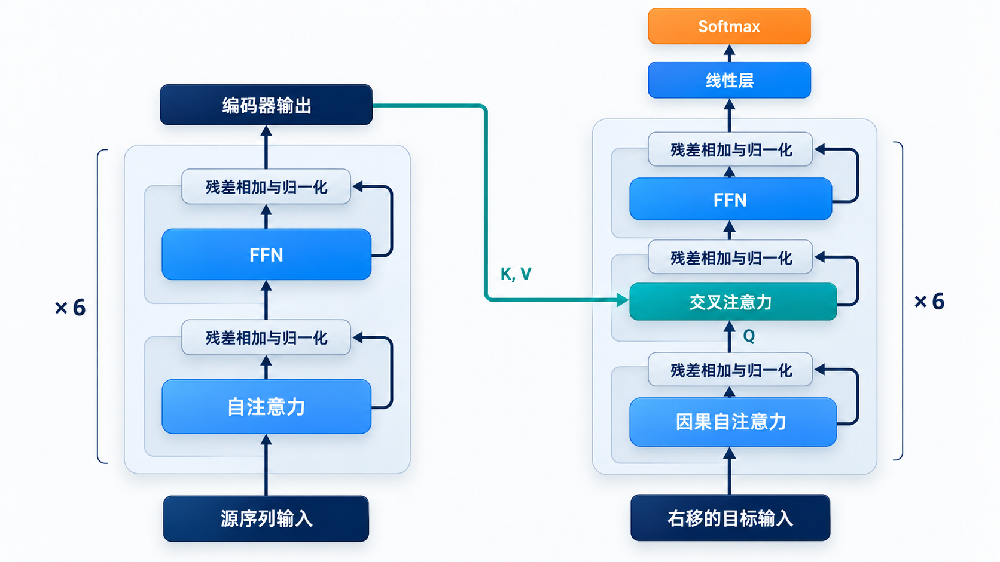
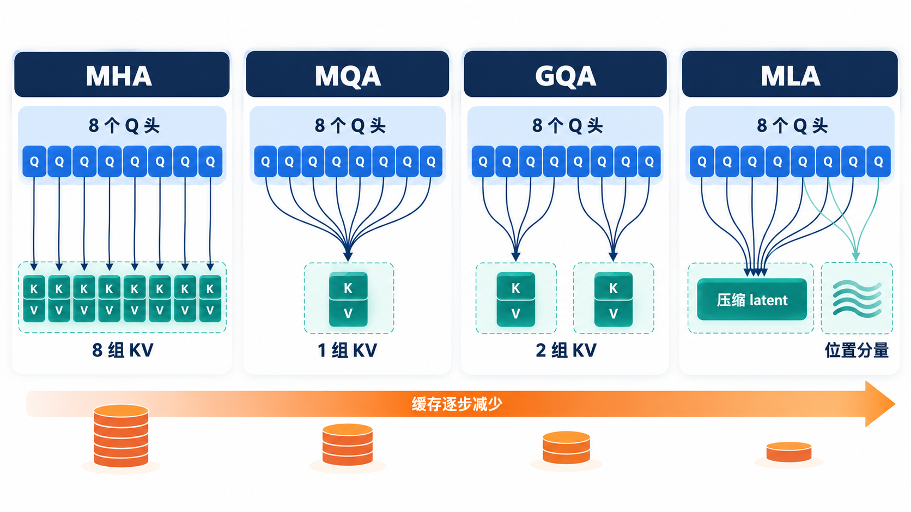
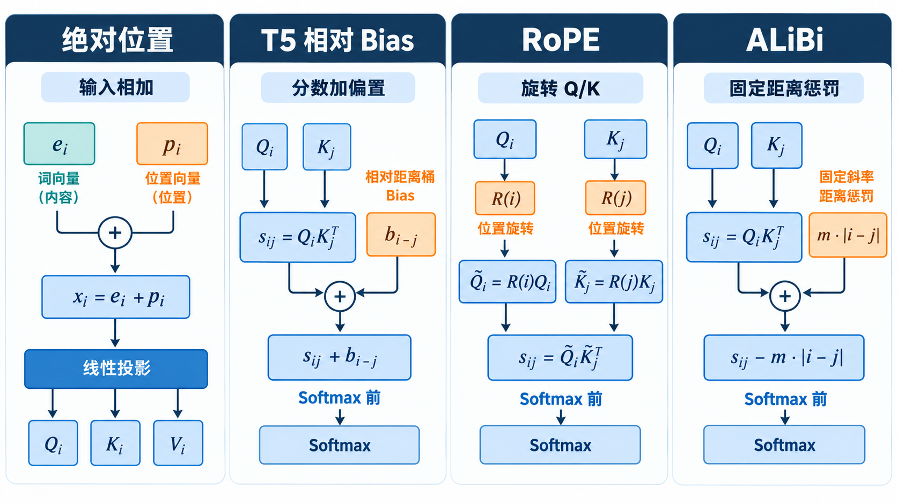
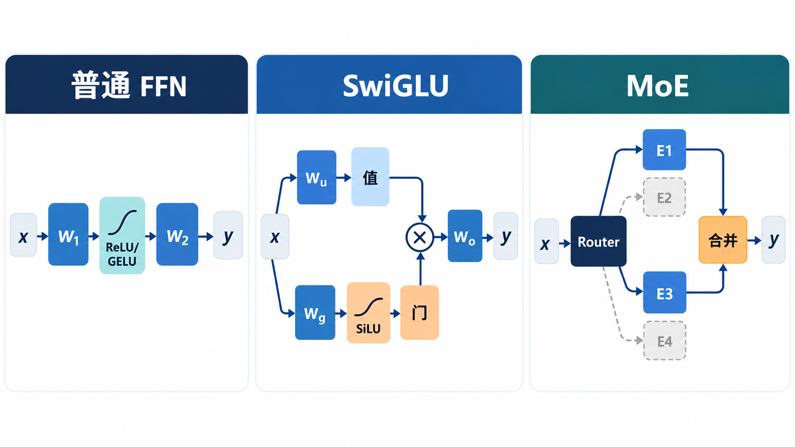
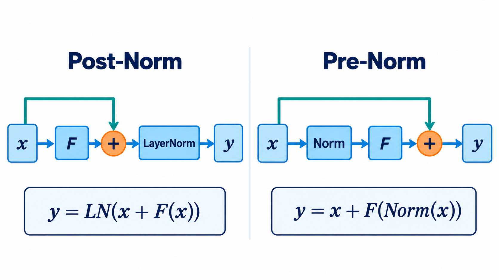
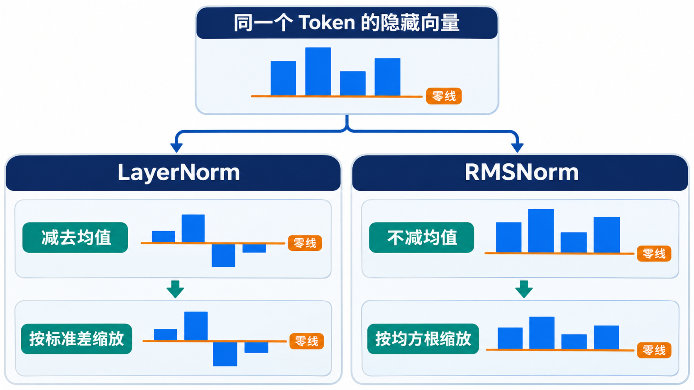

# 从原始 Transformer 到现代大模型：逐项理解架构演进

> 阅读路线：先以[原始 Transformer 学习笔记](transform.md)为基线，逐项解释架构变化，再看这些组件怎样组合成不同模型。本文讨论公开论文中的代表性设计，不把某个模型的做法当成所有大模型的统一标准。

原始 Transformer 是为序列到序列翻译设计的：Encoder 双向读取源序列，Decoder 通过因果 Self-Attention 生成目标序列，并用 Cross-Attention 读取 Encoder 输出。每层的主要结构是 Multi-Head Attention、两层 ReLU FFN、残差连接和 **Post-Norm**；位置由加到输入上的正弦位置编码提供。

现代大模型保留了“用 Attention 交换 Token 信息，再用逐 Token 的 FFN 变换表示”的骨架，但围绕**任务形态、训练稳定性、参数规模和生成时的显存/带宽**改了许多细节。先用一张总表建立坐标：

| 技术轴 | 最初版本中的做法 | 后来的代表性变化 | 主要动机 |
| :--- | :--- | :--- | :--- |
| 整体架构 | Encoder–Decoder | Encoder-only、Decoder-only，以及保留 Encoder–Decoder 的 T5 类模型 | 匹配理解、生成或条件生成任务 |
| Attention 头 | 每个 Query 头配自己的 Key/Value 头，即 MHA | MQA、GQA、MLA | 减少自回归生成时的 KV 读取或存储 |
| 位置 | 输入加绝对正弦编码 | 学习式绝对位置、相对位置 Bias、RoPE、ALiBi | 让 Attention 更直接表达位置关系，适应不同长度 |
| FFN | $\text{ReLU}(xW_1+b_1)W_2+b_2$ | GELU、GEGLU、SwiGLU、MoE | 改进非线性表达，或扩张总参数而保持稀疏计算 |
| 归一化 | Post-Norm LayerNorm | Pre-Norm LayerNorm、Pre-Norm RMSNorm | 改善深层训练的梯度传播；简化归一化计算 |
| 生成状态 | 原论文主要说明自回归解码 | KV Cache、Prefix 复用、分组或压缩 KV | 避免反复计算历史 K/V，缓解长上下文显存与带宽压力 |

这些变化并不是一条“旧版升级为新版”的直线。架构、Attention、位置、FFN、归一化与推理缓存是不同维度；某个模型可以在一个维度采用新设计，在另一个维度保留旧设计。

## 一、先分清三种整体架构：谁能看到哪些 Token？

同样的 Self-Attention 公式，只要**可见范围**和**训练目标**不同，就会形成不同模型。

先看下图：左侧 Encoder 读完源序列，右侧 Decoder 逐步生成目标序列；绿色线把源端信息送到 Cross-Attention。下文把其中的两侧分别拿出来，就得到另外两种常见架构。图展示的是**最初版本**，后续模型会改变层内组件。

### 1.1 Encoder-only：以 BERT 为代表

Encoder 中位置 $i$ 通常可以注意到输入中的所有非 Padding 位置，包括它右边的 Token。若任务是判断一句话的情感或抽取实体，这种双向上下文很自然。BERT 用 Masked Language Modeling 等目标预训练这种表示；它不是一个按原样逐 Token 续写的因果语言模型。[BERT 论文](https://arxiv.org/abs/1810.04805)

注意“输入能双向可见”不等于“模型知道被遮住的答案”：训练时某些输入位置被替换或遮蔽，模型要根据**未被遮蔽的上下文**预测它们。与原始 Encoder 相比，BERT 的经典实现使用学习式绝对位置 Embedding 和 GELU FFN，残差之后做 LayerNorm，仍属于 Post-Norm。[BERT 原始实现](https://github.com/google-research/bert/blob/master/modeling.py)

### 1.2 Encoder–Decoder：原始 Transformer 与 T5

Encoder 先得到完整源序列的表示。Decoder 的第 $t$ 个位置通过因果 Self-Attention 只看目标前缀；随后做 Cross-Attention：**Query 来自 Decoder 当前状态，Key/Value 来自 Encoder 输出**。图中的绿色横线正表示这条源端信息路径。

因此“目标端当前要写什么”和“源序列提供哪些证据”分属两个信息通道。T5 保留 Encoder–Decoder，把多种文本任务统一成 text-to-text；它仍然适合明确给定输入、再产生输出的任务。[T5 论文](https://arxiv.org/abs/1910.10683)

### 1.3 Decoder-only：以 GPT/Llama 为代表

把提示词和待生成内容放进**同一条序列**。因果掩码只允许位置 $t$ 读取自己和左边的 Token，右边尚未出现或被遮住。阅读图时可以把 Decoder 看成只保留右侧的**因果 Self-Attention → FFN** 主干，不再接左侧 Encoder 的绿色信息线。

这使“阅读提示”和“续写答案”共享一套因果 Attention。它没有独立的 Encoder，也没有原始架构中读取 Encoder 输出的 Cross-Attention。代价是一个 Prompt 内的 Token 也受因果可见性限制；它们不是在每一层都双向交换信息。

**架构与能力不能简单画等号。** Encoder-only 常用于表征任务；Encoder–Decoder 常用于条件生成；Decoder-only 常用于通用自回归生成。但具体能力还受到数据、目标函数、规模和训练方法影响。

### 1.4 代表模型出现时间：为什么今天常见的是 Decoder-only？

下表中的时间按**论文首次公开或官方首次发布的月份**记录，不混用后续修订版、模型权重分批开放或产品上线时间；它是帮助建立发展脉络的代表性选例，不是对全部模型的数量统计。

| 架构 | 代表模型 | 首次公开 | 主要定位或架构特征 |
| :--- | :--- | :--- | :--- |
| Encoder-only | [BERT](https://arxiv.org/abs/1810.04805) | 2018-10 | 双向表征，Masked Language Modeling |
| Encoder-only | [RoBERTa](https://arxiv.org/abs/1907.11692) | 2019-07 | 沿 BERT 路线改进预训练 |
| Encoder–Decoder | [原始 Transformer](https://arxiv.org/abs/1706.03762) | 2017-06 | 源序列编码、目标序列自回归生成 |
| Encoder–Decoder | [T5](https://arxiv.org/abs/1910.10683) | 2019-10 | 把多种任务统一为 text-to-text |
| Encoder–Decoder | [BART](https://arxiv.org/abs/1910.13461) | 2019-10 | 去噪预训练与条件生成 |
| Encoder–Decoder | [Flan-T5](https://arxiv.org/abs/2210.11416) | 2022-10 | 对 T5 路线做指令微调 |
| **Decoder-only** | [GPT-2](https://openai.com/index/better-language-models/) | **2019-02** | 因果语言建模、文本续写 |
| **Decoder-only** | [GPT-3](https://arxiv.org/abs/2005.14165) | **2020-05** | 扩大自回归语言模型，展示上下文学习 |
| **Decoder-only** | [LLaMA](https://arxiv.org/abs/2302.13971) | **2023-02** | 开放研究用的 Dense 基础模型系列 |
| **Decoder-only** | [Mistral 7B](https://mistral.ai/news/announcing-mistral-7b/) | **2023-09** | GQA 与滑动窗口 Attention |
| **Decoder-only** | [Mixtral 8×7B](https://mistral.ai/news/mixtral-of-experts/) | **2023-12** | Decoder 主干中的稀疏 MoE |
| **Decoder-only** | [Llama 3](https://ai.meta.com/blog/meta-llama-3/) | **2024-04** | Dense 通用生成模型系列 |
| **Decoder-only** | [Qwen2.5](https://qwenlm.github.io/blog/qwen2.5/) | **2024-09** | 通用文本生成，系列包含多种尺寸 |
| **Decoder-only** | [DeepSeek-V3](https://arxiv.org/abs/2412.19437) | **2024-12** | MLA 与 MoE 组合 |
| **Decoder-only** | [Qwen3](https://qwenlm.github.io/blog/qwen3/) | **2025-04** | 同一 Decoder 路线下有 Dense 与 MoE 型号 |

从这组连续出现的公开模型可以看到：**通用文本生成与对话模型的代表性路线，以 Decoder-only 为主**。它用同一套因果主干处理 Prompt 和生成结果，便于按下一个 Token 的目标进行大规模预训练，并与自回归推理的 KV Cache 配合。表中的近年模型无论采用 Dense FFN 还是 MoE、MHA 还是 GQA/MLA，都仍属于 Decoder-only 的整体架构。这里的“主流”限定于**通用自回归生成模型的架构选择**，不表示 Encoder-only 或 Encoder–Decoder 被淘汰：前者仍适合表征、检索与分类，后者仍适合翻译、摘要等明确的输入到输出任务。

## 二、Attention 头怎样变化：MHA → MQA → GQA → MLA

### 2.1 先看瓶颈：生成一个新 Token 要读多少历史？

把一层因果 Self-Attention 想成「当前 Token 提问，历史 Token 提供索引和内容」：当前 Token 产生 Query $q_t$；每个历史位置 $j\le t$ 留下 Key $k_j$ 和 Value $v_j$。先用 $q_t\cdot k_j$ 决定关注程度，再对 $v_j$ 加权求和。**K 用于匹配，V 用于取回信息；两者都要按历史长度保存或重新计算。**

有了 KV Cache，前一步计算过的历史 K/V 不必重算，但每生成一个新 Token，当前 Query 仍要读取它能看到的历史 K/V。缓存长度和每个位置存储的信息量共同决定显存与读取压力；容量的完整估算放在第六节。MHA、MQA、GQA、MLA 在这里要回答的核心问题是：**为了保留多个 Query 头，每个历史 Token 究竟保存什么？**

先从左到右数蓝色 Q 头：数量不变；再看下方绿色历史状态。前三种是在改变**完整 KV 被多少头共享**，MLA 改为缓存共同的压缩表示和位置分量。图底部橙色圆柱只表示一种典型配置的容量趋势，**不是四种机制对任意配置都严格递减**。

### 2.2 MHA：每个 Query 头都有自己的 K/V 头

标准 Multi-Head Attention（MHA）有 $h_q=h_{kv}=h$。每个头都从当前隐藏状态投影出自己的 Q/K/V。查询时，先拿本头 Q 与历史本头 K 比较，Softmax 得到权重，再用这些权重汇总本头的历史 V；最后拼接各头输出。完整计算见[原始 Transformer 笔记](transform.md)，这里重点追踪**需要为每个历史位置保存什么**。

拼接后还需经过输出投影 $W_O$。不同头有独立的 Q/K/V 投影，因此可以形成不同的匹配和取值方式；这里的“可以”不保证每个头一定学到人能命名的功能。

用四头示意：$Q_1$ 查自己的 $K_1/V_1$ 历史，$Q_2$ 查 $K_2/V_2$，直到 $Q_4$。每个历史 Token 要存 **4 份 K 和 4 份 V**，即 $8d$ 个元素。上下文越长，Decode 每步读取的历史越多；这就是减少 KV 头数的直接动机。[原始 Transformer 论文](https://arxiv.org/abs/1706.03762)

### 2.3 MQA：Query 仍有多头，K/V 只存一份

Multi-Query Attention（MQA）保持 $h_q=h$ 个不同 Query 头，却令 $h_{kv}=1$。四头例子变为 $Q_1,Q_2,Q_3,Q_4$ 都访问同一份历史 $K/V$。图中所有蓝色 Q 箭头收敛到一组绿色 KV；共享的是历史资料，当前各头的“问题”仍然不同。

**共享 K/V 不等于四个头的输出相同。** 各头的 Query 不同，得到的匹配分数和权重仍可不同；只是它们都从同一组 Key 中匹配、同一组 Value 中取值。四头示意中每历史 Token 从 $8d$ 个 KV 元素降为 $2d$ 个，理想的 **KV 数量**降为四分之一。Query 投影、输出投影、FFN 和模型权重没有按这个比例缩小。

代价是头之间不再拥有独立的 K/V 投影。共享越激进，表示能力与质量越可能受到影响；实际幅度需要由训练和任务验证。MQA 主要针对增量 Decode 反复读取历史 KV 的带宽瓶颈。[MQA 论文](https://arxiv.org/abs/1911.02150)

### 2.4 GQA：让一组 Query 头共享一份 K/V

Grouped-Query Attention（GQA）处于两者之间。它把 $h_q$ 个 Query 头分成 $h_{kv}$ 组，每组配一份 K/V。四个 Query 头、两个 KV 组时，$Q_1,Q_2$ 共用第一组 KV，$Q_3,Q_4$ 共用第二组。**一个 Query 头只读所属组的 KV**；同组内仍可凭不同 Q 得到不同权重。

通常让 $h_q$ 可被 $h_{kv}$ 整除，于是每组有 $h_q/h_{kv}$ 个 Query 头。边界很容易记：$h_{kv}=h_q$ 是 MHA，$h_{kv}=1$ 是 MQA。四头两组每历史 Token 保存 $4d$ 个 KV 元素，正好落在 MHA 的 $8d$ 与 MQA 的 $2d$ 之间。

用上面的四栏图回看前三栏：**减少的是被缓存、被读取的 KV 头数，不是 Query 头数，也不是因果掩码的可见范围。**

再看一个接近实际配置的算例：固定 $h_q=32,d=128,S=4096$，只比较**一层、一条序列、每元素 2 字节**的 KV：

| 方案 | $h_{kv}$ | 每个历史 Token 的 KV 元素 | 这层 4096 个 Token 的 KV |
| :--- | ---: | ---: | ---: |
| MHA | 32 | $2\times32\times128=8192$ | 64 MiB |
| GQA | 8 | $2\times8\times128=2048$ | 16 MiB |
| MQA | 1 | $2\times1\times128=256$ | 2 MiB |

若模型有 32 层且各层尺寸相同，再把表中数值乘 32；有多条同时服务的序列，还要按各自缓存长度累计。GQA=8 的 16 MiB 是 MHA 的四分之一，**整个模型显存或生成时间不会因此自动缩成四分之一**。GQA 论文展示了在其测试设置中质量与推理速度之间的折中；不同模型和负载不能直接照搬该结果。Llama 2 的部分较大模型与 Llama 3 系列采用 GQA，具体头数按版本核查。[GQA 论文](https://arxiv.org/abs/2305.13245)、[Llama 2 论文](https://arxiv.org/abs/2307.09288)、[Llama 3 论文](https://arxiv.org/abs/2407.21783)

### 2.5 MLA：历史 Token 存一份压缩表示，各头按需使用

先暂时不管 RoPE，只问一个问题：**历史 Token $j$ 到来时，模型要为未来的 Query 留下什么？**

- **MHA**：为每个头分别留下 $K_j^{(1)},V_j^{(1)},K_j^{(2)},V_j^{(2)},\ldots$。未来每个头直接读取自己的那一对。
- **GQA**：几个 Query 头共用一对完整 K/V；缓存中仍然是一组组已经展开的 K/V。
- **MLA**：先把这一层的隐藏状态 $x_j$ 投影成一份较窄的向量 $c_j^{KV}$，未来各头用**不同的投影矩阵**从这份向量获得自己需要的内容信息。缓存主要保存这份共享的压缩表示。

可以把 $c_j^{KV}$ 理解成一份共同的“资料摘要”。它不是把一个已经训练好的 MHA Cache 原封不动地压缩成无损文件；**模型训练时就学习了如何写这份摘要，以及各头怎样读取它**。它也不是 MQA：MQA 的多个头直接共用**同一对完整 K/V**；MLA 的不同头可通过各自的上投影，从**同一个 latent**得到不同的内容 K/V。

把流程分成“写入”和“读取”：历史 Token $j$ 的隐藏状态先经降维投影，写入宽度为 $d_c$ 的共享 $c_j^{KV}$；未来不同头用各自的上投影，从同一份 $c_j^{KV}$ 取得内容 Key/Value。图中蓝色的 latent 是**一份共同底稿**，右侧两个 Head 的读取参数可以不同；这正是它与 MQA 直接共用完整 KV 的区别。

图还多画了一项 $k_j^R$。先记住结论：**实际 Cache 中是“内容摘要 $c_j^{KV}$ + 位置 Key $k_j^R$”两部分**；下文解释为什么需要第二部分。图只画历史侧，当前 Token 的 Query 由当前隐藏状态另行计算。

#### 第一步：为什么存 latent 能减少 Cache？

假设有 32 个 Query 头、每个头宽度 $d=128$。若是 MHA，**每个历史 Token、每一层**要存 32 个 Key 和 32 个 Value，共 $2\times32\times128=8192$ 个元素。若是 GQA 且有 8 组 KV，则为 $2\times8\times128=2048$ 个元素。

现在只作示意：若 MLA 的共享 latent 宽度为 $d_c=512$，历史内容部分就存 512 个元素，而不是为 32 个头分别存 32 对内容 K/V。**不同头依旧存在**；压缩的是被保存的历史状态，不是把 Query 头数改成一。DeepSeek-V2 式 MLA 还要加上位置 Key 的宽度；若 $d_R=64$，合计 $512+64=576$ 个元素。这组 $d_c=4d,d_R=d/2$ 的比例来自 DeepSeek-V2 论文，前述 32 头只为方便与上面的 MHA/GQA 算例比较，并非 DeepSeek-V2 的实际头数。

#### 第二步：每次查询都把历史 K/V 完整恢复出来吗？

若每次 Decode 都为所有历史 Token、所有头展开完整 $k_j^{C,(a)}$ 和 $v_j^{C,(a)}$，虽然 Cache 小了，却会增加大量计算和中间数据。MLA 的关键是**改变乘法顺序**。先只看不带位置编码的内容匹配：

$$
q_t^{C,(a)\top}k_j^{C,(a)}
=q_t^{C,(a)\top}W_{\mathrm{up},K}^{(a)}c_j^{KV}
=\bigl(W_{\mathrm{up},K}^{(a)\top}q_t^{C,(a)}\bigr)^\top c_j^{KV}.
$$

左边看似“先为历史 Token 恢复 Key，再和当前 Query 点积”；右边是“先变换**当前这个 Query**，再直接和历史的压缩向量点积”。两个式子相等，因为这里只涉及线性投影和点积。这样就无需为**每个历史位置**显式恢复完整内容 Key；Value 与输出投影也可以按线性运算的结合关系重排。这里仍有当前 Query 的投影和 Attention 计算，绝非“免费解压”。

#### 第三步：为什么还要额外保存位置 Key？

上一步能重排，有一个条件：$W_{\mathrm{up},K}^{(a)}$ 是**与历史位置无关的固定矩阵**。RoPE 却要按 Token 位置旋转 Q/K。若把位置 $j$ 的旋转直接套在完整内容 Key 上，位置相关的旋转矩阵会夹在投影与点积之间；不同 $j$ 要用不同旋转，便不能用一组固定矩阵把上一步的重排做完。

DeepSeek-V2 因此将匹配分成两部分：内容部分继续走可压缩、可重排的 $c_j^{KV}$ 路径；位置部分另算一个带 RoPE 的 Key $k_j^R$。当前 Token 的 Query 也有对应的位置分量。**内容匹配分数与位置匹配分数相加**，随后才做缩放和 Softmax；图中的两条缓存路径正对应这两部分。这里省略各头下标，完整定义见[DeepSeek-V2 论文第 2.1 节](https://arxiv.org/html/2405.04434v5)。

因此 DeepSeek-V2 式 MLA 的**每层、每历史 Token**缓存元素数是 $d_c+d_R$，而非仅 $d_c$，也不能套用 GQA 的 $2h_{kv}d$。它的 Query 侧还用了低秩投影，但那主要影响训练激活内存，不会再减少历史 KV Cache。以上描述按 [DeepSeek-V2 论文第 2.1 节](https://arxiv.org/html/2405.04434v5)解释；[DeepSeek-V3 技术报告](https://arxiv.org/abs/2412.19437)沿用 MLA 路线。具体模型的维度和实际推理收益要看配置与实现。

**一句话回顾：GQA 是“少放几对完整 K/V”；MLA 是“保存一份可供多头使用的压缩内容表示，并为 RoPE 另存一份位置 Key”。**

### 2.6 把四者放在同一个问题下比较

从 MHA 到 MQA/GQA，主要改变**多少 Query 头共享一份完整 K/V**；到 MLA，主要改变**历史位置缓存的是完整 K/V 还是可供多头重建/重排计算的压缩表示**。四者保留多 Query 头，但各头拿到的历史信息形式不同。选哪一种需要同时看模型质量、KV 容量、Decode 带宽、投影计算与部署实现，不能仅凭缓存大小给出固定性能排序。

| 机制 | 每历史 Token、每层的缓存元素数（同头维 $d$） | 改动的核心 |
| :--- | :--- | :--- |
| MHA | $2h_qd$ | 每个 Query 头各有完整 K/V |
| MQA | $2d$ | 全部 Query 头共享一份完整 K/V |
| GQA | $2h_{kv}d$ | 每组 Query 头共享完整 K/V |
| DeepSeek-V2 式 MLA | $d_c+d_R$ | 存共享内容 latent 与位置 Key |

表中 MLA 的 $d_c,d_R$ 由具体模型决定；它可能比某个 GQA 配置节省很多，也**不保证比 MQA 更小**。比较时还需保持层数、头维、序列长度、存储精度和分片方式一致。

### 2.7 另一条独立的变化：全量 Attention 与滑动窗口

MHA/MQA/GQA/MLA 讨论“**每个 Query 头使用哪份 K/V**”；滑动窗口讨论“**一个 Query 位置能看到多远**”。两者可以组合。对窗口宽度 $w$ 的因果 Self-Attention，一个简单可见范围是 $\max(0,t-w+1)\le j\le t$。这样单层当前位置不直接读取全部历史位置，推理时也可能只需保留该层窗口所需的 KV，但窗口外的信息能否通过多层间接传递，取决于具体结构与任务。

Mistral 7B 结合 GQA 与 Sliding Window Attention；Longformer 还把局部窗口与少量全局 Attention 位置组合起来。局部机制降低长序列的成本，但“支持输入很长”不能直接等同于“能可靠找回任意远处细节”。[Mistral 7B 论文](https://arxiv.org/abs/2310.06825)、[Longformer 论文](https://arxiv.org/abs/2004.05150)

这些方法优化的是**头和 KV 表示**；FlashAttention 等主要改变 Attention 的计算与内存访问方式，通常属于**算子实现**，不能把“用了 FlashAttention”当作一种模型架构或新的注意力可见规则。

## 三、位置编码怎样变化：从输入相加到改变 Attention 分数

先抓住一个共同问题：在 Self-Attention 中，位置 $i$ 是否关注位置 $j$，最终由 **Softmax 之前的分数**决定。若只给一层无掩码的 Self-Attention 词向量，而完全不提供位置，交换两个 Token 的顺序会使输出跟着交换，却不会让模型知道“谁在谁前面”。因果掩码能限制未来位置不可见，但它本身仍没有明确告诉模型两个可见 Token **相隔多远**。因此要在计算中加入位置线索。

下面始终看同一对位置：当前位置 $i=10$ 要读取历史位置 $j=8$，两者相隔 $2$；若把整段文本整体后移，变成 $i=110,j=108$，相隔仍是 $2$。位置方法回答的是：模型如何利用这个“第几位”和“相隔几位”？

读图先看橙色的位置线索进入哪里：最左栏在 Q/K/V 生成前进入输入；T5 与 ALiBi 在 Softmax 前给分数加项；RoPE 先旋转 Q/K，再让相对位移影响点积。图省略了各方法共有的缩放和因果掩码，ALiBi 一栏的距离惩罚应按**负值**理解。四栏是不同路线，不要求模型按顺序采用。

### 3.1 第一步：把绝对位置加到 Token 表示上

原始 Transformer 把位置向量 $p_i$ 加到词向量 $e_i$：$x_i=e_i+p_i$。这样两个相同的词出现在不同位置时，输入向量也不同。位置编码只在底部加入一次，但此后的每一层都能通过隐藏状态间接使用它。原始论文使用不同频率的正弦、余弦；另一类实现把每个位置的 $p_i$ 作为可学习参数。[最初版本笔记](transform.md)给出了完整公式。[原始 Transformer 论文](https://arxiv.org/abs/1706.03762)

**它怎样影响 Attention？** 图中 $e_i$ 与 $p_i$ 相加后才投影成 Q/K/V，因此点积里既有“内容对内容”，也有“内容对位置”“位置对内容”“位置对位置”的交互。说“绝对位置编码不能表达相对距离”并不准确：**模型有可能从这些交互中学到相对关系**。只是它必须从绝对向量的组合中学到这一点，而不是直接收到“两个位置相隔 2”的信号。正弦编码的设计还让固定位置偏移对应可表示的线性关系。

它留下两个问题。其一，模型没有直接收到“$i-j=2$”这个特征；它需要从 $p_{10},p_8$ 等绝对向量的组合中学会用距离。训练时常见的 $(10,8)$ 与很少见或没见过的 $(110,108)$ 虽然距离相同，绝对位置输入仍不同。其二，**学习式绝对位置表**通常只为有限位置建参数，超出表的范围需要扩展或另做处理；**正弦位置可以继续计算新位置**，但能计算不代表模型在未训练长度上必然表现好。

### 3.2 第二步：把“相隔几位”直接加到 Attention 分数上

若我们认为 $i=10,j=8$ 与 $i=110,j=108$ 至少应共享一部分“相隔 2 位”的信息，可以不先把位置混入词向量，而是在比较 Query 与 Key 时，额外给这一对位置一个偏置。T5 使用的简化相对位置方法可写为：

$$
s_{ij}^{(a)}=
\underbrace{\frac{q_i^{(a)}k_j^{(a)\top}}{\sqrt{d_k}}}_{\text{内容匹配}}
+\underbrace{b_{\text{bucket}(i-j)}^{(a)}}_{\text{相对位置偏置}}
+M_{ij},\qquad
\alpha_{ij}^{(a)}=\text{softmax}_{j}(s_{ij}^{(a)}).
$$

$a$ 是 Attention 头；$M_{ij}$ 是可见范围的掩码，作用与位置偏置不同。两个位置对只要落入同一个距离桶，就会得到同一项 $b$；例如前面的 $(10,8)$ 与 $(110,108)$ 都对应距离 $2$ 的桶。偏置是**加在 Softmax 前的 logits 上**，因此可直接提高或降低某个距离的注意力倾向，而不必完全依赖内容向量间接推断。

为什么要“分桶”？近距离的 $1$、$2$、$3$ 往往值得细分；很远的距离可以用更粗的桶覆盖，避免为每个可能的距离都学习独立参数。T5 的论文实现使用有限个桶，远到一定范围以外会落到同一桶。这样节省了位置参数，也带来限制：**单层位置偏置无法区分同一远距离桶内的精确距离**；模型仍可能通过其他层的内容传播获得更复杂的信息。[T5 论文第 2.1 节](https://arxiv.org/html/1910.10683)

这里解决的是绝对位置输入**没有显式共享相同位移**的问题；它并没有解决所有长上下文问题。偏置 $b$ 对同一个头、同一个距离桶是相同的，不会因为当前两个 Token 的具体内容不同而改变。内容匹配仍由 $q_i k_j^\top$ 决定；两部分是在分数上相加。

### 3.3 第三步：RoPE 让相对距离进入内容匹配本身

T5 的相对 Bias 是给点积分数**另加一项**。Rotary Position Embedding（RoPE）追求另一种形式：把 Q/K 的通道两两配对，位置 $t$ 对应旋转角度 $t\theta$，先按各自位置旋转，再做点积。记旋转后的向量为 $q'_i=R(i\theta)q_i$、$k'_j=R(j\theta)k_j$；图中间两条橙色路径就是这一步，V 不需要同样旋转。

旋转不改变向量长度。更重要的是，两个旋转后的向量做点积时，角度会相减：

$$
(q'_i)^\top k'_j
=q_i^\top R(i\theta)^\top R(j\theta)k_j
=q_i^\top R((j-i)\theta)k_j.
$$

于是 $(i,j)=(10,8)$ 与 $(110,108)$ 都让旋转部分看到 $j-i=-2$。举个只为说明几何关系的特例：若未旋转的 $q_i=k_j=(1,0)$，两者旋转后的点积就是 $\cos((j-i)\theta)$。真实模型里的 Q/K 取决于 Token 内容，因此分数同时取决于**内容向量与相对位移**，并非只由距离决定。

实际头维度远大于 2，RoPE 把通道两两配对，为不同通道对使用不同频率。它通常作用在 Q/K 上，不把位置向量直接加到输入，也不要求对 V 做同样旋转。这样避免把所有距离压进有限个可学习 Bias 桶，同时保留多频率的相对位置结构。[RoFormer 论文](https://arxiv.org/abs/2104.09864)

**RoPE 没有自动解决“训练短、推理无限长”。** 未训练过的巨大位移会带来未见过的旋转组合；不同频率还有周期性。上下文能否扩展，取决于训练长度、频率配置、是否做位置缩放或继续训练，以及实际任务评测。它与 T5 Bias 是不同路线，不能简单说一个在所有任务上都更先进。

### 3.4 另一条路线：ALiBi 用固定距离惩罚强调近期

Attention with Linear Biases（ALiBi）也直接改分数，但不学习每个距离桶的 $b$。对因果 Attention 的某个头，它在 Softmax 前给越远的历史位置越大的**负偏置**：距离乘以该头固定的正斜率，再从内容分数中减去。

记某个头的固定斜率为 $m_a$，它不是由训练学习出的距离表。例如只为直观理解，若 $m_a=0.1$ 且两处内容点积分数相同，距离 $1$ 的位置被减 $0.1$，距离 $10$ 的位置被减 $1.0$；Softmax 前者因此更有优势。不同头使用不同斜率，有的更偏向近处，有的惩罚远处较轻。[ALiBi 论文第 3 节](https://arxiv.org/html/2108.12409)

它针对的是**位置外推与训练长度成本**：线性距离公式对训练时未见过的更远位置也有定义，不需要扩展位置 Embedding 表或新增距离桶。论文在其语言建模设置中验证了“较短序列训练、较长序列推理”的效果。不过，“公式有定义”仍不是对任意长度任务的效果保证；固定的近期偏好也可能不适合必须精确找回远处信息的任务。ALiBi 与 T5 Bias 都是“给 logits 加项”，但前者是**固定线性距离规则**，后者是**按距离桶学习偏置**。

回看四栏图，T5 与 ALiBi 都在 Softmax 前改分数，但一个学习距离桶的偏置，一个使用固定线性惩罚。RoPE 则让位移进入 Q/K 的内容匹配。

### 3.5 把递进关系放在同一张表中

| 方法 | 相比前一类主要想解决什么 | 位置进入哪里 | 新的取舍 |
| :--- | :--- | :--- | :--- |
| 绝对位置相加 | 无位置时无法明确使用 Token 顺序 | 输入向量 $e_i+p_i$ | 相对距离需由模型从绝对信号中学到；学习式表有长度边界 |
| T5 相对 Bias | 让相同相对位移直接共享位置线索 | Softmax 前的分数，学习式分桶偏置 | 桶外或同桶内的远距离精度有限，偏置与内容独立 |
| RoPE | 让相对位移参与 Q/K 的内容匹配，而非另加桶偏置 | 先旋转 Q/K，再做点积 | 长度外推仍受训练和频率设置限制 |
| ALiBi | 用无位置表的规则探索更长长度 | Softmax 前的分数，固定线性惩罚 | 有明确的近期偏好，远距离检索要实测 |

这张表表达的是**问题推动出的设计分支**，不是所有模型都会按这四步依次升级。绝对位置、相对 Bias、RoPE 与 ALiBi 分别提供不同的归纳偏置；任务、训练长度与模型结构会决定取舍。还要始终把**位置机制**与**因果掩码**分开：前者告诉模型位置关系，后者规定哪些位置根本不能被看到。

## 四、FFN 怎样变化：ReLU → GELU/门控 → MoE

Attention 让 Token 彼此交换信息；FFN 在每个 Token 的隐藏维上独立计算。把 Attention 换成 GQA，并不会自动改变 FFN；它们是两条独立的技术轴。

三栏从左到右分别改变了不同的东西：普通 FFN 只有一条扩维、激活、投回的路径；SwiGLU 在同一个 FFN 内增加一条门分支；MoE 在多套 FFN 中选择本次运行的 Expert。图中 MoE 的 E1/E3 仅是一次 Token 路由的示意，别的 Token 可以选其他 Expert。

### 4.1 普通 Dense FFN：换激活函数

原始 FFN 对每个 Token 的向量 $x\in\mathbb R^H$ 做同一套变换：$W_1$ 把隐藏维从 $H$ 扩到 $D$，ReLU 激活，再由 $W_2$ 投回 $H$。图的左栏就是这一条路径。

通常 $D>H$。序列中所有 Token 共用 $W_1,W_2$，但输入不同，输出自然不同。ReLU 对中间结果的负值通道直接输出 0，对正值原样通过。其优点是简单；代价是阈值附近不平滑，负值侧没有渐进的保留空间。

GELU 把门限改成随输入连续变化的权重：输入 $z$ 乘上标准正态分布的累计概率 $\Phi(z)$。比如 $z=-1$ 时，ReLU 输出 0，GELU 约为 $-0.159$；$z=1$ 时，GELU 约为 $0.841$。这说明它不是简单地“只保留正数”，而是平滑地调节通道贡献。**换激活函数没有改变 FFN 的连接方式**：仍是两次投影、所有 Token 共用一套权重，计算量仍主要来自两个矩阵乘法。[GLU Variants 论文](https://arxiv.org/abs/2002.05202)

### 4.2 门控 FFN：GEGLU 与 SwiGLU

门控结构将输入投影成**值分支**和**门分支**，逐元素相乘后再投回原维：

$$
\text{GatedFFN}(x)=W_o\bigl[\phi(W_gx)\odot(W_ux)\bigr].
$$

$\phi=\text{GELU}$ 常称 GEGLU；$\phi=\text{SiLU}$（$\text{SiLU}(z)=z\,\sigma(z)$）常称 SwiGLU。可按三个动作读公式：$W_ux$ 生成要传递的值；$\phi(W_gx)$ 为每个中间通道计算调节系数；两者逐元素相乘，再经 $W_o$ 合成输出。门的值并非只能取 0 或 1，也可能为负，因此“门控”表示连续调节，不能理解为硬开关。

为何需要额外的值分支？普通 FFN 的每个中间通道只由本通道激活后的数值决定；门控结构让一条投影的结果调制另一条投影的结果，形成更丰富的逐元素交互。代价是多一次大矩阵投影。忽略偏置时，普通 FFN 的主要参数量约为 $2HD$，门控 FFN 约为 $3HD_g$。若原本 $D=4H$，为了接近相同参数预算，可取 $D_g\approx 2D/3=8H/3$，而不是继续取 $4H$。这是预算推算，不是所有模型必须使用的宽度；实际效果还要看训练与具体配置。[GLU Variants 论文](https://arxiv.org/abs/2002.05202)

### 4.3 MoE：把一套 FFN 换成可选择的多套 Expert

Mixture of Experts（MoE）在某些层把 Dense FFN 换成 $E$ 个 Expert（通常各自是 FFN）。Router 对每个 Token 产生分数，选择其中 $k$ 个；只有选中的 Expert 执行本次 FFN 计算，输出再按路由权重合并。图的右栏画的是四选二。

若 $E=8,k=2$，一个 Token 只运行两个选中的 Expert，而模型存有八套 Expert 参数。这使**总参数量**和**每 Token 激活的参数/计算量**不再同比增加。不能把“8 个 Expert”理解为“推理只需存 2 个 Expert”：不同 Token 的选择不同，服务仍需容纳可被路由到的权重。也不能把 “8×7B” 简单乘成总参数，因为 Attention 等非 Expert 参数通常是共享的。

按一次前向传播来看，先由 Router 为当前 Token 算出 $E$ 个路由分数；再挑出 Top-$k$；把这个 Token 的表示交给选中的 Expert；最后用门控权重合并 Expert 输出。假设分数排序为 $e_2>e_5>e_1$，且 $k=2$，则本次只执行 $E_2(x),E_5(x)$；下一个 Token 可能选中完全不同的一对。这与上一节的 SwiGLU 不同：SwiGLU 在**同一个 FFN 内调节中间通道**，MoE 在**多套 FFN 之间选择计算路径**。两者也可叠加，Expert 自身可以采用门控 FFN。

这里的“稀疏”主要指 Expert 计算。Router 仍需打分，公共 Attention 仍要运行；总权重仍需存放或在设备间分布。若大量 Token 都选同一 Expert，该 Expert 会拥塞，其他 Expert 闲置。实际训练/服务要处理负载均衡、Expert 容量、跨卡 Token Dispatch、Expert 批量大小与训练稳定性；增大 Expert 数不会自动带来等比例吞吐提升。Mixtral 使用每 Token top-2 的稀疏专家，Switch Transformer 探索 top-1，DeepSeekMoE 还引入更细粒度与共享 Expert 等设计。具体是否丢弃超容量 Token、如何平衡负载，依实现而异。[Mixtral 论文](https://arxiv.org/abs/2401.04088)、[Switch Transformer 论文](https://arxiv.org/abs/2101.03961)、[DeepSeekMoE 论文](https://arxiv.org/abs/2401.06066)

**MoE 是模型层的计算选择，EP 是把 Expert 分布到不同 GPU 的并行部署策略。** 两者不是同义词。跨卡 Token 如何发送，见[分布式并行策略](大模型分布式并行策略_DP_TP_SP_PP_EP%20%281%29.md)和[GPU 通信篇](大模型_GPU通信方式_NCCL与性能优化.md)。

## 五、归一化怎样变化：Post-Norm → Pre-Norm，LayerNorm → RMSNorm

这是两个需要分开的选择：**归一化放在残差的哪一侧**，以及**归一化怎么算**。

### 5.1 Post-Norm 与 Pre-Norm 的路径差别

对一个子层 $F$，原始 Transformer 的 Post-Norm 是：

$$
y=\text{LN}(x+F(x)).
$$

Pre-Norm 则先归一化再送入子层：

$$
y=x+F(\text{Norm}(x)).
$$

两条路径的区别在于 Norm 位于残差相加之后还是子层计算之前；图中 $F$ 代表 Attention 或 FFN 子层。

先看前向信息流。Pre-Norm 让原输入 $x$ 不经改写就进入残差加法，子层只提供增量 $F(\text{Norm}(x))$；Post-Norm 则先把增量与输入相加，再把总和归一化。两者即使用同一个 LayerNorm、同一个 Attention，得到的函数也不相同。

反向传播时，沿图中的残差主线往回看：Pre-Norm 的梯度有一条不经过 Norm 的直通路径；Post-Norm 的残差相加之后仍要穿过 Norm。多层叠加时，这个路径差别会影响初始化阶段的梯度。已有分析发现，在其研究设置下 Post-LN 的靠近输出层梯度可能较大，学习率 warm-up 对其更关键；Pre-LN 的初始化梯度更容易控制。**这只是解释训练稳定性的一个机制**，并不保证任意深度都稳定，也不能单凭 Norm 顺序判断最终质量。[LayerNorm 位置分析论文](https://arxiv.org/abs/2002.04745)

一个 Pre-Norm Block 通常先做 **Norm → Attention → 残差相加**，再做 **Norm → FFN → 残差相加**。第二个 Norm 的输入是第一次残差相加后的表示，不是最初的 $x$。因此“Pre-Norm”也不表示整个模型只在最开始归一化一次；每个子层前仍有自己的 Norm。

### 5.2 LayerNorm 与 RMSNorm 的计算差别

对于单个 Token 的隐藏向量，LayerNorm 先减去**该向量的均值**，再除以标准差，最后做可学习的缩放和平移。RMSNorm 不做减均值，只按该向量的均方根调整尺度，再做可学习缩放。两种运算的差别是“是否中心化”，与上一小节的 Pre/Post 位置选择相互独立。需要精确实现式时可读[RMSNorm 论文](https://arxiv.org/abs/1910.07467)和[原始 Transformer 笔记](transform.md)。

图中的柱高只表达归一化步骤，省略了后续可学习缩放与平移，不代表某次真实模型输出；两栏处理的是**同一个 Token 的隐藏向量**，并非跨 Token 统计。下方的小例子给出可核算的数值差别。

两者都通常沿**单个 Token 的隐藏维**计算，而不是在不同 Token 之间求全局均值。RMSNorm 少了中心化这一步，但“少一步”不自动推出任何硬件上固定的加速比例。Llama 2 采用 Pre-Norm RMSNorm；原始 Transformer 是 Post-Norm LayerNorm。T5 则有自己的归一化实现，不能仅因它是 Pre-Norm 就说它与 Llama 完全一样。[RMSNorm 论文](https://arxiv.org/abs/1910.07467)、[Llama 2 论文](https://arxiv.org/abs/2307.09288)

一个二维小例子能看出差别。先忽略 $\epsilon$，设 $\gamma=1,\beta=0$，输入 $x=[1,3]$：LayerNorm 减去均值 2，再除以标准差 1，得到 $[-1,1]$；RMSNorm 用均方根 $\sqrt5$ 缩放，得到 $[1/\sqrt5,3/\sqrt5]$。如果把两个分量都加 10，LayerNorm 的结果仍是 $[-1,1]$，RMSNorm 的结果会变化。前者同时消除整体平移与尺度变化；后者主要控制尺度，保留均值信息。这就是 RMSNorm 简化计算时选择放弃的性质。[RMSNorm 论文](https://arxiv.org/abs/1910.07467)

读模型配置时要做两个独立判断：**Pre/Post 决定 Norm 在残差块中的位置；LayerNorm/RMSNorm 决定这个 Norm 对向量做什么运算。** “Pre-Norm RMSNorm”是两个选择的组合，不是一种不可拆开的新算子。

## 六、KV Cache 怎样改变推理：缓存历史，而不是改变模型参数

KV Cache 是**自回归推理的执行状态**，不是另一个训练好的 Attention 机制。它与 MHA/GQA/MLA 可以组合：后者决定要缓存哪些形状的数据，Cache 决定不重复计算历史数据。

### 6.1 不缓存会重复什么？

先区分两个阶段。**Prefill** 把完整 Prompt 一次送入模型；因果掩码保证每个位置只能使用自己及以前的 Token，同时为每一层得到 Prompt 的 K/V。**Decode** 已知全部前缀，每一步只输入一个刚生成的新 Token，并预测再下一个 Token。

例如 Prompt 是 $A,B,C$。Prefill 在某层保存 $K_A,V_A,K_B,V_B,K_C,V_C$。模型生成 $D$ 后，下一步只需由 $D$ 的该层表示计算 $q_D,k_D,v_D$，把 $k_D,v_D$ 追加到 Cache；$q_D$ 与 $A$ 到 $D$ 的 K 比较，再对对应 V 求加权和。每一层都重复这个过程。之所以可以复用旧 K/V，是因为因果掩码让历史位置的表示**不依赖后来出现的 Token**；模型权重、历史前缀和位置条件保持相同时，历史 K/V 不会因 $D$ 到来而改变。

如果不用 Cache，每生成一个 Token 都把增长后的完整前缀重新送入模型，历史位置的投影和各层前向会反复计算。有了 Cache，当前步只算新位置的隐藏状态：把本步的 $k_t,v_t$ 追加到历史 K/V，当前 $q_t$ 再读取可见的整个缓存。下面的图把 Prefill 的写入和 Decode 的追加分开画出。

这里省掉的是**历史位置的重复前向计算**，不只是少做一次 K/V 投影；当前 Query 仍要读取可见历史的 K/V 做 Attention。对于全量因果 Attention，单步读取量随上下文长度增长，缓存本身也随生成长度增长，因此 KV Cache 不让单步成本变成常数。对于滑动窗口等有限可见范围机制，增长规律还取决于具体窗口与缓存实现。

图中 $T_4$ 是本步输入 Token，$O_4$ 是其 Attention 输出；实际每一层都维护各自的 Cache，图中只画一层。

### 6.2 容量怎样估算？

对 Decoder-only MHA/GQA，一个粗略的未压缩 KV 容量公式为：

$$
M_{KV}\approx 2\,L\,B\,S\,h_{kv}\,d_k\,b.
$$

$L$ 为层数，$B$ 为并发序列数，$S$ 为当前缓存长度，$h_{kv}$ 为 KV 头数，$d_k$ 为每头维度，$b$ 为每元素字节数。式子未计分配碎片、页表、对齐、量化元数据、滑动窗口及并行分片。例：$L=32,B=1,S=4096,h_{kv}=8,d_k=128,b=2$ 时，约 $512$ MiB；同形状 MHA 若 $h_{kv}=32$，约 $2$ GiB。这个**仅是 KV 部分**，不是总显存。

这个算例也说明两种优化如何配合：**Cache** 让历史计算只做一次；**GQA** 让每个历史位置需要存和读取的 KV 头更少。前者改善重复计算，后者改善 Cache 容量与带宽压力。MLA 进一步改变所存的表示，不能直接把上式中的 $h_{kv}$ 改小来估算 MLA；要按其 latent 与位置分量的实际存储形状计算。显存节约也要结合权重、激活、并发数和分配器开销看。

### 6.3 Encoder–Decoder 的 Cache 与 Decoder-only 有何不同？

Encoder–Decoder 推理有两种来源不同的可复用状态。Decoder 的**Self-Attention K/V** 来自已生成的目标前缀，每生成一个目标 Token 就追加一次；**Cross-Attention K/V** 来自固定的 Encoder 输出，给定源序列后可计算一次，在整个目标生成过程中复用。前者的长度随目标增长，后者主要由源长度决定。不能把两者合并成“Decoder 只有一份 KV Cache”，否则会混淆 Query 从哪里来、K/V 从哪里来。

Prefix Cache 复用相同前缀的已计算状态；Paged KV Cache 改善缓存的分配与管理；KV 量化减少字节数。这些主要是**推理系统设计**，不应与 GQA 或 RoPE 这样的模型结构变化混为一谈。是否能复用还取决于模型版本、Token 序列、位置、注意力掩码等是否一致。

## 七、按模型架构重新串起这些变化

前六节分别解释了模型的可见范围、Attention、位置、FFN、Norm 和推理状态。现在沿着**一个输入如何穿过模型**来重组它们：先确定 Token 可以读取哪些上下文，再看每个 Block 如何交换信息和变换特征，最后看生成时要留下哪些状态。下表仅列**代表性公开模型**，同一系列内不同版本、尺寸可能不完全相同。

| 模型/路线 | 整体结构 | Attention/位置 | FFN | Norm | 推理时的关键状态 |
| :--- | :--- | :--- | :--- | :--- | :--- |
| 原始 Transformer | Encoder–Decoder | MHA；绝对正弦位置 | Dense ReLU | Post-LN LayerNorm | Decoder Self-Attn 与 Cross-Attn 可复用历史/源端 K/V |
| BERT | Encoder-only | 双向 Self-Attention；学习式绝对位置 | Dense GELU FFN | Post-Norm LayerNorm | 主要用于整段输入的表征 |
| T5 | Encoder–Decoder | MHA；相对位置 Bias | Dense FFN；不同版本可有门控变种 | Pre-Norm 风格 | Decoder 历史与 Encoder 输出分别复用 |
| Llama 2/3 代表配置 | Decoder-only | 因果 Attention；RoPE；部分版本 GQA | Dense SwiGLU | Pre-Norm RMSNorm | 自回归 KV Cache，GQA 降低 KV 头数 |
| Mistral 7B | Decoder-only | GQA 与 Sliding Window Attention | Dense FFN | 按具体模型实现 | 单层历史可见范围受窗口约束 |
| Mixtral 8×7B | Decoder-only | 因果 Attention；沿用该模型的 Attention 配置 | 稀疏 MoE，8 选 2 | 按具体模型实现 | KV Cache 加 Expert 路由 |
| DeepSeek-V2/V3 | Decoder-only | MLA；分离的位置路径 | DeepSeekMoE | 按具体版本实现 | 压缩 latent/位置分量的 Cache 加 Expert 路由 |

### 7.1 T5：保留 Encoder–Decoder，但改训练和位置信息

假设任务是把源句翻译成目标句。先把**完整源句**交给 Encoder：每个源 Token 可通过双向 Self-Attention 汇集源句上下文，得到一列 Encoder 输出。生成目标句时，Decoder 的因果 Self-Attention 只能看已生成的目标前缀；随后 Cross-Attention 让当前目标 Query 从固定的 Encoder 输出取信息。这解释了为何它有两套不同的 Attention 上下文：一套随目标长度增长，一套来自已读完的源句。

T5 在这种结构里把位置关系作为相对 Bias 加到 Attention 分数，把 Norm 放到子层计算之前；这些变化分别解决**如何表示距离**和**如何训练残差块**，并没有取消 Encoder 与 Cross-Attention。训练时，T5 又把多种任务统一成“输入文本 → 输出文本”的形式。读模型时先追踪源和目标数据流，再看每个 Attention 内部如何加 Bias，才不会把整体架构和局部算子混在一起。[T5 论文](https://arxiv.org/abs/1910.10683)

### 7.2 Llama：Dense Decoder-only 的一组组合

一个典型 Llama Block 可以读成两次连续的 **Pre-Norm → 子层 → 残差相加**：第一次的子层是因果 Attention，第二次是 Dense SwiGLU。第一次相加后的表示再进入第二次 Norm。

沿一个 Token 进入 Block 的路线读：先 RMSNorm，再投影 Q/K/V；对 Q/K 施加 RoPE，按因果掩码计算 Attention；若该版本采用 GQA，多个 Q 头共用一组 KV 头，否则按 MHA 一一对应；Attention 输出加回原输入；再做 RMSNorm、Dense SwiGLU，最后再次残差相加。于是位置、头共享、门控与 Norm 分别作用在**不同位置**，不是四种互相替代的“Attention 优化”。

训练时，因果掩码允许整段序列并行计算各位置的预测损失；推理时，下一个 Token 尚未出现，只能逐步生成并维护每层 KV Cache。采用 GQA 的版本会减少这份 Cache 的头数，SwiGLU 改变逐 Token 特征变换，却不决定 Cache 的长度。Llama 家族的具体头数、位置扩展方法与版本有关，不能把上式当成所有尺寸的逐项配置清单。[Llama 2 论文](https://arxiv.org/abs/2307.09288)、[Llama 3 论文](https://arxiv.org/abs/2407.21783)

### 7.3 Mistral：头共享与可见窗口可以同时改变

在 Llama 一类 Dense Decoder 的基础上，Mistral 7B 进一步调整两个不同维度：GQA 减少每个位置的 KV 头数；Sliding Window Attention 限制当前 Token 在**单层**能直接读到的历史范围。若窗口宽度是 $W$，单层当前 Query 只与附近最多 $W$ 个历史位置做匹配；较远位置的信息仍可能经多层的局部传递间接影响当前表示，但这不等于当前层能直接随机访问任意远处 Token。

因此分析长上下文时，应分别问：每层保存多少 KV？当前 Query 直接看哪些位置？多层传播能否满足任务所需的远距离检索？窗口机制与 GQA 可以叠加，却解决不同问题。缓存能否限制在窗口内还要结合滚动缓存等具体实现；不能只凭“支持长度”推断实际检索能力。[Mistral 7B 论文](https://arxiv.org/abs/2310.06825)

### 7.4 Mixtral：保留 Decoder 主干，把 Dense FFN 改为 MoE

沿 Mixtral 的一个 Block 走一遍：先做因果 Self-Attention，得到已经融合上下文的 Token 表示；到 FFN 位置时，Router 对**每个 Token 分别**选出两个 Expert；两个 Expert 各自变换同一 Token 的表示，再把输出按路由权重合并。这里被路由的是逐 Token 的 FFN 计算，Attention 仍承担 Token 间的信息交换。相邻 Token 即使互相注意，也可能选择不同 Expert。

这种设计扩大了可用参数容量，同时让每个 Token 只执行少数 Expert；代价是权重存储、路由负载与 Expert 间通信。若 Expert 分布在多张 GPU 上，Token 可能跨卡发送，实际速度不只由“每 Token 激活多少参数”决定。它也说明 MoE 与 KV Cache 作用在不同阶段：前者选 FFN 路径，后者复用生成时的历史 Attention 状态。[Mixtral 论文](https://arxiv.org/abs/2401.04088)

### 7.5 DeepSeek-V2/V3：同时改变 Attention 缓存与 FFN 容量

DeepSeek-V2/V3 把两条前面分别讨论的路线放进同一 Decoder 主干。走到 Attention 时，MLA 让历史位置主要保存压缩 latent，并单独处理承载位置的信息路径；当前 Query 利用这些缓存状态计算历史匹配。走到 FFN 时，DeepSeekMoE 让 Router 为当前 Token 选择少量路由 Expert，并结合共享 Expert 处理公共信息。两种选择发生在 Block 的不同子层，不是同一个“稀疏机制”。

因此可以分别检查收益和代价：**MLA 对准 KV Cache 的容量与读取；MoE 对准参数容量与每 Token 计算分配。** MLA 的推理实现要处理 latent/位置分量，MoE 的部署要处理 Expert 放置、Token 分发和负载。某一配置是否更快，要连同批量、序列长度、KV 实现与硬件互联一起衡量，不能从“用了 MLA + MoE”直接推出。[DeepSeek-V2 论文](https://arxiv.org/abs/2405.04434)、[DeepSeek-V3 技术报告](https://arxiv.org/abs/2412.19437)

## 八、用一套问题读懂任何新模型架构

看到一个新的模型名称时，先不要背部件清单，按数据流问：

1. **可见范围**：是 Encoder-only、Encoder–Decoder 还是 Decoder-only？每个 Attention 的 Query/Key/Value 来自哪里，是否有因果掩码？
2. **头与 Cache**：有多少 Query 头、KV 头？缓存完整 K/V、共享 K/V，还是压缩 latent？
3. **位置**：位置信息加在输入、Attention logits，还是 Q/K 上？超过训练长度时怎么处理？
4. **FFN**：是普通 Dense、门控 Dense，还是有 Router 的 MoE？每 Token 激活几个 Expert？
5. **Norm 与残差**：Norm 在加法前还是后？用 LayerNorm 还是 RMSNorm？第二个子层的输入是谁？
6. **运行状态**：Prefill 与 Decode 各需要保存什么？Cache 是模型定义的一部分，还是系统为同一模型做的内存管理优化？

这些问题把“架构是什么”和“如何高效运行”分开。进一步理解 GPU 间的专家分发、张量切分和通信代价，可接着读[分布式并行策略](大模型分布式并行策略_DP_TP_SP_PP_EP%20%281%29.md)与[GPU 通信和 NCCL](大模型_GPU通信方式_NCCL与性能优化.md)。

## 参考论文

- [Attention Is All You Need](https://arxiv.org/abs/1706.03762)；[BERT](https://arxiv.org/abs/1810.04805)；[T5](https://arxiv.org/abs/1910.10683)。
- [MQA](https://arxiv.org/abs/1911.02150)；[GQA](https://arxiv.org/abs/2305.13245)；[RoFormer/RoPE](https://arxiv.org/abs/2104.09864)；[ALiBi](https://arxiv.org/abs/2108.12409)。
- [GLU Variants](https://arxiv.org/abs/2002.05202)；[RMSNorm](https://arxiv.org/abs/1910.07467)；[Pre-LN/Post-LN 分析](https://arxiv.org/abs/2002.04745)。
- [Llama 2](https://arxiv.org/abs/2307.09288)；[Llama 3](https://arxiv.org/abs/2407.21783)；[Mistral 7B](https://arxiv.org/abs/2310.06825)；[Mixtral](https://arxiv.org/abs/2401.04088)；[DeepSeek-V2](https://arxiv.org/abs/2405.04434)；[DeepSeek-V3](https://arxiv.org/abs/2412.19437)。
