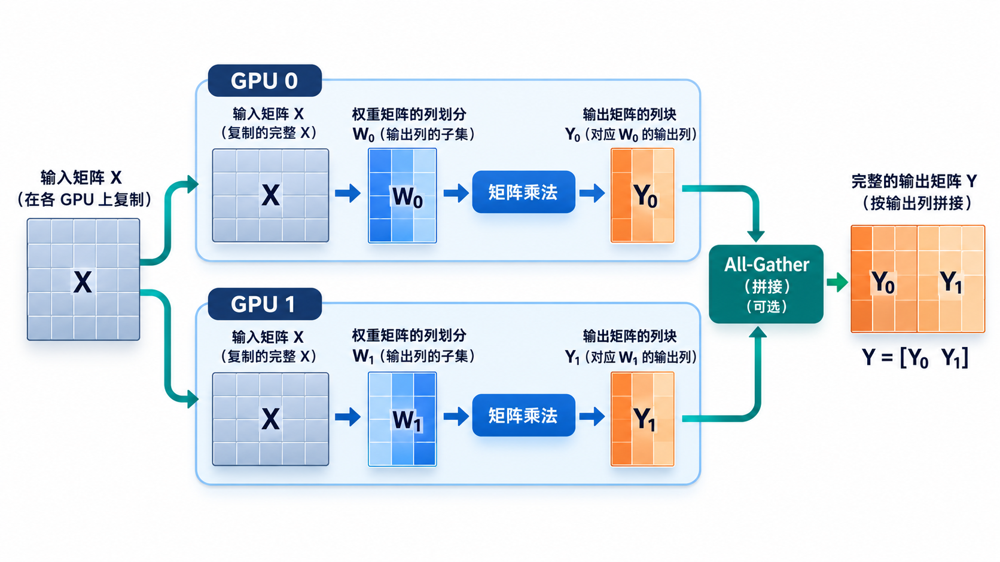
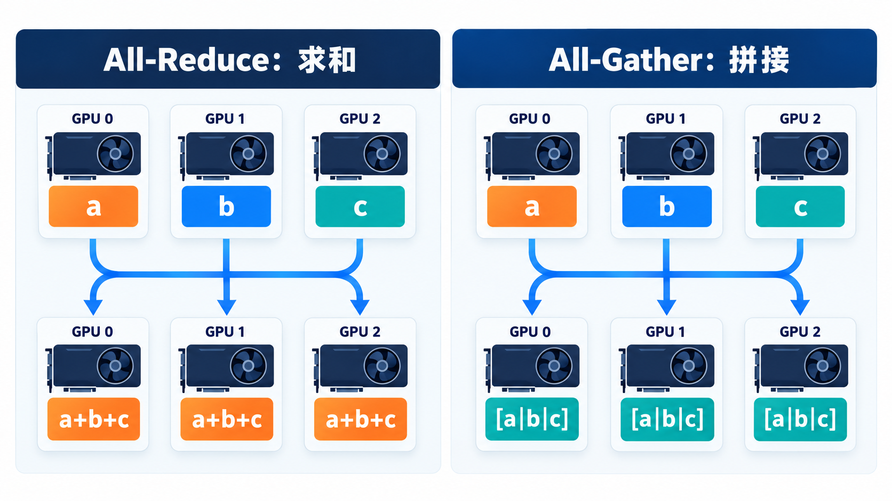
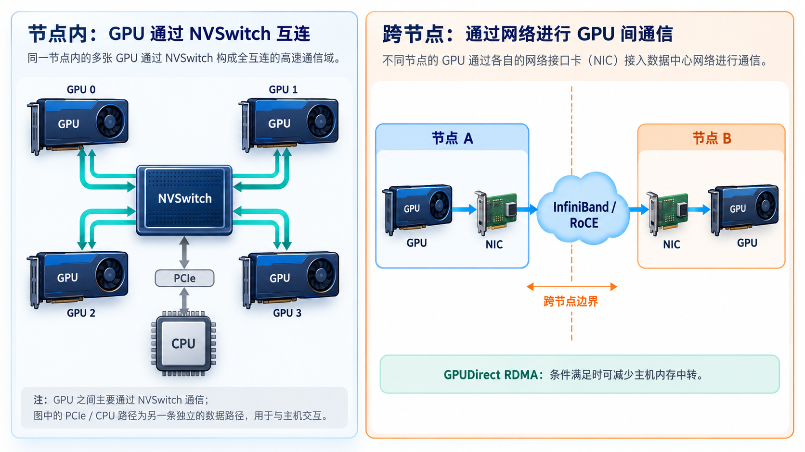
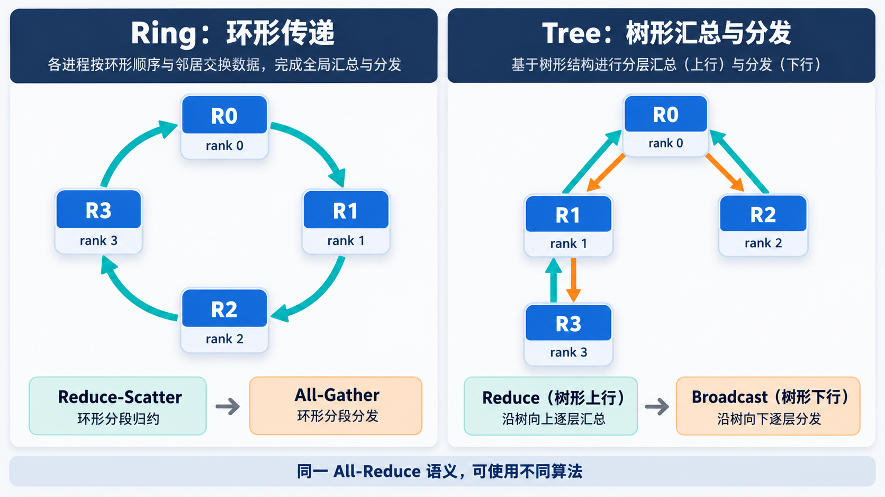
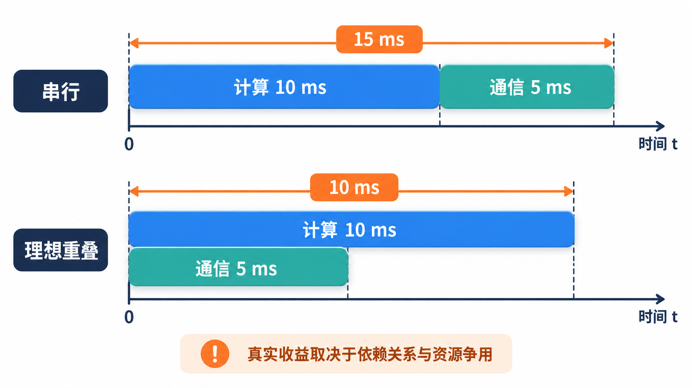

# 从零理解大模型 GPU 通信：从数据交换到 NCCL 性能优化

> 一条学习路径：为什么要通信 → 数据如何交换 → 走哪条硬件路径 → NCCL 如何执行 → 怎样定位与优化瓶颈

训练或部署一个模型时，单张 GPU 可能放不下全部参数，也可能无法在目标时间内完成计算。于是，我们把模型、数据或请求分配给多张 GPU。分配之后，一个问题随之出现：**一张 GPU 算出的结果，怎样交给另一张 GPU？**

本文以 NVIDIA GPU 与 NCCL 为主要背景，先建立通信的直觉，再介绍通信原语、常见算法、硬件互联与性能分析。示例中的数字用于解释语义；实际性能必须在目标机器和工作负载上测量。若想先了解 DP、TP、SP、PP、EP 如何切分模型与数据，可读配套的[大模型分布式并行策略](大模型分布式并行策略_DP_TP_SP_PP_EP%20%281%29.md)。

## 一、先从一层模型计算看通信为什么出现

设一层计算为 $Y=XW$。如果 $W$ 太大，我们可以把它按列拆成两块，分别放在 GPU 0 和 GPU 1：

$$
W=[W_0\;W_1],\qquad
Y=[XW_0\;XW_1].
$$

两张 GPU 可以并行得到输出的不同部分；若下一步需要完整的 $Y$，就必须把分片重新汇集。若按行拆分 $W$，每张 GPU 得到的是同一个输出的部分贡献，此时需要把贡献相加。**切分方式决定计算后的通信方式。**

图中展示的是按列切分：$X$ 在两张 GPU 上可用，$Y_0$ 与 $Y_1$ 在需要完整输出时再拼接。若按行切分，输入 $X$ 也要沿相应维度拆成 $[X_0\;X_1]$，从而有 $Y=X_0W_0+X_1W_1$；两种切分不能混为一谈。

大模型常见并行策略可以先这样理解：

| 策略 | 切分什么 | 典型通信 |
| :--- | :--- | :--- |
| 数据并行 DP（训练） | 不同数据批次 | 同步梯度或梯度分片 |
| 张量并行 TP | 同一层的权重与计算 | 归约或收集激活值 |
| 流水线并行 PP | 不同网络层 | 相邻阶段传递激活值 |
| 专家并行 EP | 不同 Expert | 按目标 Expert 发送与回收 Token |
| 上下文并行 CP | 长序列的不同片段 | 交换 Attention 所需的数据 |

推理时的多个独立 DP 副本通常各自处理请求，无需像训练那样在每步同步梯度。TP、PP、EP 的通信则可能处在单次请求的关键路径上。

多 GPU 不必然更快。一次请求的总时间大致由计算、通信、等待和调度共同组成。若切分减少的计算时间小于新增通信与等待时间，增加 GPU 反而会变慢。

## 二、理解通信的三个层次

讨论「GPU 通信」时，先区分三件事：

1. **语义：做什么？** 例如把数据发给一个 Rank、把多份数据求和、收集所有分片。
2. **算法：怎样完成？** 例如按环传递，或沿树汇总和广播。
3. **路径：实际走哪里？** 例如节点内的 NVLink/PCIe，或跨节点的 NIC 与网络。

还有第四个必须测量的层次：**性能**。相同的 All-Reduce 语义，在不同消息大小、GPU 拓扑与 NCCL 配置下，可能采用不同实现，耗时也会不同。

### Rank、通信组和张量

Rank 是通信组内参与者的编号，不应直接理解为物理 GPU 编号。一个通信组（communicator 或 process group）约定了哪些 Rank 共同通信。张量是每个 Rank 准备发送或接收的数据。

下面用四张 GPU、四个 Rank 举例，默认 Rank 0–3 分别位于 GPU 0–3。这个映射只为说明方便，真实任务应以进程与设备绑定关系为准。

## 三、两类基本操作：P2P 与 Collective

### 3.1 P2P：指定发送方和接收方

点对点通信只涉及明确的一对发送方与接收方：

$$
\text{Send}(r_i\rightarrow r_j,\;X),\qquad
\text{Recv}(r_j\leftarrow r_i,\;X).
$$

例如流水线并行中，负责前几层的 GPU 把激活值发送给下一阶段。发送方和接收方必须匹配，数据类型、元素数量等也要符合接口约定。复杂的多对多模式可以由多组 Send/Recv 组成。

### 3.2 Collective：通信组共同完成一个操作

集合通信要求组内 Rank 按约定共同参与。它提供比一组手写 Send/Recv 更直接的语义：Broadcast、Reduce、All-Reduce、All-Gather、Reduce-Scatter 和 All-to-All。

**P2P 与 Collective 描述的是操作接口与参与方式，并非「快链路」与「慢链路」的区别。** 两者都可能走节点内链路或节点间网络。

组内调用顺序、数量、数据类型等若不一致，可能导致挂起、错误或数据损坏。NCCL 对每种 Collective 的参数约定应以对应 API 文档为准。

## 四、先记住六种集合通信的输入与输出

下面的例子使用 SUM 作为归约运算，重点看**结果最终在哪些 Rank 上**。

| 原语 | 输入 | 输出 | 核心动作 |
| :--- | :--- | :--- | :--- |
| Broadcast | 一个根 Rank 有数据 | 每个 Rank 都有副本 | 一份分发给所有人 |
| Reduce | 每个 Rank 有同形状数据 | 指定根 Rank 有归约结果 | 多份归约成一份 |
| All-Reduce | 每个 Rank 有同形状数据 | 每个 Rank 都有归约结果 | 归约并共享 |
| All-Gather | 每个 Rank 有不同分片 | 每个 Rank 都有完整拼接结果 | 收集并拼接 |
| Reduce-Scatter | 每个 Rank 有可分块的同形状数据 | 每个 Rank 得到归约结果的一块 | 归约并分片 |
| All-to-All | 每个 Rank 有发往各目的地的数据块 | 每个 Rank 收到各来源发给自己的块 | 按目的地交换 |

### 4.1 Broadcast 与 Reduce：一对多、多对一

若 Rank 0 持有 $X=[1,2]$，Broadcast 之后四个 Rank 都拥有 $[1,2]$。这适合分发共同状态，但它本身不计算多个 Rank 数据的和。

若四个 Rank 分别持有：

$$
X_0=[1,2],\quad X_1=[3,4],\quad
X_2=[5,6],\quad X_3=[7,8],
$$

SUM Reduce 到 Rank 0 后，Rank 0 得到：

$$
Y=X_0+X_1+X_2+X_3=[16,20].
$$

其他 Rank **不保证**拥有完整的 $Y$。如果所有 Rank 都需要它，就应使用 All-Reduce。

### 4.2 All-Reduce：每个人都得到归约结果

仍用上面的四份数据，SUM All-Reduce 之后，四个 Rank 均得到 $[16,20]$。数据并行训练中的梯度同步是典型用途；张量并行中某些需要完整求和结果的算子也会使用它。

从**结果语义**看，All-Reduce 等价于「Reduce，再把结果分发出去」。从常见的分块实现看，也可以理解为「Reduce-Scatter，再 All-Gather」。这两种说法用于帮助理解最终结果，并不限定 NCCL 必须按某一种固定步骤执行。

### 4.3 All-Gather：拼接，不求和

若四个 Rank 各持有两项：

$$
X_0=[1,2],\quad X_1=[3,4],\quad
X_2=[5,6],\quad X_3=[7,8],
$$

All-Gather 后，每个 Rank 都拥有按 Rank 顺序拼接的：

$$
Y=\text{Concat}(X_0,X_1,X_2,X_3)
 =[1,2,3,4,5,6,7,8].
$$

它用于恢复完整的张量布局。不要把 All-Gather 与 All-Reduce 混淆：前者拼接不同分片，后者对对应元素做归约。

图中 $a,b,c$ 代表三个 Rank 的数据：左侧每个 Rank 得到相同的归约值，右侧每个 Rank 得到相同的拼接序列。

### 4.4 Reduce-Scatter：先归约，再分片

假设每个 Rank 都持有长度为 4 的向量：

$$
\begin{aligned}
X_0&=[1,2,3,4],\\
X_1&=[10,20,30,40],\\
X_2&=[100,200,300,400],\\
X_3&=[1000,2000,3000,4000].
\end{aligned}
$$

逐元素求和为 $Y=[1111,2222,3333,4444]$。Reduce-Scatter 不把整个 $Y$ 复制给每个 Rank，而是让 Rank 0–3 分别只得到 $1111$、$2222$、$3333$、$4444$。当后续计算仍保持分片布局时，这比先复制完整结果更符合数据需求。

### 4.5 All-to-All：每个人给不同的人发送不同块

设 $A_{ij}$ 是 Rank $i$ 准备发给 Rank $j$ 的数据块，则 Rank $j$ 最终收到第 $j$ 列：

$$
\{A_{0j},A_{1j},A_{2j},A_{3j}\}.
$$

与 All-Gather 的「所有人都收集同一套分片」不同，All-to-All 按目的地重新分配数据。MoE 中，Router 把 Token 分派给不同 Expert，处理后再把结果发回原来的位置，常形成两次交换。

**同一语义也有不同 API 形式。** 当前 NCCL 文档提供 ncclAlltoAll；也可通过分组的 ncclSend/ncclRecv 组合实现更灵活的交换。是否支持可变大小、怎样缓冲与同步，取决于所用 API 和框架，不能把某一种实现当成全部 All-to-All。参见 [NCCL Collective Operations](https://docs.nvidia.com/deeplearning/nccl/user-guide/docs/usage/collectives.html) 与 [Point-to-point communication](https://docs.nvidia.com/deeplearning/nccl/user-guide/docs/usage/p2p.html)。

## 五、原语如何出现在大模型并行中？

仅记原语名称还不够。关键是看**当前数据布局与下一步所需布局之间的差异**。并行策略决定数据分布，通信原语负责完成必要的转换：

| 场景 | 可能需要的通信 | 为什么 |
| :--- | :--- | :--- |
| DP 训练 | All-Reduce 或分片归约 | 让不同数据产生的梯度形成一致更新 |
| TP 层内计算 | All-Reduce、All-Gather、Reduce-Scatter | 合并部分贡献或转换输出布局 |
| PP Stage 边界 | P2P Send/Recv | 把激活值交给下一段模型 |
| EP 的 Token 路由 | All-to-All 或分层交换 | 按目标 Expert 分发并回收结果 |
| SP/CP 的布局转换 | All-Gather、Reduce-Scatter、K/V 交换等 | 满足后续算子的输入依赖 |

这里列的是可能的映射，具体原语取决于张量切分和框架实现。各策略的计算方式、显存收益与组合取舍详见[大模型分布式并行策略](大模型分布式并行策略_DP_TP_SP_PP_EP%20%281%29.md)。

## 六、同一种操作，为什么不同机器速度差很多？

通信原语定义「结果应该是什么」，硬件拓扑决定「数据可能经过哪里」。

### 6.1 单节点：PCIe、NVLink、NVSwitch

- **PCIe** 是 CPU、GPU、NIC 与交换设备之间的通用互联。GPU P2P 是否可用、会经过哪些交换设备或 CPU 根复合体，取决于拓扑和系统配置。
- **NVLink** 提供 NVIDIA GPU 间的高速互联能力。带宽依赖 GPU 产品、代际、链路数量和系统设计。
- **NVSwitch** 可把多张 GPU 连接到高速互联域，但「连接在同一域」不意味着通信免费；消息大小、路由、竞争与算法仍影响耗时。

不要把某一台机器上的标称 GB/s 当作所有 GPU 对的实测速率。先检查 GPU–GPU 拓扑，再测实际点对点与集合通信。

### 6.2 跨节点：NIC、InfiniBand、RoCE 与 RDMA

跨服务器时，数据经过源节点 GPU、网络设备、网络，再到目标节点。InfiniBand 和承载 RDMA 的以太网（RoCE）是常见选择。GPUDirect RDMA 在硬件与软件条件满足时，可让 NIC 直接访问 GPU 内存，减少主机内存中转；并非仅凭「有 RDMA 网卡」就一定启用。

实际路径受 GPU–NIC 亲和关系、PCIe 层级、NUMA、驱动和网络配置影响。跨节点 TP 或 EP 若频繁交换数据，网络链路和拓扑映射可能成为主要限制。[NVIDIA GPUDirect RDMA 文档](https://docs.nvidia.com/cuda/gpudirect-rdma/)说明了相关拓扑条件。

图示的是一种可能的节点内 NVSwitch 域与跨节点路径；实际设备连接关系必须以目标机器的拓扑为准。

## 七、先用一个模型判断延迟还是带宽瓶颈

对一次消息传输，一个粗略的模型是：

$$
T_{\text{comm}}\approx\alpha+\frac{M}{B_{\text{eff}}},
$$

其中 $\alpha$ 是启动与调度等固定开销，$M$ 是传输字节数，$B_{\text{eff}}$ 是这次操作达到的有效带宽。它忽略分块、同步、拥塞、多跳与计算重叠，只用于建立第一层直觉。

- **小消息偏延迟敏感**：$M/B_{\text{eff}}$ 很小，发起和同步次数可能更重要。可考虑融合小消息、减少调用、检查隐式同步。
- **大消息偏带宽敏感**：传输时间占比增大。可减少不必要的完整张量收集、改善布局和链路利用，检查是否跨越慢路径。
- **All-to-All 还受流量矩阵影响**：不同 Rank 的发送量、接收量和目的地不均，可能形成热点。总字节数相同，不代表完成时间相同。

这个模型不能把各种 Collective 都简单当作一次 P2P 复制；Rank 数、算法轮数和每 Rank 流量也必须纳入分析。

## 八、Ring、Tree 与 NCCL：语义和算法不要混淆

### 8.1 Ring All-Reduce 的直觉

理想的 Ring All-Reduce 先把数据分成 $N$ 块。经过 $N-1$ 轮 Reduce-Scatter，每个 Rank 得到一个已归约分片；再经过 $N-1$ 轮 All-Gather，每个 Rank 拼回完整结果。

若每个 Rank 的原始张量大小为 $M$ 字节，理想环上每个 Rank 发送的数据量约为：

$$
V_{\text{send}}=\frac{2(N-1)}{N}M.
$$

环能让大消息持续使用链路，但通信阶段数随 $N$ 增加，小消息时多轮延迟可能突出。公式只描述理想 Ring 的流量，不直接给出真实耗时。

### 8.2 Tree 的直觉

树形结构先沿树向上归约，再向下分发。理想平衡树的层数约为 $O(\log N)$，因此可能适合延迟敏感情形；上层节点或链路也可能成为瓶颈。

Ring 与 Tree 是**实现算法**，All-Reduce 是**操作语义**。NCCL 的具体选择随版本、消息大小、拓扑、协议及配置变化，不应规定「小消息一定 Tree，大消息一定 Ring」。

Ring 图强调环上逐轮交换，Tree 图强调向上汇总与向下分发；两者都可用于实现 All-Reduce 语义。

### 8.3 NCCL 在中间做什么？

NCCL（NVIDIA Collective Communications Library）提供 GPU 集合通信和 P2P API。一次框架层的 all_reduce 调用，底层可能涉及通信组与 Rank、拓扑、算法、协议、分块、GPU 传输与 Stream 依赖。

常见协议名称包括 LL、LL128 和 Simple。它们是 NCCL 的实现选择，不是新的集合通信语义；不要把某个协议名称直接当作固定性能承诺。具体可用算法、协议和参数应查所部署版本的 [NCCL User Guide](https://docs.nvidia.com/deeplearning/nccl/user-guide/docs/)。

## 九、通信与计算重叠：省下的是关键路径等待

假设计算需要 10 ms、通信需要 5 ms。完全串行时总计 15 ms；若二者完全独立且理想重叠，理论下界为 10 ms。真实系统通常处在两者之间，因为通信与计算可能争用 GPU、显存带宽或互联资源。

$$
T_{\text{serial}}=10+5=15\ \mathrm{ms},\qquad
T_{\text{ideal overlap}}=\max(10,5)=10\ \mathrm{ms}.
$$

下方时间线是假设两项工作互不依赖、资源也不相互拖慢时的理想边界，不是任何异步调用都能达到的结果。

常见手段包括 CUDA Streams、异步通信、张量分块、Double Buffering 与流水线调度。真正的目标是把通信安排到**不阻塞后续必要计算**的位置，而不是让时间线上所有任务看起来同时启动。

### 异步返回不等于结果已能在任意 Stream 使用

在 PyTorch 的 NCCL 后端，异步 Collective 返回 Work 句柄。CUDA 操作可能已提交，但 GPU 端尚未完成；在其他 Stream 上使用结果前必须建立正确依赖。具体 wait 与 Stream 语义应以所用 PyTorch 版本文档为准，参见 [PyTorch Distributed 文档](https://docs.pytorch.org/docs/stable/distributed.html)。

同一通信组内，Collective 的调用顺序也必须兼容。遇到挂起时，先检查 Rank 是否一致执行了相同序列、张量形状和数据类型是否匹配、有无 Rank 提前异常退出，再检查网络与 NCCL 日志。

## 十、怎样判断通信是否拖慢了推理？

先看服务指标，再看执行时间线。常见指标包括首 Token 延迟 TTFT、输出 Token 间隔 TPOT、端到端请求延迟和吞吐量。Prefill 与 Decode 的工作形态不同，通信瓶颈也可能不同。

| 现象 | 优先排查 |
| :--- | :--- |
| 增大 TP 后单请求反而更慢 | 层内 Collective 调用次数、消息大小、TP 组拓扑 |
| 跨节点 TP 退化明显 | GPU–NIC 亲和、网络路径、跨节点通信频率 |
| EP 吞吐低且波动大 | Token 到 Expert 的分布、All-to-All 流量与负载不均 |
| PP 吞吐低 | Stage 计算是否均衡、微批次数量、Bubble |
| GPU 利用率低 | 通信等待、调度等待、同步或负载不均 |
| Decode 的 TPOT 升高 | 小消息延迟、同步频率、KV Cache 与计算时间 |

可粗略记录通信耗时占比：

$$
R_{\text{comm}}=\frac{T_{\text{comm}}}{T_{\text{step}}},
$$

但有重叠时不能把各操作耗时简单相加。应在时间线上找**关键路径上的等待**：哪一段计算因为通信结果未到而不能启动，以及是否出现资源争用。

### 常用工具与各自回答的问题

| 工具 | 回答什么问题 |
| :--- | :--- |
| NCCL Tests | 给定消息大小与 Rank 数时，原语的耗时和带宽表现如何 |
| Nsight Systems | 计算、通信、CPU 调度与 Stream 在时间上怎样交错 |
| Nsight Compute | 某个计算 Kernel 自身是否受计算或显存访问限制 |
| PyTorch Profiler | 框架层哪些算子与通信调用耗时较高 |
| nvidia-smi / 拓扑工具 | 设备状态与 GPU–GPU、GPU–NIC 的连接关系 |

NCCL Tests 会报告时间、algorithm bandwidth（algbw）与 bus bandwidth（busbw）。两种带宽的统计口径不同；例如 All-Reduce 的 busbw 会按 Rank 数对 algbw 做换算。它们可以帮助比较通信配置，不能直接等同于模型的 Token 吞吐。参见 [NVIDIA nccl-tests 性能指标说明](https://github.com/NVIDIA/nccl-tests/blob/master/doc/PERFORMANCE.md)。

### 一个从现象到结论的排查示例

假设同一模型从 TP=2 调到 TP=4 后，单请求的 TPOT 升高。不要立刻断定是网络不够快，可以按以下顺序检查：

1. **先固定比较条件。** 两次运行使用相同的请求长度、输出长度、Batch、精度、GPU 型号和调度参数。否则 TPOT 差异可能来自工作负载变化。
2. **看每层时间线。** 若计算 Kernel 变短，但其后的 All-Reduce 或 All-Gather 及等待变长，说明并行计算的收益被通信抵消。若通信耗时未明显增加，则应继续排查 Kernel 效率、调度和显存访问。
3. **看消息形态。** 记录每步通信字节数、调用次数与 Rank 组。Decode 中每层重复的小消息，可能更多受到启动和同步影响；大块传输则更值得看有效带宽。
4. **看实际拓扑。** TP=4 是否让组内 Rank 跨越了不同的 GPU 互联域或节点？GPU–NIC 是否经过较远的 PCIe/NUMA 路径？
5. **做独立微基准。** 用与模型接近的 Rank 数和消息大小运行 NCCL Tests，比较不同拓扑下对应原语的时间。微基准用于缩小问题范围，最终仍以真实推理指标为准。
6. **一次只改一个因素。** 例如先调整 Rank 映射，再测 TPOT；随后考虑融合小通信或改变布局。这样才能判断改善来自哪一步。

例如 NCCL Tests 的 All-Reduce 测试可用类似命令扫描消息大小：

~~~bash
./build/all_reduce_perf -b 8M -e 1G -f 2 -g 8
~~~

这里从 8 MiB 起，按 2 倍递增到 1 GiB；示例中的 -g 8 表示每个测试进程使用 8 张 GPU。实际多节点测试还需根据进程启动方式、Rank 绑定及网络配置调整。若目标问题发生在远小于 8 MiB 的 Decode 消息上，应把扫描范围改到相应大小，不能只测大消息。

### 一个最小的集合通信代码例子

在每个进程绑定一张 GPU、由启动器设置 RANK、WORLD_SIZE 和 LOCAL_RANK 的常见配置下，可以让各 Rank 对一个标量执行 SUM All-Reduce：

~~~python
import os
import torch
import torch.distributed as dist

local_rank = int(os.environ["LOCAL_RANK"])
torch.cuda.set_device(local_rank)
dist.init_process_group(backend="nccl")

rank = dist.get_rank()
value = torch.tensor([rank + 1.0], device=f"cuda:{local_rank}")
dist.all_reduce(value, op=dist.ReduceOp.SUM)
torch.cuda.synchronize()
print(f"rank={rank}, sum={value.item()}")

dist.destroy_process_group()
~~~

若总共有 4 个 Rank，它们的初值分别是 1、2、3、4，最终每个 Rank 都应输出 10。这里显式同步只是为了清楚展示结果；性能代码不应无故在每次通信后同步整张 GPU。异步调用及跨 Stream 使用结果时，应按所用框架版本建立正确依赖。

## 十一、按瓶颈类型优化，而不是盲目调参数

1. **先固定工作负载**：记录模型、并行策略、Batch、序列长度、Prefill/Decode 比例、GPU 与网络拓扑，保证优化前后可比。
2. **先定位关键路径**：用端到端指标和时间线确认等待发生在哪个操作、哪一对 Rank、哪个消息大小区间。
3. **延迟问题**：减少不必要的小 Collective，合并消息，检查同步和 Stream 依赖，考虑是否存在更合适的数据布局。
4. **带宽问题**：减少必须传输的字节数，把高频 TP 通信放在高速互联域，检查节点间流量、NIC 绑定与拥塞。
5. **All-to-All 问题**：检查 Expert 负载、发送矩阵、热点目的地和小包数量，必要时调整路由或分层交换策略。
6. **重叠问题**：调整分块与调度，使通信在独立计算期间进行，并确认没有引入隐式同步或过度资源竞争。
7. **复测**：同时比较 NCCL 微基准与真实模型指标。微基准变快而 TTFT、TPOT 或吞吐未改善时，应重新检查是否优化到了关键路径。

NCCL 的环境变量可用于诊断和实验，但算法、协议等强制设置可能使其他消息大小或拓扑退化。先保留默认自动选择，只有在可复现测量支持时再固定配置。

## 十二、用一张心智地图收束全文

阅读任何一个多 GPU 通信问题，都可以按顺序问：

1. **谁持有什么数据？** 当前张量怎样分片？
2. **下一步谁需要什么结果？** 由此确定 Send/Recv、All-Reduce、All-Gather、Reduce-Scatter 或 All-to-All 等语义。
3. **通信由什么算法实现？** Ring、Tree、其他实现与协议是否适合消息大小？
4. **数据实际走哪里？** 节点内链路、跨节点网络、GPU–NIC 亲和与热点怎样？
5. **它在关键路径上吗？** 通信是否被计算覆盖，还是让下一步 Kernel 等待？
6. **优化真的改善服务指标了吗？** 用相同负载复测 TTFT、TPOT 与吞吐量。

把「数据布局 → 通信语义 → 算法 → 硬件路径 → 时间线」串起来，比记住某个固定带宽数字更有用。这也是理解 NCCL 与多 GPU 大模型性能的主线。
