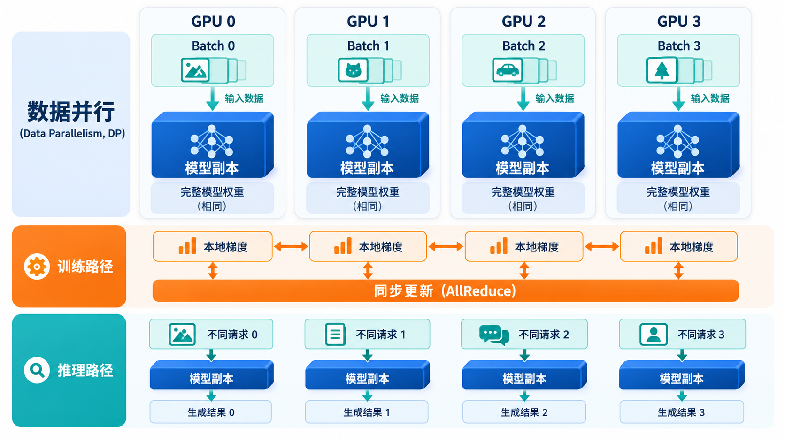
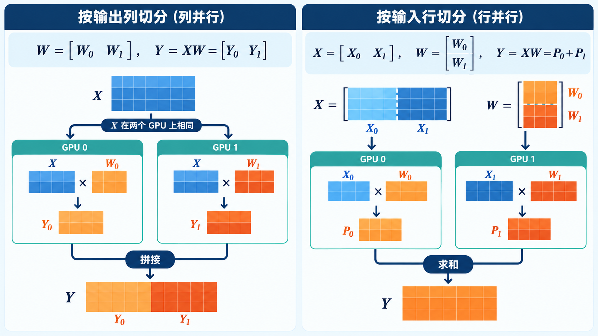
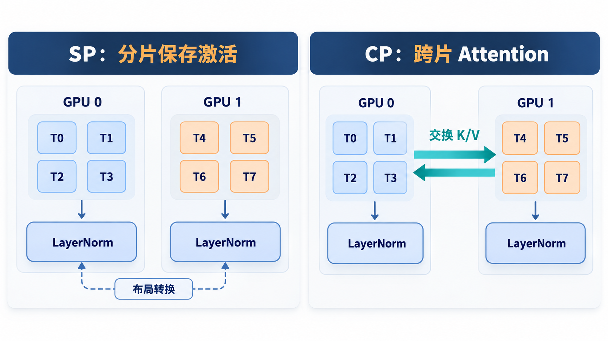
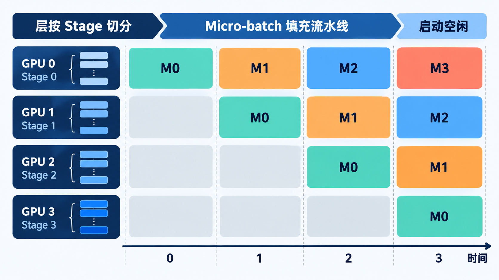
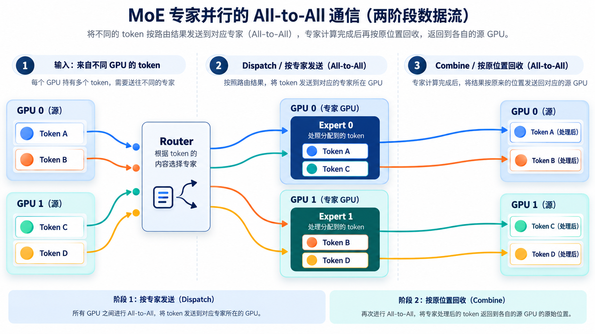
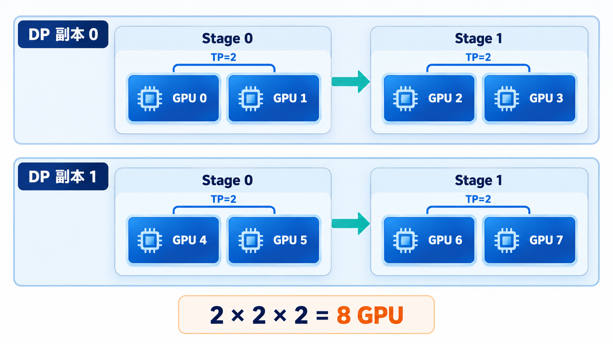

# 从零理解大模型分布式并行：DP、TP、SP、PP 与 EP

> 一条学习路径：单卡为什么不够 → 沿哪个维度切分 → 每种策略怎样工作 → 怎样组合与取舍

一张 GPU 跑不动大模型，可能是**模型放不下**，也可能是**运行得不够快**。这两个问题不完全相同：复制多份模型可以处理更多请求，却不一定能让单个请求更快；把一个模型拆到多张 GPU 可以缓解容量问题，却会产生新的数据交换与等待。

本文围绕一个问题展开：**每种并行策略究竟切分了什么？** 先理解数据布局和计算责任，再讨论显存、吞吐与延迟。通信原语、NCCL、硬件链路和性能测量的细节放在配套文章：[从零理解大模型 GPU 通信](大模型_GPU通信方式_NCCL与性能优化.md)。

## 一、先画出需要分配的东西

运行一个 Transformer 时，可以把资源想成四类：

1. **模型状态**：权重；训练时还包括梯度、优化器状态。
2. **中间状态**：激活值；推理时还包括随着上下文增长的 KV Cache。
3. **工作量**：不同样本、请求、Token、层或 Expert 的计算。
4. **GPU 资源**：每张卡的显存、计算能力，以及卡与卡之间的连接。

假设有一个输入张量 $X\in\mathbb{R}^{B\times S\times H}$：$B$ 是批次大小，$S$ 是序列长度，$H$ 是隐藏维度。模型有 $L$ 层；MoE 层还有 $E$ 个 Expert。五种策略分别从不同方向切入：

| 策略 | 主要切分对象 | 最容易记住的直觉 |
| :--- | :--- | :--- |
| DP：Data Parallelism | 样本或请求 | 同一模型处理不同数据 |
| TP：Tensor Parallelism | 同一层内的张量与权重 | 多卡合作算一个层 |
| SP：Sequence Parallelism | 某些激活值的序列维 | 不在每卡重复保存全部位置 |
| PP：Pipeline Parallelism | 模型层 | 不同卡负责不同层 |
| EP：Expert Parallelism | MoE Expert | 不同卡存放不同专家 |

这不是五选一。真实系统经常同时沿多个维度切分。但先分别理解每一种，再讨论组合，才不容易把显存收益、计算收益和通信成本混在一起。

## 二、DP：把数据分给多个模型副本

### 2.1 从四张 GPU 的例子看 DP

若模型能放进一张 GPU，最直接的扩展方法是复制四份。GPU 0–3 都持有同一套模型参数，但分别处理 Batch 0–3。每张 GPU 完成的计算彼此相似，输入数据不同。

**训练时**，四个副本必须保持参数一致。第 $i$ 个 Rank 计算本地梯度 $g_i$，概念上的平均梯度为：

$$
g=\frac{1}{N}\sum_{i=0}^{N-1}g_i.
$$

普通数据并行常用梯度 All-Reduce；分片优化器或 ZeRO 类方案会把优化器状态、梯度或参数进一步分片，并使用不同的数据交换。这里的 DP 只描述「不同数据由不同副本处理」，不代表所有训练实现都把完整优化器状态复制到每张 GPU。

**推理时**，没有反向传播。常见的 DP 是部署多个独立副本，由调度器把不同请求交给不同副本。副本之间一般不需要每生成一个 Token 就同步梯度。因此，推理 DP 主要提高服务的**总吞吐与并发容量**，通常不直接降低单个请求的模型计算量。

### 2.2 DP 能解决什么，不能解决什么？

若单个副本的权重和 KV Cache 放得进一张 GPU，增加副本通常有助于处理更多独立请求。若**一个副本本身就放不进单卡**，简单增加 DP 副本只会复制同一份过大的模型，不能解决容量问题；此时需要 TP、PP、EP 或参数分片等手段。

服务场景还要注意请求负载并不均匀。长 Prompt 与短 Prompt 的 Prefill 成本不同，输出长度也不同。即使四个副本的模型完全相同，调度不均仍可能让部分 GPU 忙、部分 GPU 闲。

> 记忆：DP 切数据，优先扩展总吞吐；训练副本要同步更新，推理副本通常独立处理请求。

## 三、TP：多卡合作计算同一层

DP 复制整层，TP 则把**同一层的参数和计算**分给多张 GPU。先从线性层 $Y=XW$ 看清两种最基本的切法。暂时把 $X$ 视为二维矩阵，批次和序列维可合并为前导维。

### 3.1 Column Parallel：按输出列切分

将 $W\in\mathbb{R}^{H\times O}$ 沿输出维切成 $p$ 份：

$$
W=[W_0\;W_1\;\cdots\;W_{p-1}],\qquad
W_i\in\mathbb{R}^{H\times O/p}.
$$

各 Rank 计算不同的输出列：

$$
Y_i=XW_i,\qquad
Y=[Y_0\;Y_1\;\cdots\;Y_{p-1}].
$$

若下一步能直接消费分片 $Y_i$，就不必立刻把完整 $Y$ 复制到每个 Rank；若需要完整输出，则要重新收集。**张量的最终布局由后续算子决定，而不是由这一层的名字决定。**

### 3.2 Row Parallel：按输入行切分

把 $W$ 沿输入维切成 $p$ 份，同时把 $X$ 的最后一维对应切分：

$$
W=\begin{bmatrix}W_0\\W_1\\\vdots\\W_{p-1}\end{bmatrix},
\qquad
X=[X_0\;X_1\;\cdots\;X_{p-1}].
$$

每个 Rank 得到同一输出的部分贡献：

$$
P_i=X_iW_i,\qquad
Y=\sum_{i=0}^{p-1}P_i.
$$

若每个 Rank 都需要完整 $Y$，常见做法是归约后让各 Rank 获得结果；若输出继续按某个维度分片，也可能采用 Reduce-Scatter 等布局转换。归约的目的不是「把不同列拼起来」，而是**对对应位置的部分贡献求和**。

图中左、右两种布局分别对应上面的两个公式；右侧的 $X_0$、$X_1$ 是输入**特征维**的分片。

### 3.3 一个 Transformer Block 怎样使用 TP？

常见的 Megatron 风格 FFN 先用 Column Parallel 扩展隐藏维，激活函数在各 Rank 的局部分片上执行，再用 Row Parallel 映射回隐藏维并合并部分贡献。这样，两次线性层之间不一定需要把宽大的中间激活完整收集。

Attention 中，Q/K/V 的投影与注意力头也可沿头或通道分片。假设 64 个头、TP=8，一种布局是每个 Rank 负责 8 个头；最后的输出投影再合并各 Rank 的部分结果。实际能否整齐按头切分，还取决于 Query 头数、KV 头数、GQA/MQA、模型结构及框架实现。

TP 的收益是分摊层内权重、部分激活和计算；代价是**同一层内的频繁协作**。TP 度过大时，每卡计算越来越少，但层内通信和同步并不会免费消失。尤其 Decode 每步的计算粒度较小时，增加 TP 不一定降低单请求延迟。

> 记忆：Column Parallel 产生不同输出分片；Row Parallel 产生需要求和的部分贡献。

## 四、SP：沿序列维减少激活值冗余

Sequence Parallelism 这个名称在不同系统中可能指不同实现。本文的 **SP** 特指 Megatron 经典语境：它通常与 TP 配合，沿序列维分片**某些激活值**，减少 TP Rank 间重复保存的内容。

若原激活为 $X\in\mathbb{R}^{B\times S\times H}$，一个大小为 $p$ 的 TP/SP 组可让每个 Rank 在相关位置持有：

$$
X_i\in\mathbb{R}^{B\times(S/p)\times H}.
$$

LayerNorm、Dropout、残差连接等逐 Token 操作可以在本地序列分片上执行。进入某些需要其他布局的算子时，再交换数据；计算完成后也可能重新分片。这样做节省的是**特定激活值的重复存储**，同时增加了布局转换的代价。

### SP 与 CP 为什么不能混称？

Context Parallelism（CP）也沿序列切分，但目标通常是让**长上下文的输入与 Attention 计算**分散到多卡。Self-Attention 的一个 Query 可能需要其他序列分片的 K/V，因此 CP 必须处理跨分片依赖，例如 K/V 交换或 Ring Attention 类方法。

| 维度 | Megatron 经典 SP | CP |
| :--- | :--- | :--- |
| 主要目的 | 降低部分激活值冗余 | 扩展长上下文的容量与计算 |
| 典型配合 | 与 TP 配合 | 可与 TP、PP、DP 等组合 |
| Attention | 不等于把完整 Attention 独立切到各 Token 块 | 必须显式处理跨序列分片的 K/V 依赖 |

NVIDIA 的 [Megatron Core 并行指南](https://docs.nvidia.com/megatron-core/developer-guide/latest/user-guide/parallelism-guide.html) 和 [Megatron-LM CP 文档](https://github.com/NVIDIA/Megatron-LM/blob/main/docs/user-guide/features/context_parallel.md)分别说明了这些机制。读框架配置时，应先确认它所称的 SP 属于哪一种语境。

图的左侧只画可在本地执行的逐 Token 操作；完整 Attention 所需的数据布局仍取决于实现。右侧箭头表示 CP 需要处理远端 K/V 依赖。

> 记忆：经典 SP 关注激活值冗余；CP 关注完整长上下文的分布式处理。

## 五、PP：把网络层分成流水线 Stage

TP 切一层内部，Pipeline Parallelism 则沿网络深度切。假设一个模型有 80 层、PP=4，可以让四个 Stage 各负责连续 20 层：

$$
\text{Stage}_0(0\!:\!19)\rightarrow
\text{Stage}_1(20\!:\!39)\rightarrow
\text{Stage}_2(40\!:\!59)\rightarrow
\text{Stage}_3(60\!:\!79).
$$

一个输入必须依次经过四个 Stage。Stage 边界传递的是激活值；训练的反向阶段还需要沿相反方向传递梯度。PP 能把不同层的权重放在不同 GPU 上，缓解单卡模型容量压力。

### 5.1 为什么单个输入不能让所有 Stage 一直忙？

只有一个输入时，Stage 0 工作时其他 Stage 还没有数据；它离开 Stage 0 后，Stage 0 又可能空闲。这种启动与排空期间的空闲就是 **Pipeline Bubble** 的直观来源。

训练可以把一个大 Batch 切成多个 Micro-batch：Stage 1 处理第一个 Micro-batch 时，Stage 0 已开始处理第二个。稳态中不同 Stage 同时处理不同 Micro-batch。理想、等时、只考虑前向的简化模型里，$p$ 个 Stage、$m$ 个 Micro-batch 的利用率近似为：

$$
U_{\text{ideal}}\approx\frac{m}{m+p-1}.
$$

这个式子只解释「增加 Micro-batch 可摊薄填充与排空开销」的趋势；真实训练还涉及反向、不同 Stage 时长、通信、显存和调度，不能直接用它预测端到端性能。

图中只展示前向流水线的前四个时间片；灰色空格是启动阶段尚无 Micro-batch 可处理的 Stage。

### 5.2 训练与推理的调度不同

训练中的 GPipe 会组织多次前向与反向；1F1B 在稳态交替执行前向和反向，有助于控制需要保存的激活。推理没有反向传播，但可用多个请求、连续批处理或 Micro-batch 填充流水线。单请求 Decode 每次产生一个新 Token，如何让多 Stage 持续忙碌取决于请求并发与调度。不同训练调度的实现可参见 [Megatron Core Pipeline Schedules](https://docs.nvidia.com/megatron-core/developer-guide/latest/apidocs/core/core.pipeline_parallel.schedules.html)。

PP 的核心取舍是：层权重被分散了，但出现 Stage 边界传输、Bubble 与负载均衡问题。即使各 Stage 层数相同，Attention、FFN 或 MoE 层的实际耗时也可能不同，不能只按层数平均切。

> 记忆：PP 切层；吞吐取决于流水线是否填满，延迟还取决于输入经过多少 Stage。

## 六、EP：把 MoE 的 Expert 分散到不同 GPU

EP 只在包含 Mixture of Experts（MoE）的模型中有意义。普通 Dense FFN 对每个 Token 使用同一组 FFN 权重；MoE 层有多个 Expert，Router 为每个 Token 选择其中一个或几个。

若 Token $x$ 选择的专家集合为 $\mathcal E(x)$，输出可抽象写为：

$$
y(x)=\sum_{e\in\mathcal E(x)}g_e(x)\,E_e(x),
$$

其中 $E_e$ 是第 $e$ 个 Expert，$g_e(x)$ 是 Router 给它的组合权重。实际模型可能还有共享 Expert、容量限制、归一化或特殊路由规则。

假设有 8 个 Expert、EP=4，每张 GPU 可各放 2 个 Expert。Token 的源 GPU 未必保存它需要的 Expert，因此一次 MoE 层通常经历：

1. **Router** 选出目标 Expert，并记录原 Token 的位置及组合权重。
2. **Dispatch** 按目标 Expert 所在 GPU 重新分配 Token。
3. **Expert Compute** 在目标 GPU 上运行选中的 Expert。
4. **Combine** 把结果送回原 Token 位置，并按权重合并。

图中颜色用于追踪 Token 的去向；实际模型可能为每个 Token 选择多个 Expert，也可能采用不同的容量与路由策略。

EP 能分摊专家参数与专家计算，但性能受路由分布影响。若大量 Token 集中到少数 Expert，这些 Expert 所在 GPU 会成为慢点；Decode 时每步 Token 较少，又可能出现大量小消息。具体模型是否丢弃超出容量的 Token、是否复制热门 Expert，取决于架构与实现。

不同框架的 Expert 分布、路由与交换策略可能不同；实现层面的配置可参见 [Megatron Core MoE 指南](https://docs.nvidia.com/megatron-core/developer-guide/latest/user-guide/features/moe.html)。

> 记忆：EP 切 Expert；数据不是固定沿一条路径走，而是由 Router 动态决定目的地。

## 七、把五种策略放在同一张取舍表中

| 策略 | 主要解决 | 主要新增代价 | 单请求延迟的常见影响 |
| :--- | :--- | :--- | :--- |
| DP | 增加独立样本/请求的总处理能力 | 副本显存与请求调度 | 一般不减少单请求模型工作量 |
| TP | 分摊层内参数与计算 | 高频层内协作 | 取决于计算收益是否超过通信 |
| SP | 降低某些激活值冗余 | 数据布局转换 | 依实现与工作负载而定 |
| PP | 分摊不同层的权重 | Stage 传输、Bubble、负载不均 | 单请求仍要经过所有 Stage |
| EP | 分摊 MoE 专家参数与计算 | 动态路由、负载不均 | 取决于路由与交换成本 |

这张表是思考顺序，不是固定性能排名。相同的 TP=4，在一台 NVSwitch 服务器内与跨多个节点的效果可能截然不同。有关 All-Reduce、All-Gather、All-to-All 和底层路径的解释，参见[GPU 通信文章](大模型_GPU通信方式_NCCL与性能优化.md)。

## 八、混合并行：多个维度怎样组合？

假设有 64 张 GPU，希望用 TP=4、PP=2、DP=8。若三个维度形成彼此独立的并行组，可以理解为：

$$
N_{\text{GPU}}=N_{\text{TP}}N_{\text{PP}}N_{\text{DP}}
=4\times2\times8=64.
$$

每份数据并行副本由两个 Pipeline Stage 组成，每个 Stage 再用四张 GPU 合作计算层内算子；这样的完整副本一共有八份。这个层次关系比只记乘积更重要：一个请求会通过哪些 GPU，哪些 GPU 存放同层分片，哪些 GPU 只是处理另一个请求，都由并行组映射决定。

为便于看清层次，图中采用较小的 $DP=2,\ PP=2,\ TP=2$ 示例；结构与上面的 64 卡例子相同，具体数值不同。

加入 EP、SP 或 CP 时，不能机械地把所有数字再乘一次。**SP 常与 TP 使用同一组 Rank**，EP 与 TP/DP 的组关系也可能因框架的专家并行设计而变化。先画出每个 Rank 属于哪个组，再确认总 GPU 数和各张量布局。

### 一个具体的布局检查

拿到配置时，可以选一个 Rank 问五个问题：

1. 它负责哪些请求或训练样本？这是 DP 维度。
2. 它保存哪些层？这是 PP 维度。
3. 在这些层中，它保存权重矩阵的哪部分、哪些 Attention 头？这是 TP 维度。
4. 哪些序列位置的激活值保存在本地？这是 SP/CP 维度。
5. 哪些 Expert 在本地，哪些 Token 会被送过来？这是 EP 维度。

如果能回答这些问题，就可以推断该 Rank 的显存构成、计算工作和数据交换方向。

## 九、Prefill 与 Decode 为什么会改变并行策略的取舍？

LLM 推理通常包含两个工作形态：

- **Prefill** 处理已有 Prompt 的多个 Token，矩阵运算较大，长上下文时 Attention 和临时激活值占用也重要。
- **Decode** 每步生成新 Token，反复读取 KV Cache。单步工作较小，但服务端可通过 Continuous Batching 聚合多个请求。

DP 在两阶段都可分流请求。TP 在 Prefill 的较大矩阵计算中可能更容易体现并行计算收益；Decode 则需特别关注每层重复的小通信与同步。PP 在有足够请求填充时更容易提高吞吐，单请求低并发时 Bubble 可能明显。EP 在 Prefill 可能面对较大规模的 Token Dispatch，在 Decode 可能面对更细碎的路由。CP 则常出现在长上下文容量与 Attention 计算成为问题时。

这些只是观察方向，不是硬规则。真实结果取决于模型、Batch、序列长度、KV Cache、硬件拓扑和调度器。选并行度时必须同时记录 TTFT、TPOT、吞吐量和显存使用，而不是只看某个算子的理论加速。

## 十、从需求倒推组合：一个实用决策顺序

1. **先算容量。** 单个副本的权重、KV Cache、激活值与通信 Buffer 能否放进计划使用的 GPU？若不能，先考虑模型切分或减少状态。
2. **再定目标。** 是提高总吞吐、降低单请求延迟、支持更长上下文，还是承载更大的 MoE？不同目标对应不同策略。
3. **看模型结构。** Dense 模型没有 EP；MoE 要看 Expert 数量、Top-K 路由和负载；长上下文要评估 CP 与 KV Cache。
4. **画并行组。** 确认 TP、PP、DP、EP、SP/CP 的 Rank 映射，避免误把重叠维度相乘。
5. **估计数据布局。** 每层输入输出在哪些 Rank 上、什么时候需要汇总或重分布？这一步决定通信类型和频率。
6. **结合拓扑。** 把频繁交互的组尽量映射到更合适的互联域，再测实际通信与计算时间。
7. **以真实负载复测。** 比较改变并行度前后的显存、TTFT、TPOT、吞吐量及时间线；若效果不符预期，去[GPU 通信与 NCCL 排查篇](大模型_GPU通信方式_NCCL与性能优化.md)定位关键路径。

## 十一、最后用一句话区分

- **DP**：谁处理哪份数据？
- **TP**：同一层由谁共同计算？
- **SP**：哪些序列位置的激活值留在本地？
- **PP**：哪些层放在哪个 Stage？
- **EP**：哪些 Expert 放在哪张 GPU，Token 要去哪里？

这五个问题回答的是**数据和计算如何分配**。分配确定后，才轮到通信原语、NCCL 算法和硬件路径回答「结果怎样到达需要它的地方」。两篇文章连起来，才能建立完整的多 GPU 大模型运行图景。
